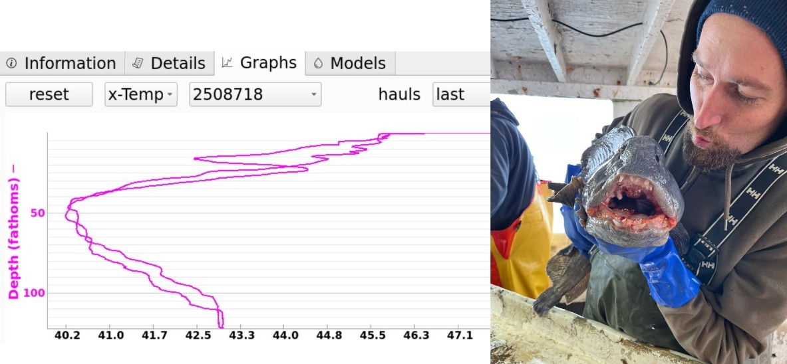
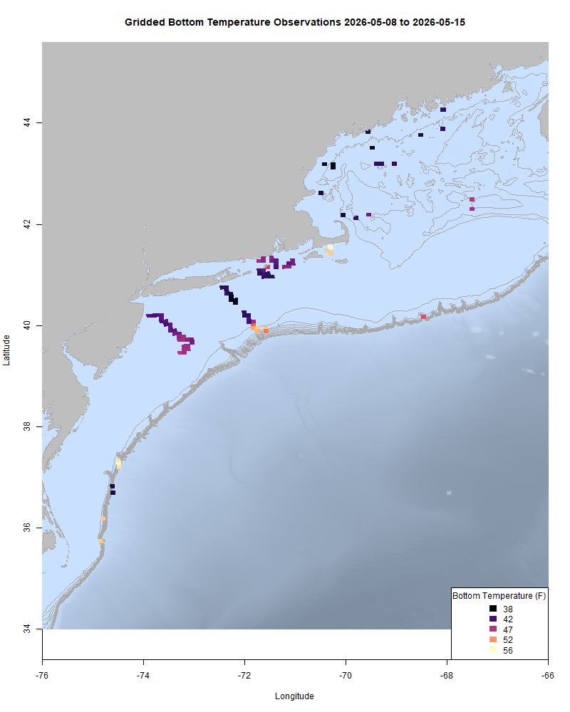
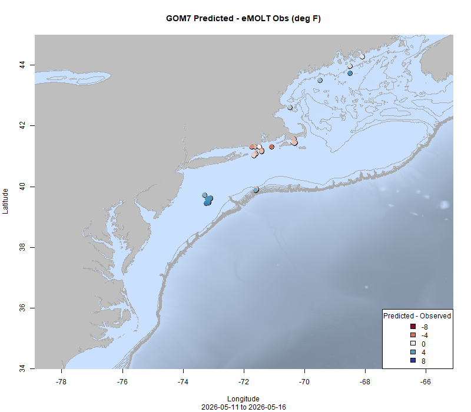

  
```{r setup, include=FALSE}
knitr::opts_chunk$set(echo = TRUE)
options(scipen = 999)
library(marmap)
library(rstudioapi)
if(Sys.info()["sysname"]=="Windows"){
  source("C:/Users/george.maynard/Documents/GitHubRepos/emolt_project_management/WeeklyUpdates/forecast_check/R/emolt_download.R")
} else {
  source("/home/george/Documents/emolt_project_management/WeeklyUpdates/forecast_check/R/emolt_download.R")
}
if(file.exists(paste0("C:/Users/george.maynard/Documents/emolt_project_management/WeeklyUpdates/",lubridate::year(Sys.time()),"/",lubridate::year(Sys.time()),"-",lubridate::month(Sys.time()),"-",lubridate::day(Sys.time()),"/Doppio_comparison_",format(Sys.time(), "%Y%m%d"),".csv")
)==FALSE){
  source("C:/Users/george.maynard/Documents/emolt_project_management/WeeklyUpdates/forecast_check/R/doppio_all_R_compare_and_plot.R")
}
if(file.exists(paste0("C:/Users/george.maynard/Documents/emolt_project_management/WeeklyUpdates/",lubridate::year(Sys.time()),"/",lubridate::year(Sys.time()),"-",lubridate::month(Sys.time()),"-",lubridate::day(Sys.time()),"/GOM7_comparison_",format(Sys.time(), "%Y%m%d"),".csv")
)==FALSE){
  reticulate::source_python("C:/Users/george.maynard/Documents/emolt_project_management/WeeklyUpdates/Plotting/Windows/GOM7.py")
  source("C:/Users/george.maynard/Documents/emolt_project_management/WeeklyUpdates/forecast_check/R/plot_comparisons.R")
}
data=emolt_download(days=7)
start_date=Sys.Date()-lubridate::days(7)
## Use the dates from above to create a URL for grabbing the data
full_data=read.csv(
  paste0(
    "https://erddap.emolt.net/erddap/tabledap/eMOLT_RT.csvp?tow_id%2Csegment_type%2Ctime%2Clatitude%2Clongitude%2Cdepth%2Ctemperature%2Csensor_type&segment_type=3&time%3E=",
    lubridate::year(start_date),
    "-",
    lubridate::month(start_date),
    "-",
    lubridate::day(start_date),
    "T00%3A00%3A00Z&time%3C=",
    lubridate::year(Sys.Date()),
    "-",
    lubridate::month(Sys.Date()),
    "-",
    lubridate::day(Sys.Date()),
    "T23%3A59%3A59Z"
  )
)
sensor_time=0
for(tow in unique(full_data$tow_id)){
  x=subset(full_data,full_data$tow_id==tow)
  sensor_time=sensor_time+difftime(max(x$time..UTC.),units='hours',min(x$time..UTC.))
}
```

<center> 

<font size="5"> *eMOLT Update `r Sys.Date()` * </font>
  
</center>

I spent the first part of this week aboard the F/V Mary Elizabeth out of Scituate wrapping up the last leg of the 2026 Spring Gulf of Maine Bottom Longline Survey. The trip provided an opportunity to see Captain Phil's eMOLT system in action and compare the observations on that his eMOLT logger with the RBR Duo sensors that the Longline Survey team uses. The good news was that the two sensors corroborated each other's observations well. Most of our sets showed bottom temps hovering around 40F, with the warmest bottom temps we recorded around 43F. 



>*(L) A screenshot of temperature profiles from the eMOLT system aboard the F/V Mary Elizabeth showing surface temps around 47F, a cold (40F) middle layer around 50 fathoms, and a bottom temp somewhere in between (43F around 100 fathoms). (R) Crewman Ryan with one of the large wolffish we caught on the trip.*

While temperatures remain stubbornly cold up north, closer to home for me, Nantucket Sound is warming up considerably, with bottom temps now consistently in the low to mid 50s. Temps remain in the upper 40s south of Rhode Island and off of New Jersey. 

Huanxin kept the lights on back on shore, fielding tech support requests and continuing to prep sensors for the season. We've got a big batch heading out to the Outer Cape next week, and the majority of our DO sensors are defouled. We've got a bit of testing to do on those, but are definitely on track to have them out in the field by the end of June. Next week, I will be at sea aboard the NOAA Ship Pisces for the last leg of the Northeast Bottom Trawl Survey. We should have reliable internet on board, but if I'm slow to respond to tech support calls, that's why. 

Big thanks to my colleague Katie Burchard down at the Narragansett Lab this week for all of her work helping me get the paperwork moving in order to keep eMOLT's base funding squared away here at NOAA Fisheries. 

This week, the eMOLT fleet recorded `r length(unique(full_data$tow_id))` tows of sensorized fishing gear totaling `r as.numeric(sensor_time)` sensor hours underwater.

```{r FISHBOT_Plot, echo=FALSE, fig.width=8, fig.height=10,warning=FALSE,message=FALSE,error=FALSE}
source("C:/Users/george.maynard/Documents/emolt_project_management/WeeklyUpdates/Plotting/FISHBOT_Weekly.R")
```



> *FISHBOT bottom temperature records from the past week. The data are available on the [Commercial Fisheries Research Foundation ERDDAP](https://erddap.ondeckdata.com/erddap/tabledap/fishbot_realtime.html) and an interactive visualization is available at the [Cape Cod Ocean Watch](https://ccocean.whoi.edu/index.html) dashboard hosted by Woods Hole Oceanographic Institution. FISHBOT aggregates data provided by participants in eMOLT, the CFRF Lobster and Jonah Crab Research Fleet, the CFRF Shelf Research Fleet, the Cape Cod Commercial Fishermen's Alliance Cape Cod Oceanographic Research Fleet, the Maine Coast Fishermen's Association Fisheries Ocean Data Program, MassDMF Cape Cod Bay Study Fleet, the Northeast Fisheries Science Center Study Fleet, and the Northeast Fisheries Science Center Ecosystem Monitoring Surveys*

### Bottom Temperature Forecast Performance

Observations were generally a bit warmer than the Doppio forecast predicted this week. Observations were cooler than the NECOFS forecast in the Gulf of Maine and the Mid Atlantic, but warmer than the NECOFS forecast in Southern New England.

{width=45%} {width=45%}
>*<p class="caption-text">Comparisons between bottom temperatures predicted by two ocean forecasting models and observations from the eMOLT fleet. Blue dots show where the observations were cooler than the forecast and red dots show where the observations were warmer than the forecast. White dots show areas where the observations and forecasts agreed. On the left is the comparison with the Doppio model and on the right is the comparison with the NECOFS model (GOM7).</p>*

### Other happenings

- We are still looking for research partners (commercial fishermen or fish dealers) for our mackerel biological sampling program. If you catch and land mackerel in the Gulf of Maine, or if you process mackerel shoreside and are interested in participating, please contact katherine.viducic@noaa.gov for more information. Compensation is available. 

- Want an eMOLT system for your boat or know somebody else who does? Check out our [online eMOLT System Request form](https://docs.google.com/forms/d/e/1FAIpQLSdRYtqgxrNmraclFQn_EfIVydPOSyMhsmCNKaRgej2F3n6Xzw/viewform) to get on the wait list. Being able to break this list down by gear type and geographic area is helpful when we apply for funding to expand the program. 

- Know someone who's interested in working on a commercial fishing boat on Cape Cod this summer? The Cape Cod Commercial Fishermen's Alliance is offering a three day crash course introduction to commercial fishing at their building in Chatham from May 18-20. Participants will receive a gear credit to Cape Fishermen's Supply and opportunities to meet with captains who are looking for crew. [Register here](https://docs.google.com/forms/d/e/1FAIpQLSe8AciquGTmMe4bqaXIzvNcdV7hVsPg3wFFIE69Ii_0tPkCUA/viewform) or for more information contact Ray at  508-237-7184 or raymond@capecodfishermen.org

- Want to understand what drives people to make their living at sea? Check out my colleague Hannah Ciarametaro's conversations with the captain and crew of the F/V Miss Trish II out of Gloucester, MA [here](https://www.fisheries.noaa.gov/science-blog/those-who-go-sea) while she sailed with them to support the NEFSC's [groundfish conversion factor](https://www.fisheries.noaa.gov/feature-story/noaa-fisheries-partners-northeast-groundfish-industry-update-key-data-stock#:~:text=NOAA%20Fisheries%20is%20re%2Devaluating%20conversion%20factors%20and,these%20factors%20may%20vary%20seasonally%20and%20geographically.) research. Also, congratulations are in order for Hannah, since this piece was picked up by NOAA's national "FishNews" newsletter!

- Finally, to read some of the feedback on the recent 2026 Cooperative Research Summit from our industry partners, graduate students, and other participants, check out [this feature story](https://www.fisheries.noaa.gov/feature-story/lots-talk-about-recent-cooperative-research-summit-heres-what-theyre-saying) from my NEFSC colleague Heather Soulen.

### Disclaimer
  
The eMOLT Update is NOT an official NOAA document. Mention of products or manufacturers does not constitute an endorsement by NOAA or Department of Commerce. The content of this update reflects only the personal views of the authors and does not necessarily represent the views of NOAA Fisheries, the Department of Commerce, or the United States.


All the best,

-George
