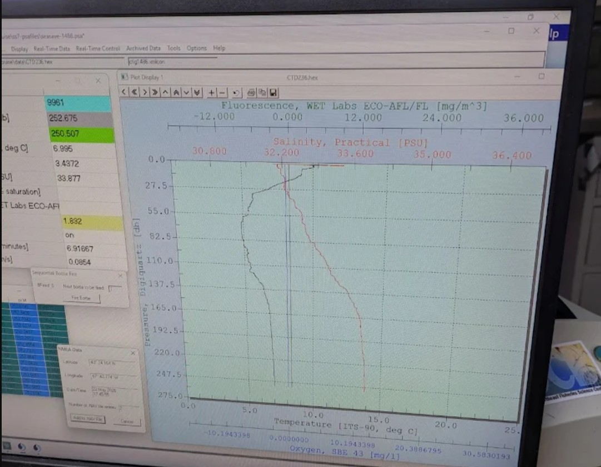
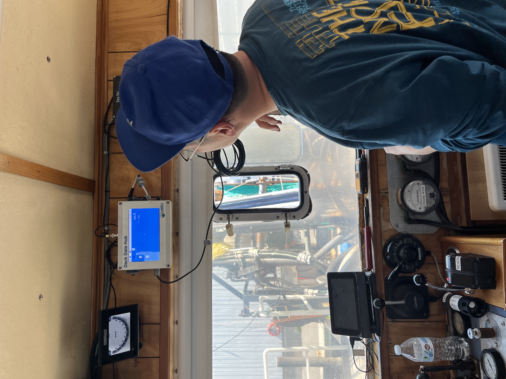
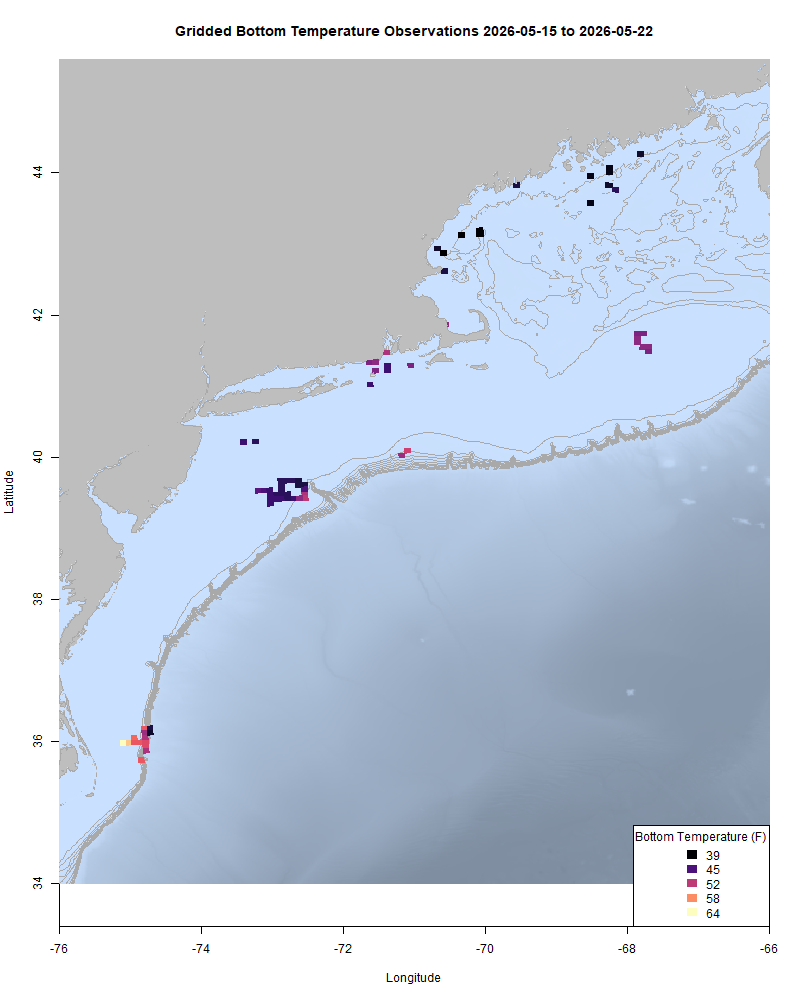
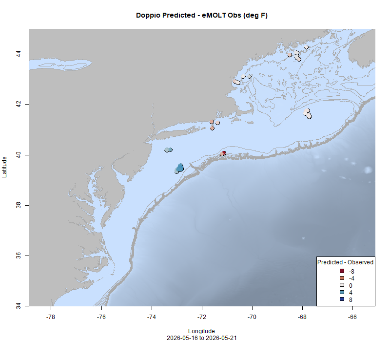

  
```{r setup, include=FALSE}
knitr::opts_chunk$set(echo = TRUE)
options(scipen = 999)
library(marmap)
library(rstudioapi)
if(Sys.info()["sysname"]=="Windows"){
  source("C:/Users/george.maynard/Documents/GitHubRepos/emolt_project_management/WeeklyUpdates/forecast_check/R/emolt_download.R")
} else {
  source("/home/george/Documents/emolt_project_management/WeeklyUpdates/forecast_check/R/emolt_download.R")
}
if(file.exists(paste0("C:/Users/george.maynard/Documents/emolt_project_management/WeeklyUpdates/",lubridate::year(Sys.time()),"/",lubridate::year(Sys.time()),"-",lubridate::month(Sys.time()),"-",lubridate::day(Sys.time()),"/Doppio_comparison_",format(Sys.time(), "%Y%m%d"),".csv")
)==FALSE){
  source("C:/Users/george.maynard/Documents/emolt_project_management/WeeklyUpdates/forecast_check/R/doppio_all_R_compare_and_plot.R")
}
if(file.exists(paste0("C:/Users/george.maynard/Documents/emolt_project_management/WeeklyUpdates/",lubridate::year(Sys.time()),"/",lubridate::year(Sys.time()),"-",lubridate::month(Sys.time()),"-",lubridate::day(Sys.time()),"/GOM7_comparison_",format(Sys.time(), "%Y%m%d"),".csv")
)==FALSE){
  reticulate::source_python("C:/Users/george.maynard/Documents/emolt_project_management/WeeklyUpdates/Plotting/Windows/GOM7.py")
  source("C:/Users/george.maynard/Documents/emolt_project_management/WeeklyUpdates/forecast_check/R/plot_comparisons.R")
}
data=emolt_download(days=7)
start_date=Sys.Date()-lubridate::days(7)
## Use the dates from above to create a URL for grabbing the data
full_data=read.csv(
  paste0(
    "https://erddap.emolt.net/erddap/tabledap/eMOLT_RT.csvp?tow_id%2Csegment_type%2Ctime%2Clatitude%2Clongitude%2Cdepth%2Ctemperature%2Csensor_type&segment_type=3&time%3E=",
    lubridate::year(start_date),
    "-",
    lubridate::month(start_date),
    "-",
    lubridate::day(start_date),
    "T00%3A00%3A00Z&time%3C=",
    lubridate::year(Sys.Date()),
    "-",
    lubridate::month(Sys.Date()),
    "-",
    lubridate::day(Sys.Date()),
    "T23%3A59%3A59Z"
  )
)
sensor_time=0
for(tow in unique(full_data$tow_id)){
  x=subset(full_data,full_data$tow_id==tow)
  sensor_time=sensor_time+difftime(max(x$time..UTC.),units='hours',min(x$time..UTC.))
}
```

<center> 

<font size="5"> *eMOLT Update `r Sys.Date()` * </font>
  
</center>

I'm out at sea supporting the Spring Bottom Trawl Survey aboard the NOAA Ship Pisces, so this update will be brief. We started out on the Northern Edge of Georges Bank and have been working our way west and north so that we're now in Jordan Basin. Where the bottom temps were up in the mid-high 40s, we got into some dogs, but we've seen more redfish and whiting since moving into cooler waters near where the Bottom Longline Survey team aboard the F/V Mary Elizabeth was working last week. Things are warming up a bit with surface temps now at 50 (up from 47 last week), the cold mid-water layer now up to 41 (from 40), and the warmer bottom waters up to 44.6 (from 43). 


*Graph of a CTD cast aboard the NOAA Ship Pisces this afternoon. Depth is on the y-axis (surface at the top) and temperature and salinity are on the x-axes (red for salinity, black for temperature). The water at the bottom is warmer and saltier than the water in the middle of the water column and the water at the surface is the warmest and freshest.*

Huanxin and Sarah headed down to Point Judith to repair the deckbox aboard the F/V Prevail. Like many others, it seems to have had a hard drive failure potentially caused by bad supercaps. If you see a black screen with white text on your box instead of the normal DDH software, please let us know so we can take care of it. 



*Huanxin wrapping up reconfiguration of the deckbox aboard the F/V Prevail earlier this week*

This week, the eMOLT fleet recorded `r length(unique(full_data$tow_id))` tows of sensorized fishing gear totaling `r as.numeric(sensor_time)` sensor hours underwater.

```{r FISHBOT_Plot, echo=FALSE, fig.width=8, fig.height=10,warning=FALSE,message=FALSE,error=FALSE}
source("C:/Users/george.maynard/Documents/emolt_project_management/WeeklyUpdates/Plotting/FISHBOT_Weekly.R")
```



> *FISHBOT bottom temperature records from the past week. The data are available on the [Commercial Fisheries Research Foundation ERDDAP](https://erddap.ondeckdata.com/erddap/tabledap/fishbot_realtime.html) and an interactive visualization is available at the [Cape Cod Ocean Watch](https://ccocean.whoi.edu/index.html) dashboard hosted by Woods Hole Oceanographic Institution. FISHBOT aggregates data provided by participants in eMOLT, the CFRF Lobster and Jonah Crab Research Fleet, the CFRF Shelf Research Fleet, the Cape Cod Commercial Fishermen's Alliance Cape Cod Oceanographic Research Fleet, the Maine Coast Fishermen's Association Fisheries Ocean Data Program, MassDMF Cape Cod Bay Study Fleet, the Northeast Fisheries Science Center Study Fleet, and the Northeast Fisheries Science Center Ecosystem Monitoring Surveys*

### Bottom Temperature Forecast Performance

The Doppio forecast performed well in the Gulf of Maine and on Georges Bank this week while observations in that region were generally cooler than predicted by NECOFS. Observations were warmer than predicted by both models off of Southern New England, and cooler than predicted by both models southwest of Hudson Canyon.

{width=45%} {width=45%}
>*<p class="caption-text">Comparisons between bottom temperatures predicted by two ocean forecasting models and observations from the eMOLT fleet. Blue dots show where the observations were cooler than the forecast and red dots show where the observations were warmer than the forecast. White dots show areas where the observations and forecasts agreed. On the left is the comparison with the Doppio model and on the right is the comparison with the NECOFS model (GOM7).</p>*

### Other happenings

- We are still looking for research partners (commercial fishermen or fish dealers) for our mackerel biological sampling program. If you catch and land mackerel in the Gulf of Maine, or if you process mackerel shoreside and are interested in participating, please contact katherine.viducic@noaa.gov for more information. Compensation is available. 

- Want an eMOLT system for your boat or know somebody else who does? Check out our [online eMOLT System Request form](https://docs.google.com/forms/d/e/1FAIpQLSdRYtqgxrNmraclFQn_EfIVydPOSyMhsmCNKaRgej2F3n6Xzw/viewform) to get on the wait list. Being able to break this list down by gear type and geographic area is helpful when we apply for funding to expand the program. 

### Disclaimer
  
The eMOLT Update is NOT an official NOAA document. Mention of products or manufacturers does not constitute an endorsement by NOAA or Department of Commerce. The content of this update reflects only the personal views of the authors and does not necessarily represent the views of NOAA Fisheries, the Department of Commerce, or the United States.


All the best,

-George
