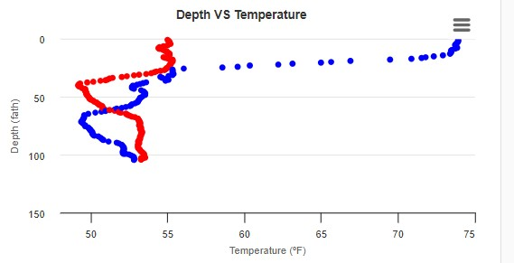
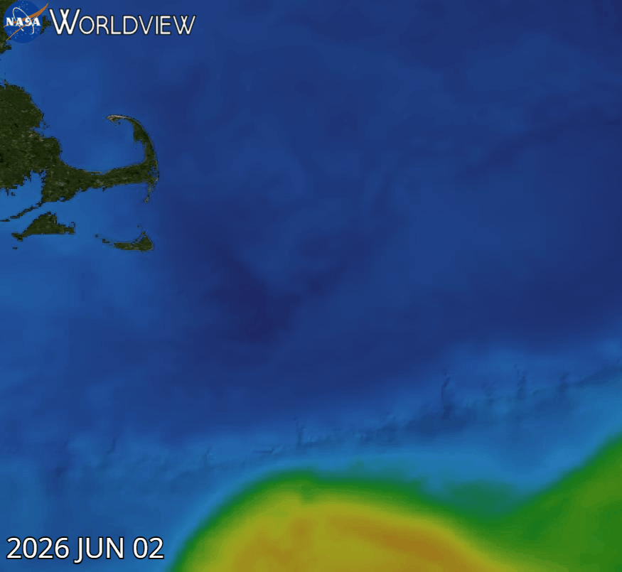
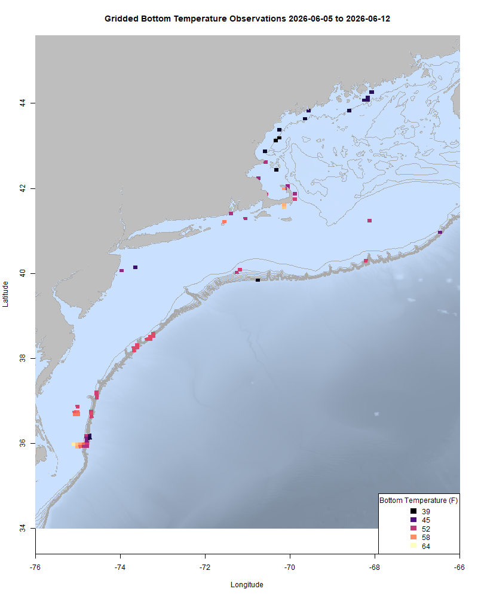
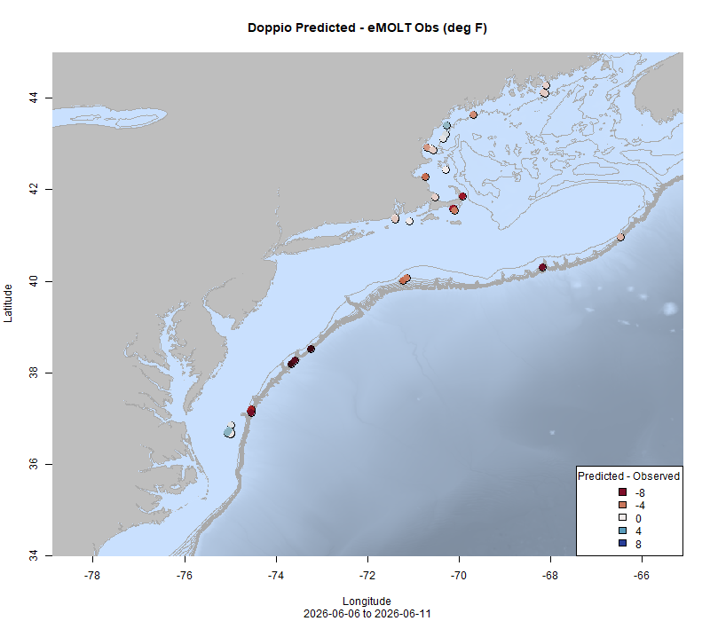
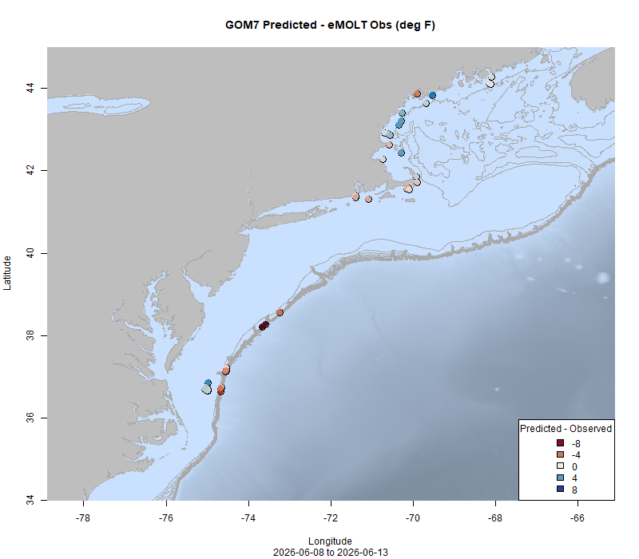

  
```{r setup, include=FALSE}
knitr::opts_chunk$set(echo = TRUE)
options(scipen = 999)
library(marmap)
library(rstudioapi)
if(Sys.info()["sysname"]=="Windows"){
  source("C:/Users/george.maynard/Documents/GitHubRepos/emolt_project_management/WeeklyUpdates/forecast_check/R/emolt_download.R")
} else {
  source("/home/george/Documents/emolt_project_management/WeeklyUpdates/forecast_check/R/emolt_download.R")
}
# if(file.exists(paste0("C:/Users/george.maynard/Documents/emolt_project_management/WeeklyUpdates/",lubridate::year(Sys.time()),"/",lubridate::year(Sys.time()),"-",lubridate::month(Sys.time()),"-",lubridate::day(Sys.time()),"/Doppio_comparison_",format(Sys.time(), "%Y%m%d"),".csv")
# )==FALSE){
#   source("C:/Users/george.maynard/Documents/emolt_project_management/WeeklyUpdates/forecast_check/R/doppio_all_R_compare_and_plot.R")
# }
# if(file.exists(paste0("C:/Users/george.maynard/Documents/emolt_project_management/WeeklyUpdates/",lubridate::year(Sys.time()),"/",lubridate::year(Sys.time()),"-",lubridate::month(Sys.time()),"-",lubridate::day(Sys.time()),"/GOM7_comparison_",format(Sys.time(), "%Y%m%d"),".csv")
# )==FALSE){
#   reticulate::source_python("C:/Users/george.maynard/Documents/emolt_project_management/WeeklyUpdates/Plotting/Windows/GOM7.py")
#   source("C:/Users/george.maynard/Documents/emolt_project_management/WeeklyUpdates/forecast_check/R/plot_comparisons.R")
# }
data=emolt_download(days=7)
start_date=Sys.Date()-lubridate::days(7)
## Use the dates from above to create a URL for grabbing the data
full_data=read.csv(
  paste0(
    "https://erddap.emolt.net/erddap/tabledap/eMOLT_RT.csvp?tow_id%2Csegment_type%2Ctime%2Clatitude%2Clongitude%2Cdepth%2Ctemperature%2Csensor_type&segment_type=3&time%3E=",
    lubridate::year(start_date),
    "-",
    lubridate::month(start_date),
    "-",
    lubridate::day(start_date),
    "T00%3A00%3A00Z&time%3C=",
    lubridate::year(Sys.Date()),
    "-",
    lubridate::month(Sys.Date()),
    "-",
    lubridate::day(Sys.Date()),
    "T23%3A59%3A59Z"
  )
)
sensor_time=0
for(tow in unique(full_data$tow_id)){
  x=subset(full_data,full_data$tow_id==tow)
  sensor_time=sensor_time+difftime(max(x$time..UTC.),units='hours',min(x$time..UTC.))
}
```

<center> 

<font size="5"> *eMOLT Update `r Sys.Date()` * </font>
  
</center>

Bottom water temps off the New Hampshire Seacoast are some of the coldest in the region, with one eMOLT sensor recording 39 degrees on the bottom on June 10. Along the coast of Maine, temps have pushed up into the low to mid 40s. A large warm core ring is sitting off the eastern end of Georges Bank currently, with surface temps in the mid 70s, and a Gulf Stream eddy is pushing up towards Oceanographer Canyon, bringing surface waters in that area closer to 80. 


The changes at the surface can be seen in these two profiles above from fishing gear deployed on the western edge of Oceanographer Canyon on June 2nd (red) and June 6 (blue) with surface temps increasing by almost 20 degrees F during that time, and the gif below shows the progression of the surface feature over that time. 



We've been hard at work getting more sensors back out to our partners and into the water. Beyond just prepping the sensors there's also a bit of configuration on the deckbox side to make sure things are good to go. Thanks to captains Curt, Ray, Mark, Denny, Tony, Tim, Danny, and Robert for your patience this week as we worked through some software reconfiguration to get your systems up and running. 

For all of the lobstermen who are hauling your sensors for the first time in a while, one common issue that's been rearing up is long wait times for the downloads or the sensor failing to download and just "retrying" over and over. If you run into either of these issues, it is likely related to the speed at which your sensor is logging data. We can straighten that our for you, so please get in touch ASAP. The longer the problem persists, the more data builds up on the logger and the longer it takes to reset. 

This week, the eMOLT fleet recorded `r length(unique(full_data$tow_id))` tows of sensorized fishing gear totaling `r as.numeric(sensor_time)` sensor hours underwater.

```{r FISHBOT_Plot, echo=FALSE, fig.width=8, fig.height=10,warning=FALSE,message=FALSE,error=FALSE}
source("C:/Users/george.maynard/Documents/emolt_project_management/WeeklyUpdates/Plotting/FISHBOT_Weekly.R")
```



> *FISHBOT bottom temperature records from the past week. The data are available on the [Commercial Fisheries Research Foundation ERDDAP](https://erddap.ondeckdata.com/erddap/tabledap/fishbot_realtime.html) and an interactive visualization is available at the [Cape Cod Ocean Watch](https://ccocean.whoi.edu/index.html) dashboard hosted by Woods Hole Oceanographic Institution. FISHBOT aggregates data provided by participants in eMOLT, the CFRF Lobster and Jonah Crab Research Fleet, the CFRF Shelf Research Fleet, the Cape Cod Commercial Fishermen's Alliance Cape Cod Oceanographic Research Fleet, the Maine Coast Fishermen's Association Fisheries Ocean Data Program, MassDMF Cape Cod Bay Study Fleet, the Northeast Fisheries Science Center Study Fleet, and the Northeast Fisheries Science Center Ecosystem Monitoring Surveys*

### Bottom Temperature Forecast Performance

Overall, observations were warmer than both models predicted along Southern New England and the Mid-Atlantic. Doppio's bottom temperature forecast in the Gulf of Maine was pretty close to the observations, which were cooler than predictions from the Northeast Coastal Ocean Forecast System. 

{width=45%} {width=45%}
>*<p class="caption-text">Comparisons between bottom temperatures predicted by two ocean forecasting models and observations from the eMOLT fleet. Blue dots show where the observations were cooler than the forecast and red dots show where the observations were warmer than the forecast. White dots show areas where the observations and forecasts agreed. On the left is the comparison with the Doppio model and on the right is the comparison with the NECOFS model (GOM7).</p>*

### Other happenings

- You may have seen the reports of lots of squid washing up on Cape Cod beaches over the last week. For more, check out [this article from On the Water Magazine](https://onthewater.com/why-are-thousands-of-squid-beaching-themselves-on-cape-cod?fbclid=IwZXh0bgNhZW0CMTEAc3J0YwZhcHBfaWQKNjYyODU2ODM3OQABHh7d9WRUN1xwt8947N8GoD0wwTfH45EilGxtW-Zw54-G-Bt5o7IG04jLAxat_aem_MWcDU9H2ioZzgwYMVGW9kw) featuring some cool footage from our colleagues at the Center for Coastal Studies. 

- We are still looking for research partners (commercial fishermen or fish dealers) for our mackerel biological sampling program. If you catch and land mackerel in the Gulf of Maine, or if you process mackerel shoreside and are interested in participating, please contact katherine.viducic@noaa.gov for more information. Compensation is available. 

- Want an eMOLT system for your boat or know somebody else who does? Check out our [online eMOLT System Request form](https://docs.google.com/forms/d/e/1FAIpQLSdRYtqgxrNmraclFQn_EfIVydPOSyMhsmCNKaRgej2F3n6Xzw/viewform) to get on the wait list. Being able to break this list down by gear type and geographic area is helpful when we apply for funding to expand the program. 

### Disclaimer
  
The eMOLT Update is NOT an official NOAA document. Mention of products or manufacturers does not constitute an endorsement by NOAA or Department of Commerce. The content of this update reflects only the personal views of the authors and does not necessarily represent the views of NOAA Fisheries, the Department of Commerce, or the United States.


All the best,

-George
