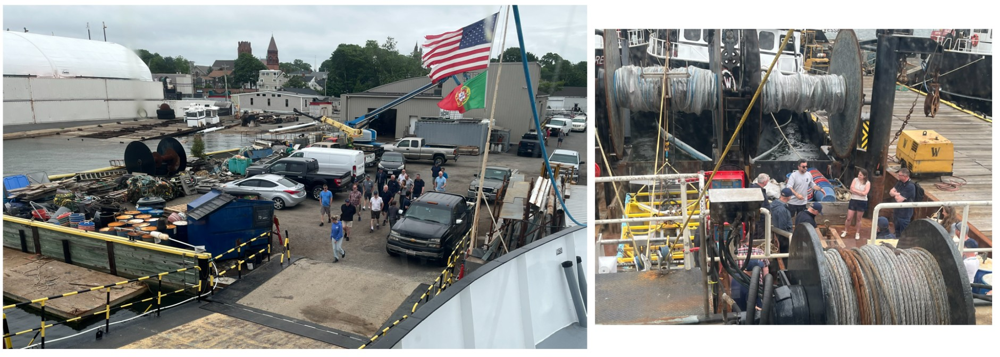
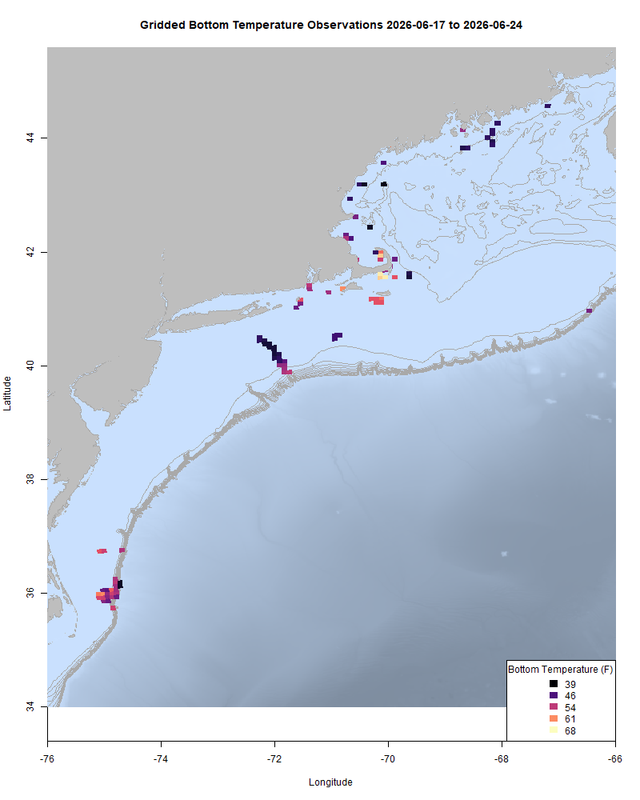
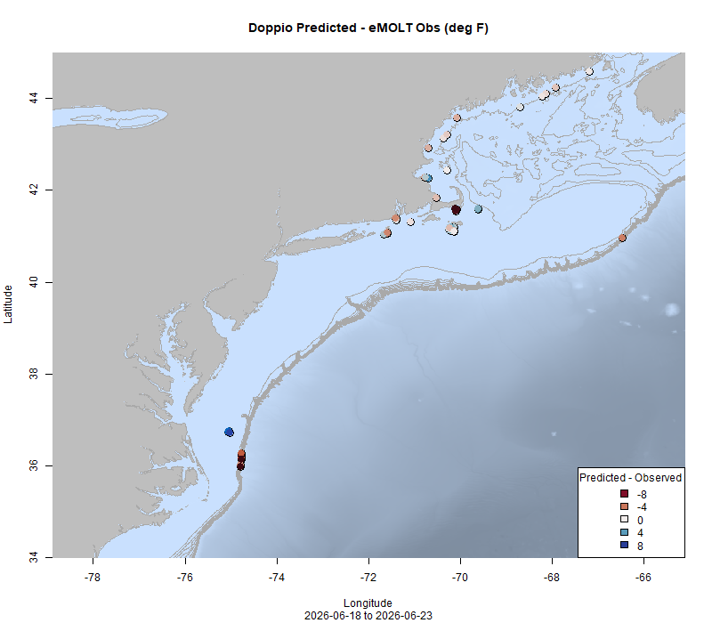
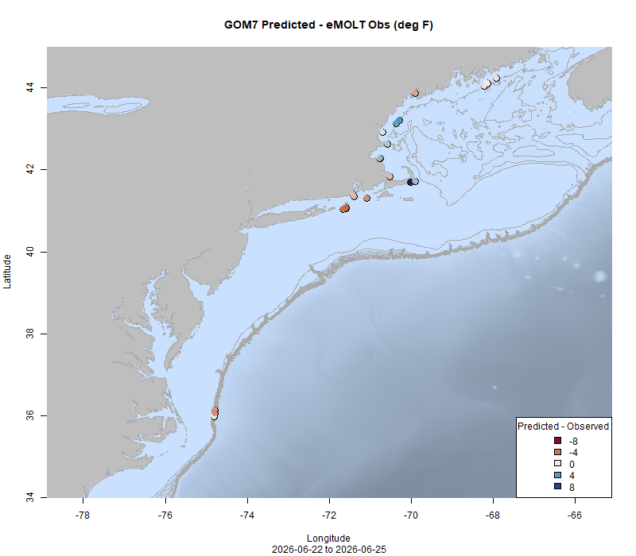

  
```{r setup, include=FALSE}
knitr::opts_chunk$set(echo = TRUE)
options(scipen = 999)
library(marmap)
library(rstudioapi)
if(Sys.info()["sysname"]=="Windows"){
  source("C:/Users/george.maynard/Documents/GitHubRepos/emolt_project_management/WeeklyUpdates/forecast_check/R/emolt_download.R")
} else {
  source("/home/george/Documents/emolt_project_management/WeeklyUpdates/forecast_check/R/emolt_download.R")
}
if(file.exists(paste0("C:/Users/george.maynard/Documents/emolt_project_management/WeeklyUpdates/",lubridate::year(Sys.time()),"/",lubridate::year(Sys.time()),"-",lubridate::month(Sys.time()),"-",lubridate::day(Sys.time()),"/Doppio_comparison_",format(Sys.time(), "%Y%m%d"),".csv")
)==FALSE){
  source("C:/Users/george.maynard/Documents/emolt_project_management/WeeklyUpdates/forecast_check/R/doppio_all_R_compare_and_plot.R")
}
if(file.exists(paste0("C:/Users/george.maynard/Documents/emolt_project_management/WeeklyUpdates/",lubridate::year(Sys.time()),"/",lubridate::year(Sys.time()),"-",lubridate::month(Sys.time()),"-",lubridate::day(Sys.time()),"/GOM7_comparison_",format(Sys.time(), "%Y%m%d"),".csv")
)==FALSE){
  reticulate::source_python("C:/Users/george.maynard/Documents/emolt_project_management/WeeklyUpdates/Plotting/Windows/GOM7.py")
  source("C:/Users/george.maynard/Documents/emolt_project_management/WeeklyUpdates/forecast_check/R/plot_comparisons.R")
}
data=emolt_download(days=7)
start_date=Sys.Date()-lubridate::days(7)
## Use the dates from above to create a URL for grabbing the data
full_data=read.csv(
  paste0(
    "https://erddap.emolt.net/erddap/tabledap/eMOLT_RT.csvp?tow_id%2Csegment_type%2Ctime%2Clatitude%2Clongitude%2Cdepth%2Ctemperature%2Csensor_type&segment_type=3&time%3E=",
    lubridate::year(start_date),
    "-",
    lubridate::month(start_date),
    "-",
    lubridate::day(start_date),
    "T00%3A00%3A00Z&time%3C=",
    lubridate::year(Sys.Date()),
    "-",
    lubridate::month(Sys.Date()),
    "-",
    lubridate::day(Sys.Date()),
    "T23%3A59%3A59Z"
  )
)
sensor_time=0
for(tow in unique(full_data$tow_id)){
  x=subset(full_data,full_data$tow_id==tow)
  sensor_time=sensor_time+difftime(max(x$time..UTC.),units='hours',min(x$time..UTC.))
}
```

<center> 

<font size="5"> *eMOLT Update `r Sys.Date()` * </font>
  
</center>

This week's update is coming a little early because I will be headed offshore on the F/V Dyrsten later this week to support year three of the [Oceanographic Drives of Shortfin Squid](https://www.fisheries.noaa.gov/new-england-mid-atlantic/science-data/oceanographic-drivers-shortfin-squid) research project. 

A huge thanks to our partners at [Atlantic Shellfish](https://www.instagram.com/atlantic_shellfish/) and the Coonamessett Farm Foundation. Captain Paulo (F/V Princess Scarlett), Tasha O'Hara (CFF) and Nadia Nevells (Atlantic Shellfish) welcomed a group of fishermen and staff from the Scottish Fishermen's Organization aboard the F/V Princess Scarlett in Fairhaven last week to show them some of the cooperative research programs (including eMOLT and [CFF's HabCam Program](https://www.coonamessettfarmfoundation.org/habcam-surveys)) that they are engaged with. The SFO team was touring ports in New England to learn more about how cooperative research is done in our region, and how they might be able to spin up similar efforts back in Scotland. 


*(L) Nadia Nevells from Atlantic Shellfish leads SFO members up the ramp to the F/V Princess Scarlett in Fairhaven. (R) Captain Paulo and Tasha explain how CFF's HabCam works to the SFO team.*

Just another reminder for all of the lobstermen who are hauling your sensors for the first time in a while, one common issue that's been rearing up is long wait times for the downloads or the sensor failing to download and just "retrying" over and over. If you run into either of these issues, it is likely related to the speed at which your sensor is logging data. We can straighten that our for you, so please get in touch ASAP. The longer the problem persists, the more data builds up on the logger and the longer it takes to reset. 

Cold water masses persist on the bottom inshore along the Maine and New Hampshire coast and southeast of Cape Cod. Bottom temperatures off of Provincetown are within a degree of where they were last year at this time, while bottom temperatures off Southern New England from Block Island to Nantucket are a few degrees cooler than they were in 2025. Bottom temperatures off Cape Hatteras are slightly cooler than in 2025, but not by much. 

This week, the eMOLT fleet recorded `r length(unique(full_data$tow_id))` tows of sensorized fishing gear totaling `r as.numeric(sensor_time)` sensor hours underwater.

```{r FISHBOT_Plot, echo=FALSE, fig.width=8, fig.height=10,warning=FALSE,message=FALSE,error=FALSE}
source("C:/Users/george.maynard/Documents/emolt_project_management/WeeklyUpdates/Plotting/FISHBOT_Weekly.R")
```



> *FISHBOT bottom temperature records from the past week. The data are available on the [Commercial Fisheries Research Foundation ERDDAP](https://erddap.ondeckdata.com/erddap/tabledap/fishbot_realtime.html) and an interactive visualization is available at the [Cape Cod Ocean Watch](https://ccocean.whoi.edu/index.html) dashboard hosted by Woods Hole Oceanographic Institution. FISHBOT aggregates data provided by participants in eMOLT, the CFRF Lobster and Jonah Crab Research Fleet, the CFRF Shelf Research Fleet, the Cape Cod Commercial Fishermen's Alliance Cape Cod Oceanographic Research Fleet, the Maine Coast Fishermen's Association Fisheries Ocean Data Program, MassDMF Cape Cod Bay Study Fleet, the Northeast Fisheries Science Center Study Fleet, and the Northeast Fisheries Science Center Ecosystem Monitoring Surveys*

### Bottom Temperature Forecast Performance

Both forecasts performed well Downeast this week, but observations were cooler than anticipated around the Cape and Islands and warmer than anticipated south of Rhode Island. 

{width=45%} {width=45%}
> *Comparisons between bottom temperatures predicted by two ocean forecasting models and observations from the eMOLT fleet. Blue dots show where the observations were cooler than the forecast and red dots show where the observations were warmer than the forecast. White dots show areas where the observations and forecasts agreed. On the left is the comparison with the Doppio model and on the right is the comparison with the NECOFS model (GOM7).*

### Other happenings

- We are still looking for research partners (commercial fishermen or fish dealers) for our mackerel biological sampling program. If you catch and land mackerel in the Gulf of Maine, or if you process mackerel shoreside and are interested in participating, please contact katherine.viducic@noaa.gov for more information. Compensation is available. 

- Want an eMOLT system for your boat or know somebody else who does? Check out our [online eMOLT System Request form](https://docs.google.com/forms/d/e/1FAIpQLSdRYtqgxrNmraclFQn_EfIVydPOSyMhsmCNKaRgej2F3n6Xzw/viewform) to get on the wait list. Being able to break this list down by gear type and geographic area is helpful when we apply for funding to expand the program. 

### Disclaimer
  
The eMOLT Update is NOT an official NOAA document. Mention of products or manufacturers does not constitute an endorsement by NOAA or Department of Commerce. The content of this update reflects only the personal views of the authors and does not necessarily represent the views of NOAA Fisheries, the Department of Commerce, or the United States.


All the best,

-George
