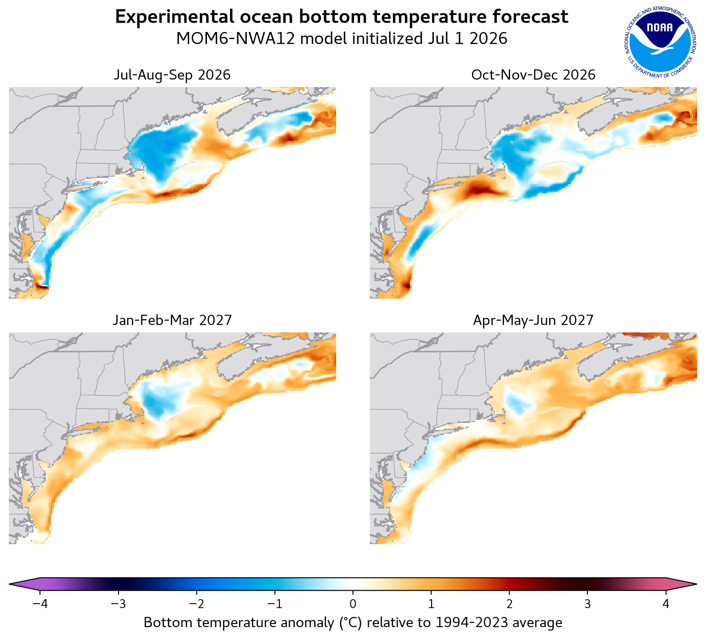
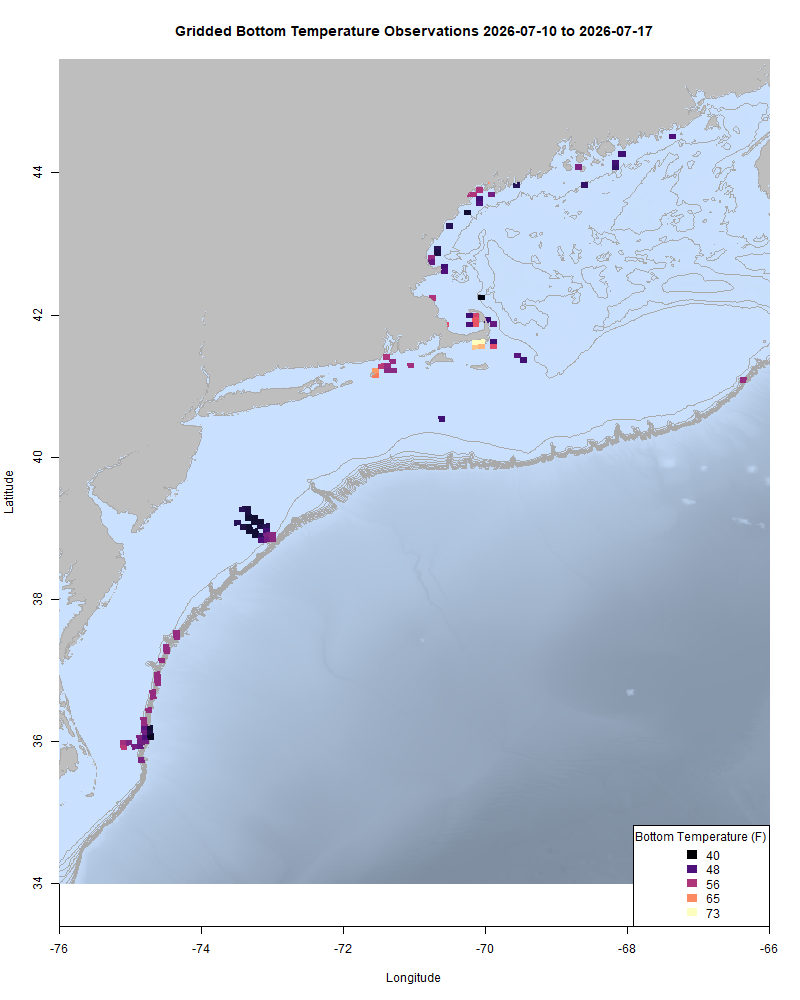
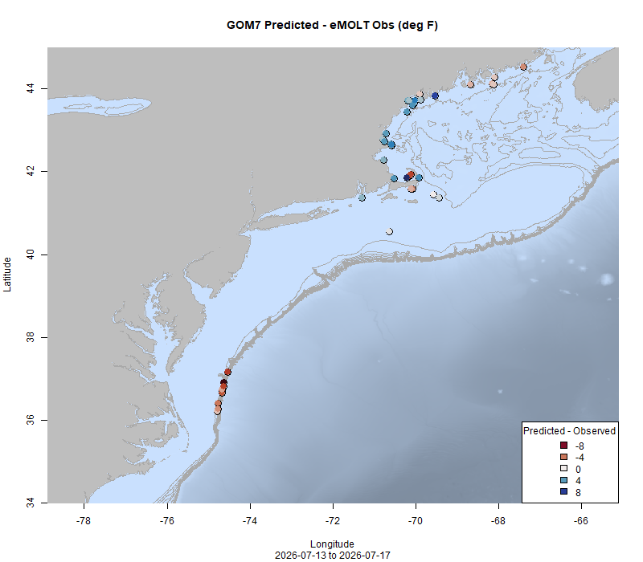

  
```{r setup, include=FALSE}
knitr::opts_chunk$set(echo = TRUE)
options(scipen = 999)
library(marmap)
library(rstudioapi)
if(Sys.info()["sysname"]=="Windows"){
  source("C:/Users/george.maynard/Documents/GitHubRepos/emolt_project_management/WeeklyUpdates/forecast_check/R/emolt_download.R")
} else {
  source("/home/george/Documents/emolt_project_management/WeeklyUpdates/forecast_check/R/emolt_download.R")
}
# if(file.exists(paste0("C:/Users/george.maynard/Documents/emolt_project_management/WeeklyUpdates/",lubridate::year(Sys.time()),"/",lubridate::year(Sys.time()),"-",lubridate::month(Sys.time()),"-",lubridate::day(Sys.time()),"/Doppio_comparison_",format(Sys.time(), "%Y%m%d"),".csv")
# )==FALSE){
#   source("C:/Users/george.maynard/Documents/emolt_project_management/WeeklyUpdates/forecast_check/R/doppio_all_R_compare_and_plot.R")
# }
# if(file.exists(paste0("C:/Users/george.maynard/Documents/emolt_project_management/WeeklyUpdates/",lubridate::year(Sys.time()),"/",lubridate::year(Sys.time()),"-",lubridate::month(Sys.time()),"-",lubridate::day(Sys.time()),"/GOM7_comparison_",format(Sys.time(), "%Y%m%d"),".csv")
# )==FALSE){
#   reticulate::source_python("C:/Users/george.maynard/Documents/emolt_project_management/WeeklyUpdates/Plotting/Windows/GOM7.py")
#   source("C:/Users/george.maynard/Documents/emolt_project_management/WeeklyUpdates/forecast_check/R/plot_comparisons.R")
# }
data=emolt_download(days=7)
start_date=Sys.Date()-lubridate::days(7)
## Use the dates from above to create a URL for grabbing the data
full_data=read.csv(
  paste0(
    "https://erddap.emolt.net/erddap/tabledap/eMOLT_RT.csvp?tow_id%2Csegment_type%2Ctime%2Clatitude%2Clongitude%2Cdepth%2Ctemperature%2Csensor_type&segment_type=3&time%3E=",
    lubridate::year(start_date),
    "-",
    lubridate::month(start_date),
    "-",
    lubridate::day(start_date),
    "T00%3A00%3A00Z&time%3C=",
    lubridate::year(Sys.Date()),
    "-",
    lubridate::month(Sys.Date()),
    "-",
    lubridate::day(Sys.Date()),
    "T23%3A59%3A59Z"
  )
)
sensor_time=0
for(tow in unique(full_data$tow_id)){
  x=subset(full_data,full_data$tow_id==tow)
  sensor_time=sensor_time+difftime(max(x$time..UTC.),units='hours',min(x$time..UTC.))
}
```

<center> 

<font size="5"> *eMOLT Update `r Sys.Date()` * </font>
  
</center>

NOAA's Geophysical Fluid Dynamics Laboratory recently released their latest experimental forecasts for the Northwest Atlantic. *"The experimental seasonal outlook for the Northwest Atlantic Ocean continues to predict widespread warm surface conditions this summer and fall, with even stronger warming in winter and spring in the tropical North Atlantic and Gulf of St. Lawrence driven by the Pacific El Niño. Along the Northeast U.S. continental shelf, cooler than normal bottom temperatures will continue to persist in the deep Western Gulf of Maine."* To check out a more detailed description of what this model predicts [click here](https://www.gfdl.noaa.gov/news/gfdl-a-partner-in-noaas-changing-ecosystems-and-fisheries-initiative/) and to download the forecast model output, [click here](https://psl.noaa.gov/cefi_portal/). The MOM6 team at GFDL has [previously used data collected by eMOLT to help assess forecast performance](https://www.fisheries.noaa.gov/feature-story/new-seasonal-forecast-predicts-cooler-waters-northeast). 



These plots show the forecasted bottom temp anomalies over the next year according to the experimental MOM6 model. Cooler than average temps persist between Massachusetts and Georges Bank for the duration of the model run, while the rest of the region experiences slightly warmer than average temps later in the time series. 

This week, the eMOLT fleet recorded `r length(unique(full_data$tow_id))` tows of sensorized fishing gear totaling `r as.numeric(sensor_time)` sensor hours underwater.

```{r FISHBOT_Plot, echo=FALSE, fig.width=8, fig.height=10,warning=FALSE,message=FALSE,error=FALSE}
source("C:/Users/george.maynard/Documents/emolt_project_management/WeeklyUpdates/Plotting/FISHBOT_Weekly.R")
```



> *FISHBOT bottom temperature records from the past week. The data are available on the [Commercial Fisheries Research Foundation ERDDAP](https://erddap.ondeckdata.com/erddap/tabledap/fishbot_realtime.html) and an interactive visualization is available at the [Cape Cod Ocean Watch](https://ccocean.whoi.edu/index.html) dashboard hosted by Woods Hole Oceanographic Institution. FISHBOT aggregates data provided by participants in eMOLT, the CFRF Lobster and Jonah Crab Research Fleet, the CFRF Shelf Research Fleet, the Cape Cod Commercial Fishermen's Alliance Cape Cod Oceanographic Research Fleet, the Maine Coast Fishermen's Association Fisheries Ocean Data Program, MassDMF Cape Cod Bay Study Fleet, the Northeast Fisheries Science Center Study Fleet, and the Northeast Fisheries Science Center Ecosystem Monitoring Surveys*

### Bottom Temperature Forecast Performance

Observations along the shelf break off the Mid-Atlantic were warmer than both models predicted. Observations in the Gulf of Maine were warmer than predicted by Doppio and cooler than predicted by the Northeast Coastal Ocean Forecast System. 

{width=45%} {width=45%}
> *Comparisons between bottom temperatures predicted by two ocean forecasting models and observations from the eMOLT fleet. Blue dots show where the observations were cooler than the forecast and red dots show where the observations were warmer than the forecast. White dots show areas where the observations and forecasts agreed. On the left is the comparison with the Doppio model and on the right is the comparison with the NECOFS model (GOM7).*

### [Seafood Engine in New England Receives NSF Award](https://www.nationalfisherman.com/nsf-awards-15m-to-launch-new-england-seafood-engine)

The eMOLT team is excited to be a small part of a new National Science Foundation award to the Seafood Engine in New England, a collaboration of the seafood industry, tech sector, government and research partners. We'll be working with our partners at the Commercial Fisheries Research Foundation, the Cape Cod Commercial Fishermen's Alliance, Woods Hole Oceanographic Institution, and in the commercial fishing fleet to deploy new types of sensors and develop better ways for fishermen to integrate the data we collect into their business decision making. 

### Other happenings

- A team of scientists from Woods Hole Oceanographic Institution and Commercial Fisheries Research Foundation recently published a report [Assessing the Impacts of Wind Farm-Associated Noise Pollution on Physiological Stress in the American Lobster *(Homarus americanus)*](https://doi.org/10.1007/978-3-031-94229-7_123-1). You can read the full study by clicking on the link, and check out interviews with the project team [here](https://www.whoi.edu/oceanus/feature/is-underwater-noise-from-construction-affecting-the-american-lobster/).

- Another research team at URI and Commercial Fisheries Research Foundation is conducting an ongoing investigation into how Jonah Crabs interact with offshore wind installations. For more on that, [click here](https://www.uri.edu/news/2026/05/marine-life-finds-new-home-at-base-of-wind-turbines/). 

- We are still looking for research partners (commercial fishermen or fish dealers) for our mackerel biological sampling program. If you catch and land mackerel in the Gulf of Maine, or if you process mackerel shoreside and are interested in participating, please contact katherine.viducic@noaa.gov for more information. Compensation is available. 

- Want an eMOLT system for your boat or know somebody else who does? Check out our [online eMOLT System Request form](https://docs.google.com/forms/d/e/1FAIpQLSdRYtqgxrNmraclFQn_EfIVydPOSyMhsmCNKaRgej2F3n6Xzw/viewform) to get on the wait list. Being able to break this list down by gear type and geographic area is helpful when we apply for funding to expand the program. 

### Disclaimer
  
The eMOLT Update is NOT an official NOAA document. Mention of products or manufacturers does not constitute an endorsement by NOAA or Department of Commerce. The content of this update reflects only the personal views of the authors and does not necessarily represent the views of NOAA Fisheries, the Department of Commerce, or the United States.


All the best,

-George
