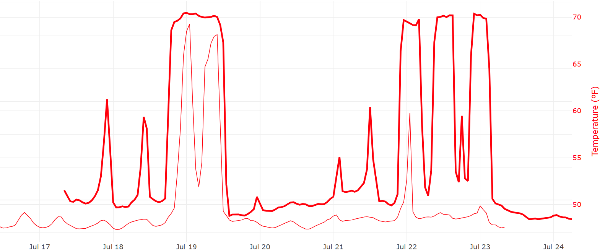
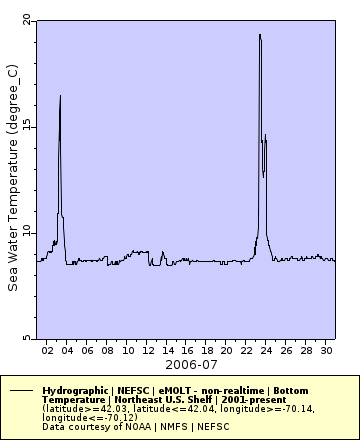
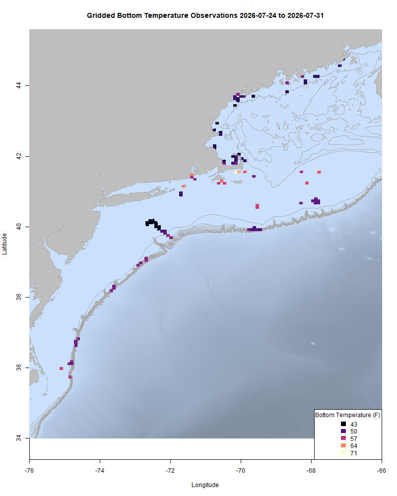
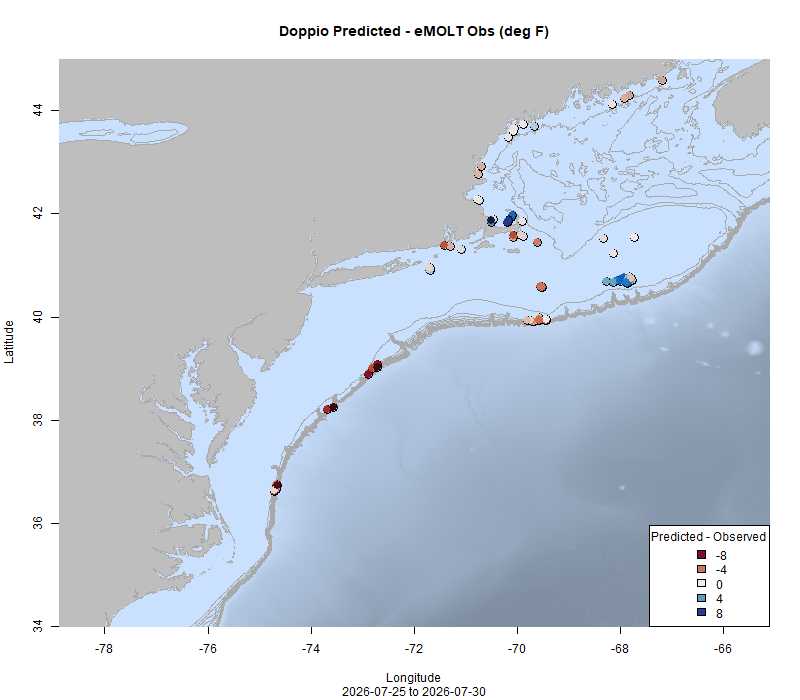
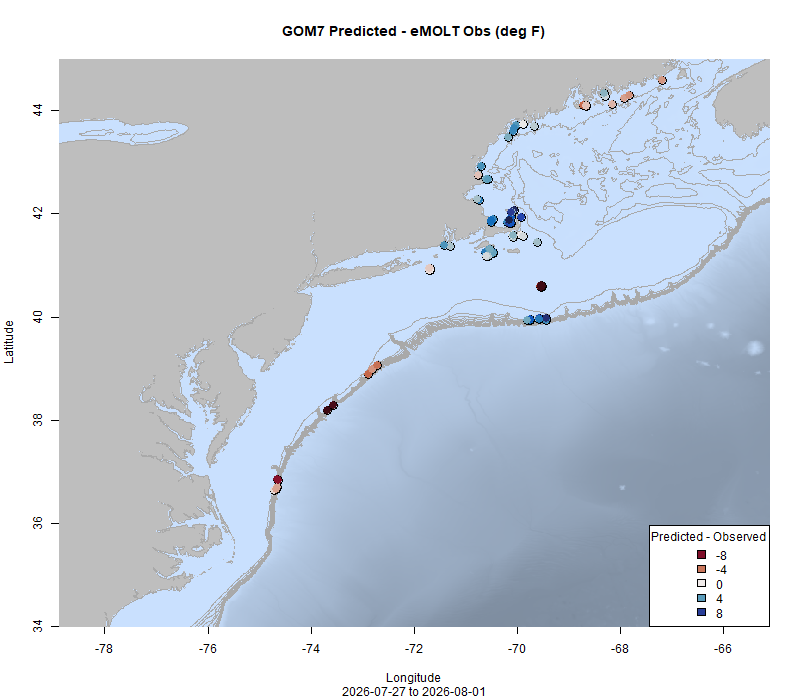
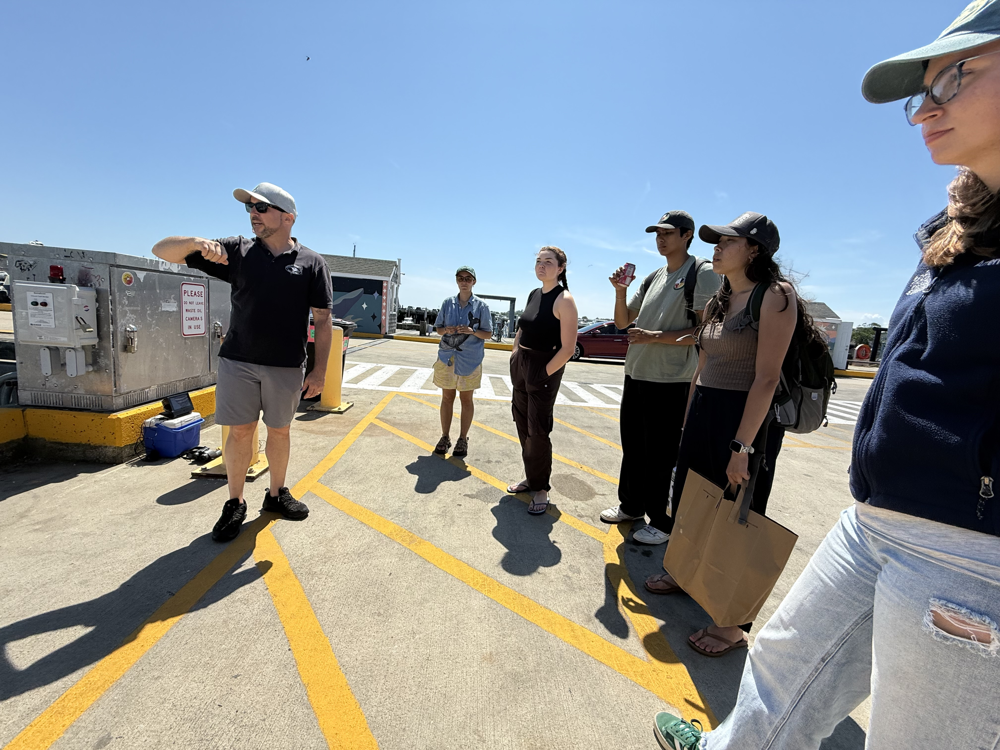

  
```{r setup, include=FALSE}
knitr::opts_chunk$set(echo = TRUE)
options(scipen = 999)
library(marmap)
library(rstudioapi)
if(Sys.info()["sysname"]=="Windows"){
  source("C:/Users/george.maynard/Documents/GitHubRepos/emolt_project_management/WeeklyUpdates/forecast_check/R/emolt_download.R")
} else {
  source("/home/george/Documents/emolt_project_management/WeeklyUpdates/forecast_check/R/emolt_download.R")
}
# if(file.exists(paste0("C:/Users/george.maynard/Documents/emolt_project_management/WeeklyUpdates/",lubridate::year(Sys.time()),"/",lubridate::year(Sys.time()),"-",lubridate::month(Sys.time()),"-",lubridate::day(Sys.time()),"/Doppio_comparison_",format(Sys.time(), "%Y%m%d"),".csv")
# )==FALSE){
#   source("C:/Users/george.maynard/Documents/emolt_project_management/WeeklyUpdates/forecast_check/R/doppio_all_R_compare_and_plot.R")
# }
# if(file.exists(paste0("C:/Users/george.maynard/Documents/emolt_project_management/WeeklyUpdates/",lubridate::year(Sys.time()),"/",lubridate::year(Sys.time()),"-",lubridate::month(Sys.time()),"-",lubridate::day(Sys.time()),"/GOM7_comparison_",format(Sys.time(), "%Y%m%d"),".csv")
# )==FALSE){
#   reticulate::source_python("C:/Users/george.maynard/Documents/emolt_project_management/WeeklyUpdates/Plotting/Windows/GOM7.py")
#   source("C:/Users/george.maynard/Documents/emolt_project_management/WeeklyUpdates/forecast_check/R/plot_comparisons.R")
# }
data=emolt_download(days=7)
start_date=Sys.Date()-lubridate::days(7)
## Use the dates from above to create a URL for grabbing the data
full_data=read.csv(
  paste0(
    "https://erddap.emolt.net/erddap/tabledap/eMOLT_RT.csvp?tow_id%2Csegment_type%2Ctime%2Clatitude%2Clongitude%2Cdepth%2Ctemperature%2Csensor_type&segment_type=3&time%3E=",
    lubridate::year(start_date),
    "-",
    lubridate::month(start_date),
    "-",
    lubridate::day(start_date),
    "T00%3A00%3A00Z&time%3C=",
    lubridate::year(Sys.Date()),
    "-",
    lubridate::month(Sys.Date()),
    "-",
    lubridate::day(Sys.Date()),
    "T23%3A59%3A59Z"
  )
)
sensor_time=0
for(tow in unique(full_data$tow_id)){
  x=subset(full_data,full_data$tow_id==tow)
  sensor_time=sensor_time+difftime(max(x$time..UTC.),units='hours',min(x$time..UTC.))
}
```

<center> 

<font size="5"> *eMOLT Update `r Sys.Date()` * </font>
  
</center>

Earlier this week, I was checking on data flows for one of our newer partners, Captain Ray on the F/V Lizzy A. His loggers in eastern Cape Cod Bay showed a crazy temperature spike on July 19th, where bottom temperatures jumped nearly 20 F in just over two hours! 



The pattern was consistent across multiple loggers in the area, so I reached out to Jim Manning to ask what might be going on. He said it's a known phenomenon in Eastern Cape Cod Bay because of how sharp the thermocline is and how much it moves around, often influenced by warm, surface water being blown into the eastern part of the bay by the prevailing southwest summer winds. Sure enough, the same spikes are visible in the July bottom temperature data from a non-realtime eMOLT site in the same area in most years from 2001 - 2023.



For example, in the plot above, two distinct warming events are visible in July of 2006, 20 years ago. This sloshing around of the thermocline and the general mixing of waters in Cape Cod Bay is described in more detail for anyone who's interested in Scully et al.'s 2022 paper ["Unprecedented summer hypoxia in southern Cape Cod Bay: an ecological response to regional climate change?"](https://doi.org/10.5194/bg-19-3523-2022)

This week, the eMOLT fleet recorded `r length(unique(full_data$tow_id))` tows of sensorized fishing gear totaling `r as.numeric(sensor_time)` sensor hours underwater. Bottom temps north of Cape Cod are in the mid-40s. In the shoals along the northern side of Georges Bank, temps are right around 60, although in the deeper waters ouf the Southeast Part, temps are closer to 50. Close in to Southern New England, bottom temps are in the mid-50s to low 60s. The same is true near the canyons along the Mid-Atlantic. All of these measurements are around where we were last year at this time. 

```{r FISHBOT_Plot, echo=FALSE, fig.width=8, fig.height=10,warning=FALSE,message=FALSE,error=FALSE}
source("C:/Users/george.maynard/Documents/emolt_project_management/WeeklyUpdates/Plotting/FISHBOT_Weekly.R")
```



> *FISHBOT bottom temperature records from the past week. The data are available on the [Commercial Fisheries Research Foundation ERDDAP](https://erddap.ondeckdata.com/erddap/tabledap/fishbot_realtime.html) and an interactive visualization is available at the [Cape Cod Ocean Watch](https://ccocean.whoi.edu/index.html) dashboard hosted by Woods Hole Oceanographic Institution. FISHBOT aggregates data provided by participants in eMOLT, the CFRF Lobster and Jonah Crab Research Fleet, the CFRF Shelf Research Fleet, the Cape Cod Commercial Fishermen's Alliance Cape Cod Oceanographic Research Fleet, the Maine Coast Fishermen's Association Fisheries Ocean Data Program, MassDMF Cape Cod Bay Study Fleet, the Northeast Fisheries Science Center Study Fleet, and the Northeast Fisheries Science Center Ecosystem Monitoring Surveys*

### Bottom Temperature Forecast Performance

Both Doppio and NECOFS struggled a bit this week. Downeast, observations were warmer than both models predicted. Along the Mid-Coast, Doppio performed well, but observations were cooler than predicted by NECOFS. In Cape Cod Bay, observations were cooler than expected. Along Southern New England, observations were warmer than Doppio forecast, but cooler than NECOFS, and observations along the Mid-Atlantic Canyons were warmer than either model forecast. 

{width=45%} {width=45%}
> *Comparisons between bottom temperatures predicted by two ocean forecasting models and observations from the eMOLT fleet. Blue dots show where the observations were cooler than the forecast and red dots show where the observations were warmer than the forecast. White dots show areas where the observations and forecasts agreed. On the left is the comparison with the Doppio model and on the right is the comparison with the NECOFS model (GOM7).*

### Native Land Conservancy First Light Fellows learn about eMOLT

Earlier this month, Owen Nichols (Director of Marine Fisheries Research at the Center for Coastal Studies and longtime eMOLT partner) took some time between working on eMOLT systems up in Provincetown to showcase the tech that we use in our program and describe how eMOLT works for [First Light Fellows]() and Dr. Diana Ruiz from the Native Land Conservancy. Although the tech was designed for use on commercial fishing vessels, there are plenty of other applications where low-cost, low barrier to entry water measurements might be useful, so thanks to Owen for sharing our approach to participatory science. 


*Owen Nichols (left) with fellows from the Native Land Conservancy at MacMillan Pier in Provincetown*

### Other happenings

- We are still looking for research partners (commercial fishermen or fish dealers) for our mackerel biological sampling program. If you catch and land mackerel in the Gulf of Maine, or if you process mackerel shoreside and are interested in participating, please contact katherine.viducic@noaa.gov for more information. Compensation is available. 

- Want an eMOLT system for your boat or know somebody else who does? Check out our [online eMOLT System Request form](https://docs.google.com/forms/d/e/1FAIpQLSdRYtqgxrNmraclFQn_EfIVydPOSyMhsmCNKaRgej2F3n6Xzw/viewform) to get on the wait list. Being able to break this list down by gear type and geographic area is helpful when we apply for funding to expand the program. 

### Disclaimer
  
The eMOLT Update is NOT an official NOAA document. Mention of products or manufacturers does not constitute an endorsement by NOAA or Department of Commerce. The content of this update reflects only the personal views of the authors and does not necessarily represent the views of NOAA Fisheries, the Department of Commerce, or the United States.


All the best,

-George
