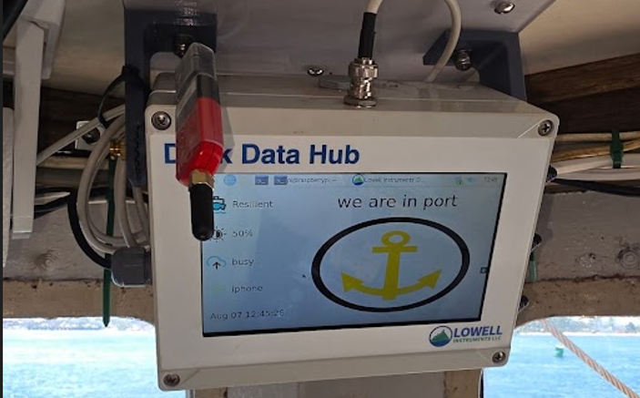
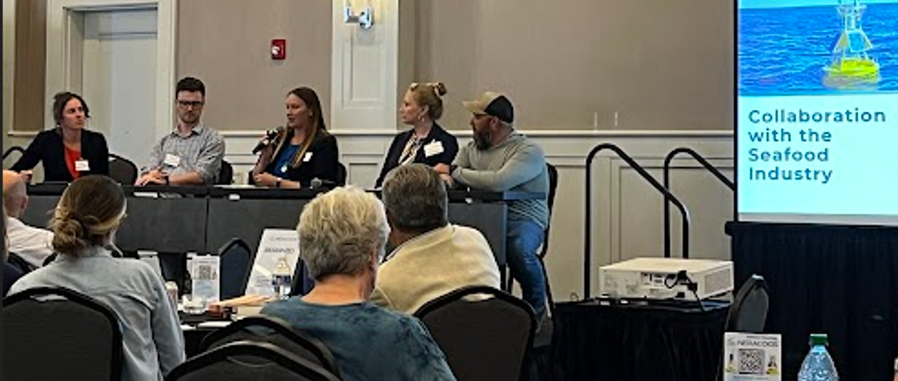
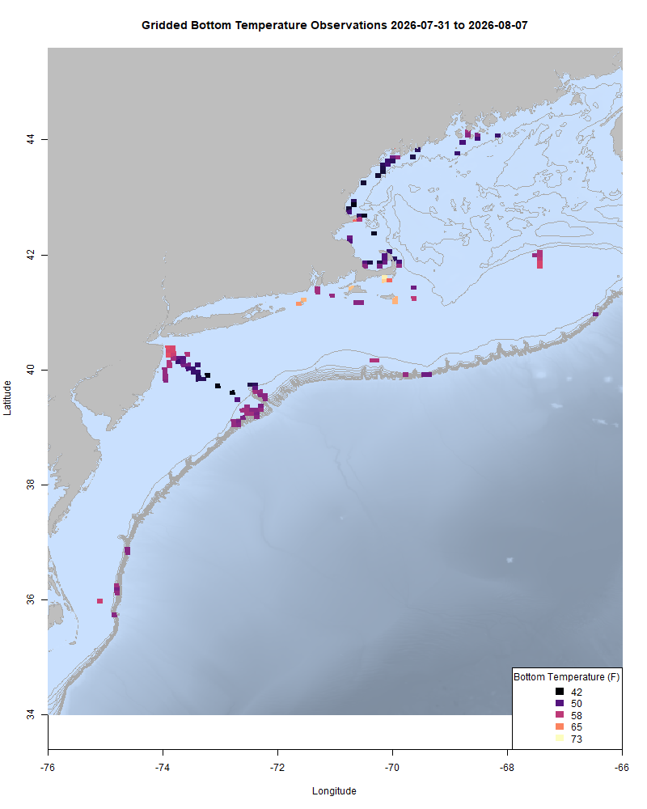
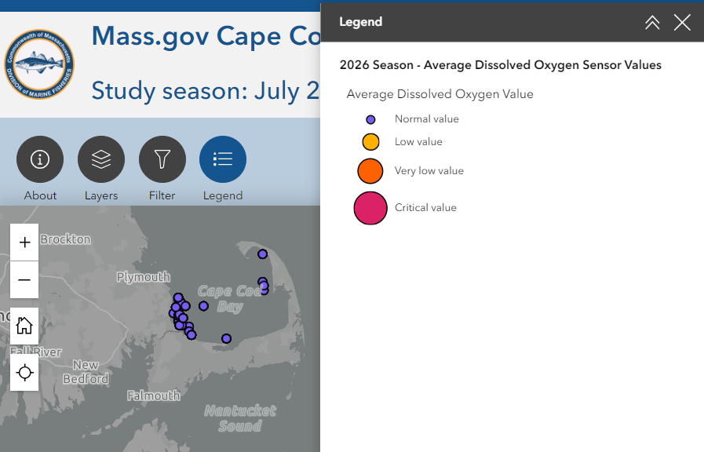
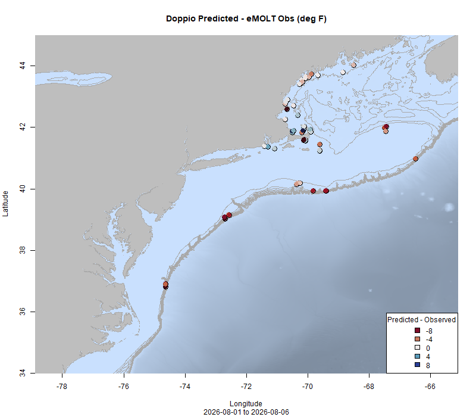
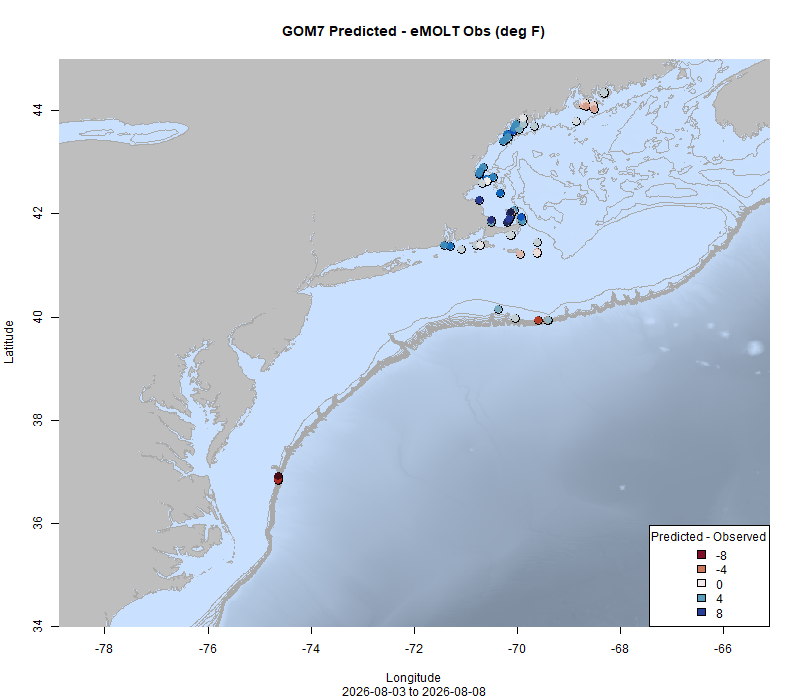

  
```{r setup, include=FALSE}
knitr::opts_chunk$set(echo = TRUE)
options(scipen = 999)
library(marmap)
library(rstudioapi)
if(Sys.info()["sysname"]=="Windows"){
  source("C:/Users/george.maynard/Documents/GitHubRepos/emolt_project_management/WeeklyUpdates/forecast_check/R/emolt_download.R")
} else {
  source("/home/george/Documents/emolt_project_management/WeeklyUpdates/forecast_check/R/emolt_download.R")
}
# if(file.exists(paste0("C:/Users/george.maynard/Documents/emolt_project_management/WeeklyUpdates/",lubridate::year(Sys.time()),"/",lubridate::year(Sys.time()),"-",lubridate::month(Sys.time()),"-",lubridate::day(Sys.time()),"/Doppio_comparison_",format(Sys.time(), "%Y%m%d"),".csv")
# )==FALSE){
#   source("C:/Users/george.maynard/Documents/emolt_project_management/WeeklyUpdates/forecast_check/R/doppio_all_R_compare_and_plot.R")
# }
# if(file.exists(paste0("C:/Users/george.maynard/Documents/emolt_project_management/WeeklyUpdates/",lubridate::year(Sys.time()),"/",lubridate::year(Sys.time()),"-",lubridate::month(Sys.time()),"-",lubridate::day(Sys.time()),"/GOM7_comparison_",format(Sys.time(), "%Y%m%d"),".csv")
# )==FALSE){
#   reticulate::source_python("C:/Users/george.maynard/Documents/emolt_project_management/WeeklyUpdates/Plotting/Windows/GOM7.py")
#   source("C:/Users/george.maynard/Documents/emolt_project_management/WeeklyUpdates/forecast_check/R/plot_comparisons.R")
# }
data=emolt_download(days=7)
start_date=Sys.Date()-lubridate::days(7)
## Use the dates from above to create a URL for grabbing the data
full_data=read.csv(
  paste0(
    "https://erddap.emolt.net/erddap/tabledap/eMOLT_RT.csvp?tow_id%2Csegment_type%2Ctime%2Clatitude%2Clongitude%2Cdepth%2Ctemperature%2Csensor_type&segment_type=3&time%3E=",
    lubridate::year(start_date),
    "-",
    lubridate::month(start_date),
    "-",
    lubridate::day(start_date),
    "T00%3A00%3A00Z&time%3C=",
    lubridate::year(Sys.Date()),
    "-",
    lubridate::month(Sys.Date()),
    "-",
    lubridate::day(Sys.Date()),
    "T23%3A59%3A59Z"
  )
)
sensor_time=0
for(tow in unique(full_data$tow_id)){
  x=subset(full_data,full_data$tow_id==tow)
  sensor_time=sensor_time+difftime(max(x$time..UTC.),units='hours',min(x$time..UTC.))
}
```

<center> 

<font size="5"> *eMOLT Update `r Sys.Date()` * </font>
  
</center>



Earlier this week, I spent some time on the F/V Seafox and F/V Cornerstone getting their eMOLT systems back up and running. On Wednesday, Erin and I attended the annual meeting of [NERACOOS](https://neracoos.org/about/) (the Northeastern Regional Association of Coastal Ocean Observing Systems) in Portsmouth, New Hampshire. Plenty of other eMOLT partners were there too, including Scott from Lowell Instruments, Cooper and Jack from Ocean Data Network, and Samir from the Coonamessett Farm Foundation. At the meeting, we heard from the semi-retired Capt. David Goethel (an early adopter of the near realtime eMOLT systems), Fred Mattera (CFRF / Commercial Fisheries Center of Rhode Island), Aubrey Church (CCCFA), Oliver Dixon (Blue Acres Aquaculture), Dr. Susie Arnold (The Island Institute), and many others about how important environmental data is to people who work on the water. From the wind and wave data that helps fishermen understand when it's safe to leave the dock to the water temperature and dissolved oxygen data that can help inform when and where to set gear, environmental data is an important decision support tool. In the words of Fred Mattera though "It's a big goddamn ocean", and there are still a lot of places that aren't monitored by traditional ocean observing platforms, and that's where all of you come in. It's a testament to all the work of our tech support partners and the commercial fishermen who actually collect the data that several speakers took the time to highlight the eMOLT Program as an important part of the ocean observing system in our region, so thank you to everyone who participates!


*L-R Katy Bland (NERACOOS), Austin Pugh (NERACOOS), Aubrey Church (CCCFA), Dr. Sam Siedlecki (UCONN), and Chuck Loring (Penobscot Indian Nation) discuss collaborations between the seafood industry and scientific community at the NERACOOS Annual Meeting earlier this week.*

Today, Huanxin (GOMLF) and Luca (CFRF) are down in Point Judith trying to fix a handful of different issues aboard some of our partner vessels down there. If you see them around and have questions or concerns about the system on your boat, don't hesitate to flag them down!

This week, the eMOLT fleet recorded `r length(unique(full_data$tow_id))` tows of sensorized fishing gear totaling `r as.numeric(sensor_time)` sensor hours underwater. Bottom temps around the region remain close to last year's values in the Gulf of Maine despite a cooler start this season. Out on Georges Bank, temps are slightly cooler than last year at this time, but not by much. In the fishing grounds of Southern New England and the Mid-Atlantic, bottom temps have tracked reasonably closely to last year except for some dips back in March.  

```{r FISHBOT_Plot, echo=FALSE, fig.width=8, fig.height=10,warning=FALSE,message=FALSE,error=FALSE}
source("C:/Users/george.maynard/Documents/emolt_project_management/WeeklyUpdates/Plotting/FISHBOT_Weekly.R")
```



> *FISHBOT bottom temperature records from the past week. The data are available on the [Commercial Fisheries Research Foundation ERDDAP](https://erddap.ondeckdata.com/erddap/tabledap/fishbot_realtime.html) and an interactive visualization is available at the [Cape Cod Ocean Watch](https://ccocean.whoi.edu/index.html) dashboard hosted by Woods Hole Oceanographic Institution. FISHBOT aggregates data provided by participants in eMOLT, the CFRF Lobster and Jonah Crab Research Fleet, the CFRF Shelf Research Fleet, the Cape Cod Commercial Fishermen's Alliance Cape Cod Oceanographic Research Fleet, the Maine Coast Fishermen's Association Fisheries Ocean Data Program, MassDMF Cape Cod Bay Study Fleet, the Northeast Fisheries Science Center Study Fleet, and the Northeast Fisheries Science Center Ecosystem Monitoring Surveys*

### Dissolved Oxygen

Dissolved oxygen levels remain high around Isle Au Haut, in Casco Bay, and in Cape Cod Bay (screenshot from [Massachusetts DMF's Cape Cod Bay dashboard](https://experience.arcgis.com/experience/0af88a18b7364b228004bb6d7dc71b5a) below). At the mouth of Narragansett Bay, readings collected by CFRF partner vessels are in the "Very Low" category, around 3.4 mg/L. 



### Bottom Temperature Forecast Performance

This week the NECOFS bottom temperature forecast was biased warm (observations were an average of 1.5 degrees cooler than the model) in the Western Gulf of Maine, in Massachusetts Bay and Cape Cod Bay, along Southern New England, and even some down on the shelf edge. In contrast, the Doppio bottom temperature forecast performed well in the Western Gulf of Maine, but was biased cold (observations were an average of 0.8 degrees warmer than the model) throughout much of the region, with waters much warmer than predicted along the shelf break and on the northern edge of Georges Bank. 

{width=45%} {width=45%}
> *Comparisons between bottom temperatures predicted by two ocean forecasting models and observations from the eMOLT fleet. Blue dots show where the observations were cooler than the forecast and red dots show where the observations were warmer than the forecast. White dots show areas where the observations and forecasts agreed. On the left is the comparison with the Doppio model and on the right is the comparison with the NECOFS model (GOM7).*

### Other happenings

- We are gearing up for the Woods Hole Science Stroll tomorrow August 8, from 1000-1500 here along Water Street in Woods Hole. The Cooperative Research team here at NEFSC will have a booth describing many of our ongoing initiatives along with many of the other research teams from NOAA, WHOI, Marine Biological Laboratory, and others. For more information, check out the [Science Stroll website here](https://woodsholesciencestroll.org/). 

- Want an eMOLT system for your boat or know somebody else who does? Check out our [online eMOLT System Request form](https://docs.google.com/forms/d/e/1FAIpQLSdRYtqgxrNmraclFQn_EfIVydPOSyMhsmCNKaRgej2F3n6Xzw/viewform) to get on the wait list. Being able to break this list down by gear type and geographic area is helpful when we apply for funding to expand the program. 

### Disclaimer
  
The eMOLT Update is NOT an official NOAA document. Mention of products or manufacturers does not constitute an endorsement by NOAA or Department of Commerce. The content of this update reflects only the personal views of the authors and does not necessarily represent the views of NOAA Fisheries, the Department of Commerce, or the United States.


All the best,

-George
