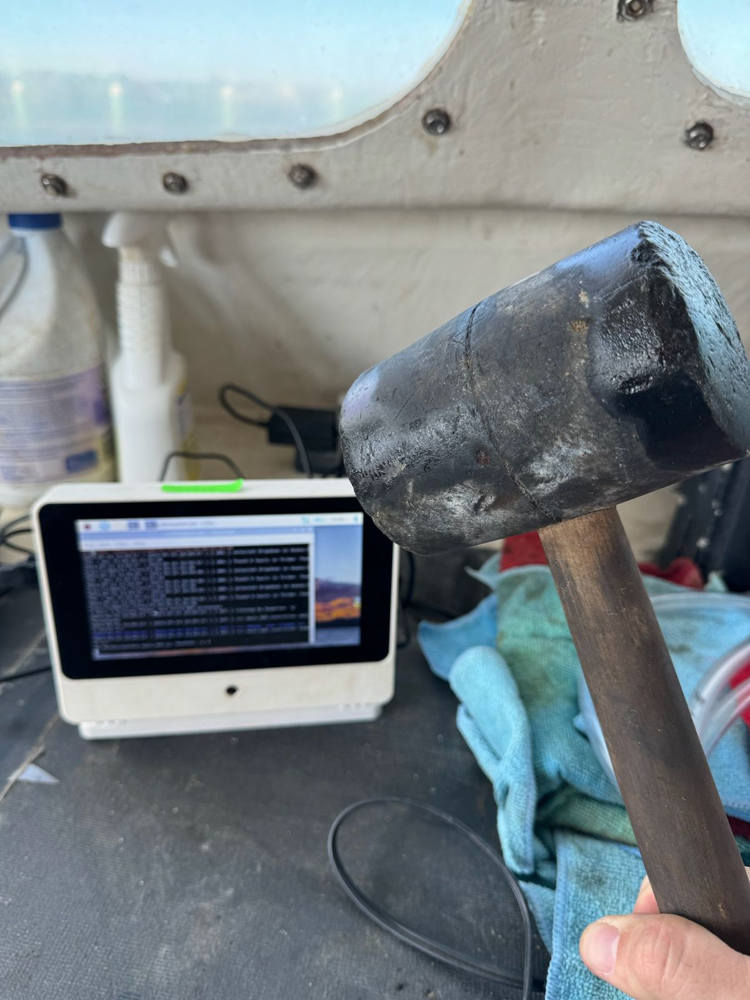
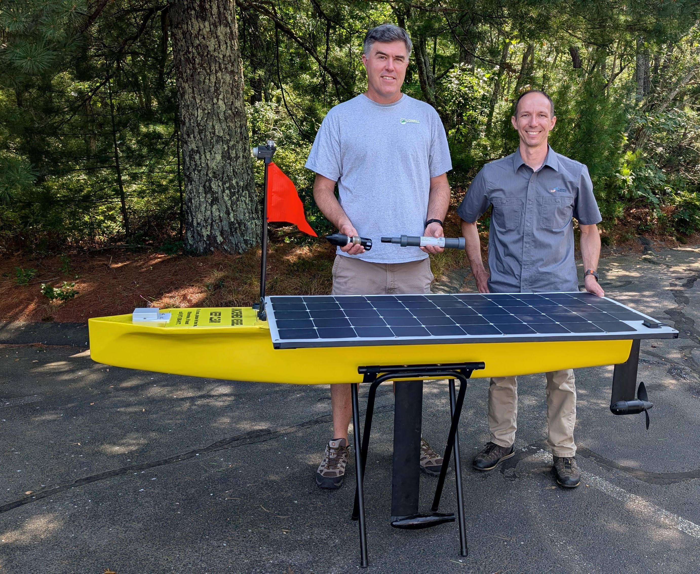
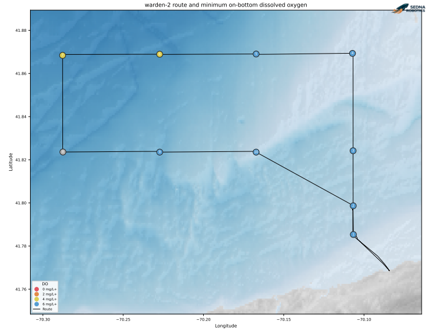
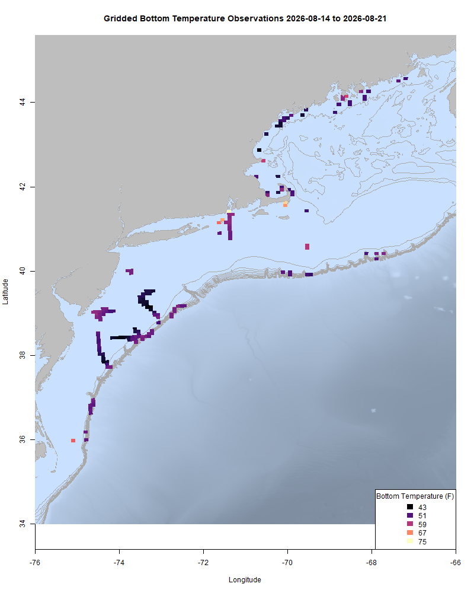
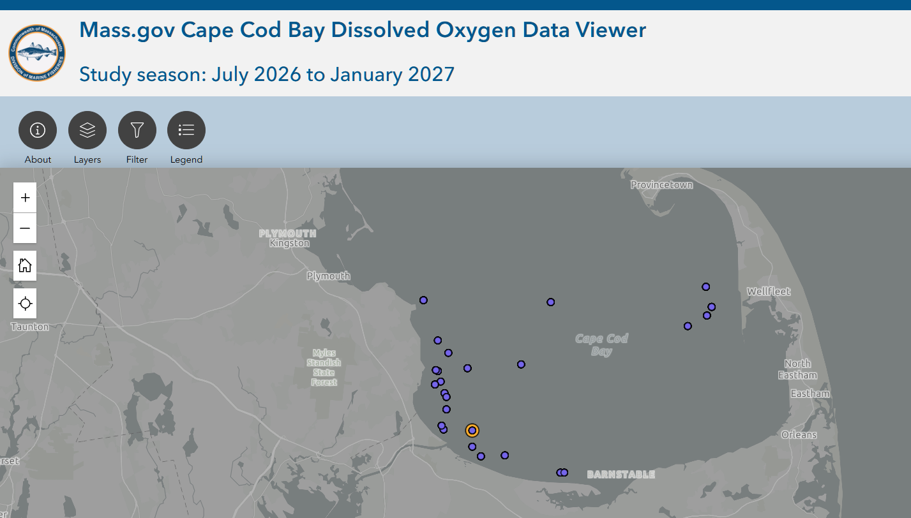
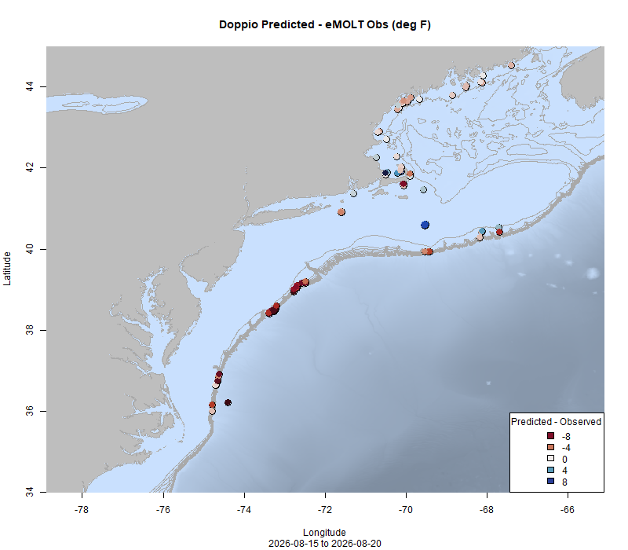

  
```{r setup, include=FALSE}
knitr::opts_chunk$set(echo = TRUE)
options(scipen = 999)
library(marmap)
library(rstudioapi)
if(Sys.info()["sysname"]=="Windows"){
  source("C:/Users/george.maynard/Documents/GitHubRepos/emolt_project_management/WeeklyUpdates/forecast_check/R/emolt_download.R")
} else {
  source("/home/george/Documents/emolt_project_management/WeeklyUpdates/forecast_check/R/emolt_download.R")
}
# if(file.exists(paste0("C:/Users/george.maynard/Documents/emolt_project_management/WeeklyUpdates/",lubridate::year(Sys.time()),"/",lubridate::year(Sys.time()),"-",lubridate::month(Sys.time()),"-",lubridate::day(Sys.time()),"/Doppio_comparison_",format(Sys.time(), "%Y%m%d"),".csv")
# )==FALSE){
#   source("C:/Users/george.maynard/Documents/emolt_project_management/WeeklyUpdates/forecast_check/R/doppio_all_R_compare_and_plot.R")
# }
# if(file.exists(paste0("C:/Users/george.maynard/Documents/emolt_project_management/WeeklyUpdates/",lubridate::year(Sys.time()),"/",lubridate::year(Sys.time()),"-",lubridate::month(Sys.time()),"-",lubridate::day(Sys.time()),"/GOM7_comparison_",format(Sys.time(), "%Y%m%d"),".csv")
# )==FALSE){
#   reticulate::source_python("C:/Users/george.maynard/Documents/emolt_project_management/WeeklyUpdates/Plotting/Windows/GOM7.py")
#   source("C:/Users/george.maynard/Documents/emolt_project_management/WeeklyUpdates/forecast_check/R/plot_comparisons.R")
# }
data=emolt_download(days=7)
start_date=Sys.Date()-lubridate::days(7)
## Use the dates from above to create a URL for grabbing the data
full_data=read.csv(
  paste0(
    "https://erddap.emolt.net/erddap/tabledap/eMOLT_RT.csvp?tow_id%2Csegment_type%2Ctime%2Clatitude%2Clongitude%2Cdepth%2Ctemperature%2Csensor_type&segment_type=3&time%3E=",
    lubridate::year(start_date),
    "-",
    lubridate::month(start_date),
    "-",
    lubridate::day(start_date),
    "T00%3A00%3A00Z&time%3C=",
    lubridate::year(Sys.Date()),
    "-",
    lubridate::month(Sys.Date()),
    "-",
    lubridate::day(Sys.Date()),
    "T23%3A59%3A59Z"
  )
)
sensor_time=0
for(tow in unique(full_data$tow_id)){
  x=subset(full_data,full_data$tow_id==tow)
  sensor_time=sensor_time+difftime(max(x$time..UTC.),units='hours',min(x$time..UTC.))
}
```

<center> 

<font size="5"> *eMOLT Update `r Sys.Date()` * </font>
  
</center>



Everyone gets frustrated with technology from time to time. With all of the negative talk about technology in the media right now, I just wanted to share one bright story that's got nothing to do with AI or automated license plate readers.

This fall, if you're out on Cape Cod Bay, you might see what appears to be a solar-powered yellow kayak out there with you. It is seven feet long and has a small mast with an orange flag and an amber strobe. These vessels are called Wardens and are built by Sedna Robotics up in Boston. Working with the team at Lowell Instruments, Sedna co-founder Andrew Gregg is hoping that Wardens could help fill in some of the subsurface gaps in our ocean observing systems left by traditional buoys and cooperative research efforts like eMOLT. 


*(L) Nick Lowell of Lowell Instruments and (R) Andrew Gregg of Sedna Robotics with a Warden*

As a demonstration of how this approach might work, the Sedna Robotics team launched a Warden in Brewster earlier this week and set it to sample a 5 km grid in a part of Cape Cod Bay with no DO measurements available through Mass DMF or eMOLT. We are working with the teams at Sedna Robotics, the Gulf of Maine Lobster Foundation, and CFRF to incorporate these data into the existing eMOLT infrastructure so that they can be publicly accessed on ERDDAP and incorporated into FIShBOT.



*The sampling voyage of a Sedna Robotics Warden earlier this week in Cape Cod Bay. Oxygen levels were good on the eastern end of the track (blue dots), but were slightly lower at the northwestern two stations (yellow dots).* 

This week, the eMOLT fleet recorded `r length(unique(full_data$tow_id))` tows of sensorized fishing gear totaling `r as.numeric(sensor_time)` sensor hours underwater. Bottom temps remain close to last year's values in the Gulf of Maine and Southern New England and on Georges Bank and are cooler than last year in the Mid-Atlantic. 

```{r FISHBOT_Plot, echo=FALSE, fig.width=8, fig.height=10,warning=FALSE,message=FALSE,error=FALSE}
source("C:/Users/george.maynard/Documents/emolt_project_management/WeeklyUpdates/Plotting/FISHBOT_Weekly.R")
```



> *FISHBOT bottom temperature records from the past week. The data are available on the [Commercial Fisheries Research Foundation ERDDAP](https://erddap.ondeckdata.com/erddap/tabledap/fishbot_realtime.html) and an interactive visualization is available at the [Cape Cod Ocean Watch](https://ccocean.whoi.edu/index.html) dashboard hosted by Woods Hole Oceanographic Institution. FISHBOT aggregates data provided by participants in eMOLT, the CFRF Lobster and Jonah Crab Research Fleet, the CFRF Shelf Research Fleet, the Cape Cod Commercial Fishermen's Alliance Cape Cod Oceanographic Research Fleet, the Maine Coast Fishermen's Association Fisheries Ocean Data Program, MassDMF Cape Cod Bay Study Fleet, the Northeast Fisheries Science Center Study Fleet, and the Northeast Fisheries Science Center Ecosystem Monitoring Surveys*

### Dissolved Oxygen

Dissolved oxygen levels remain high around Isle Au Haut, in Casco Bay, and in Cape Cod Bay (screenshot from [Massachusetts DMF's Cape Cod Bay dashboard](https://experience.arcgis.com/experience/0af88a18b7364b228004bb6d7dc71b5a) below). One low reading (5.9 mg/L) occurred off Scusset Beach earlier in the week, but nearby sensors are still reading normal values. At the mouth of Narragansett Bay, readings collected by CFRF partner vessels have increased back into the "normal" range. 



### Bottom Temperature Forecast Performance

Doppio performed well around MDI, Cape Ann, and Outer Cape Cod. Observations were warmer than expected off Southern Maine and along the shelf break, but cooler than expected in the Great South Channel and western Cape Cod Bay. Observations were warmer than forecast by NECOFS Downeast and in some places along the shelf break. Temps were cooler than forecast by NECOFS in Southern Maine and around Cape Cod.
{width=45%} {width=45%}
> *Comparisons between bottom temperatures predicted by two ocean forecasting models and observations from the eMOLT fleet. Blue dots show where the observations were cooler than the forecast and red dots show where the observations were warmer than the forecast. White dots show areas where the observations and forecasts agreed. On the left is the comparison with the Doppio model and on the right is the comparison with the NECOFS model (GOM7).*

### Other happenings

- eMOLT in the News: Thanks to Ellen Goethel for the shout out in her recent [Portsmouth Herald article about changing conditions in the Gulf of Maine](https://www.fosters.com/story/news/local/2026/08/20/jellyfish-sharks-gulf-of-maine-changing-warming/91364061007/)! Ellen is a marine biologist who owns the Oceanarium, a hands-on ocean museum in Hampton Beach, NH. 

- Want an eMOLT system for your boat or know somebody else who does? Check out our [online eMOLT System Request form](https://docs.google.com/forms/d/e/1FAIpQLSdRYtqgxrNmraclFQn_EfIVydPOSyMhsmCNKaRgej2F3n6Xzw/viewform) to get on the wait list. Being able to break this list down by gear type and geographic area is helpful when we apply for funding to expand the program. 

### Disclaimer
  
The eMOLT Update is NOT an official NOAA document. Mention of products or manufacturers does not constitute an endorsement by NOAA or Department of Commerce. The content of this update reflects only the personal views of the authors and does not necessarily represent the views of NOAA Fisheries, the Department of Commerce, or the United States.


All the best,

-George
