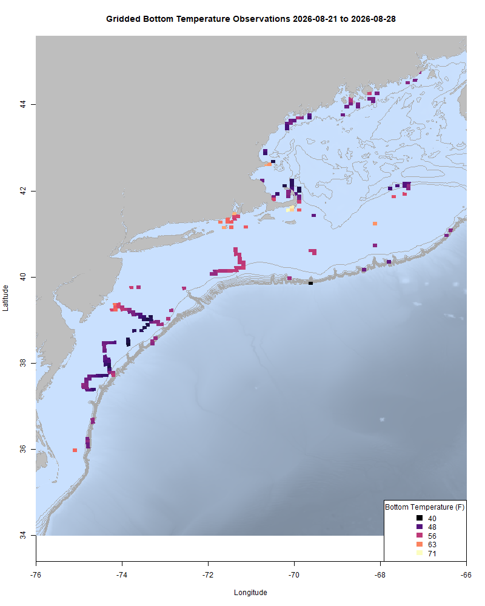
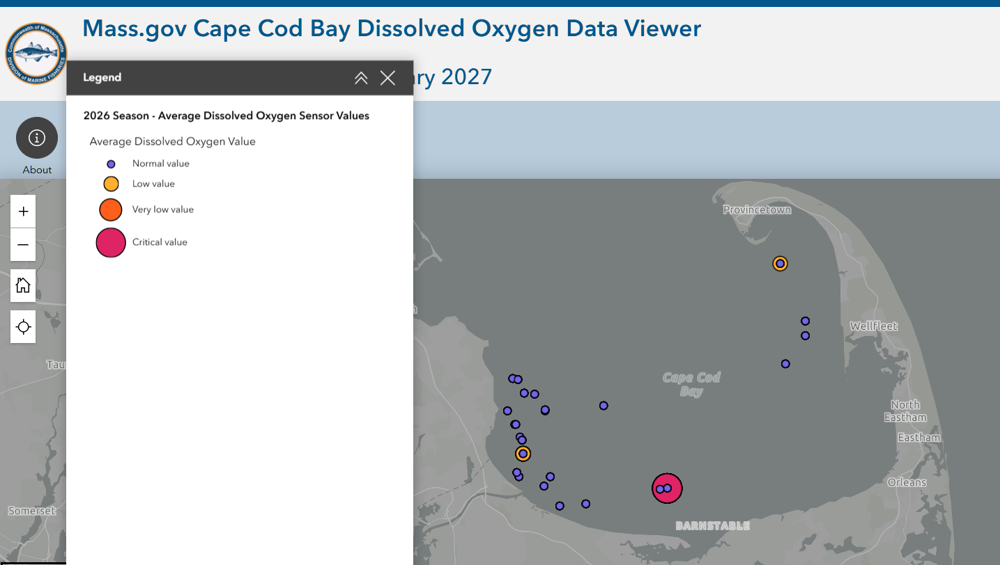
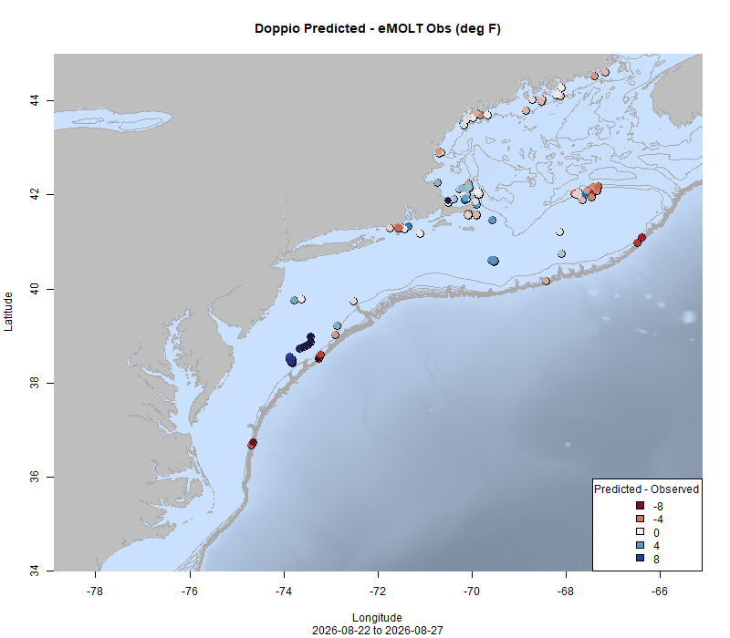
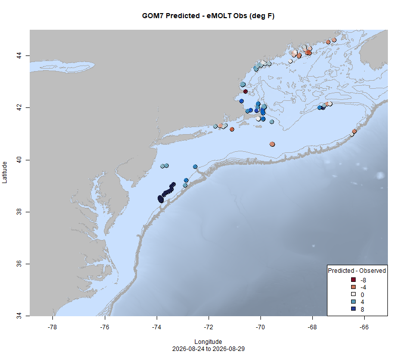

  
```{r setup, include=FALSE}
knitr::opts_chunk$set(echo = TRUE)
options(scipen = 999)
library(marmap)
library(rstudioapi)
if(Sys.info()["sysname"]=="Windows"){
  source("C:/Users/george.maynard/Documents/GitHubRepos/emolt_project_management/WeeklyUpdates/forecast_check/R/emolt_download.R")
} else {
  source("/home/george/Documents/emolt_project_management/WeeklyUpdates/forecast_check/R/emolt_download.R")
}
# if(file.exists(paste0("C:/Users/george.maynard/Documents/emolt_project_management/WeeklyUpdates/",lubridate::year(Sys.time()),"/",lubridate::year(Sys.time()),"-",lubridate::month(Sys.time()),"-",lubridate::day(Sys.time()),"/Doppio_comparison_",format(Sys.time(), "%Y%m%d"),".csv")
# )==FALSE){
#   source("C:/Users/george.maynard/Documents/emolt_project_management/WeeklyUpdates/forecast_check/R/doppio_all_R_compare_and_plot.R")
# }
# if(file.exists(paste0("C:/Users/george.maynard/Documents/emolt_project_management/WeeklyUpdates/",lubridate::year(Sys.time()),"/",lubridate::year(Sys.time()),"-",lubridate::month(Sys.time()),"-",lubridate::day(Sys.time()),"/GOM7_comparison_",format(Sys.time(), "%Y%m%d"),".csv")
# )==FALSE){
#   reticulate::source_python("C:/Users/george.maynard/Documents/emolt_project_management/WeeklyUpdates/Plotting/Windows/GOM7.py")
#   source("C:/Users/george.maynard/Documents/emolt_project_management/WeeklyUpdates/forecast_check/R/plot_comparisons.R")
# }
data=emolt_download(days=7)
start_date=Sys.Date()-lubridate::days(7)
## Use the dates from above to create a URL for grabbing the data
full_data=read.csv(
  paste0(
    "https://erddap.emolt.net/erddap/tabledap/eMOLT_RT.csvp?tow_id%2Csegment_type%2Ctime%2Clatitude%2Clongitude%2Cdepth%2Ctemperature%2Csensor_type&segment_type=3&time%3E=",
    lubridate::year(start_date),
    "-",
    lubridate::month(start_date),
    "-",
    lubridate::day(start_date),
    "T00%3A00%3A00Z&time%3C=",
    lubridate::year(Sys.Date()),
    "-",
    lubridate::month(Sys.Date()),
    "-",
    lubridate::day(Sys.Date()),
    "T23%3A59%3A59Z"
  )
)
sensor_time=0
for(tow in unique(full_data$tow_id)){
  x=subset(full_data,full_data$tow_id==tow)
  sensor_time=sensor_time+difftime(max(x$time..UTC.),units='hours',min(x$time..UTC.))
}
```

<center> 

<font size="5"> *eMOLT Update `r Sys.Date()` * </font>
  
</center>


We're excited to announce that a new website has gone live for the eMOLT Program at our long-time address [www.emolt.org](https://www.emolt.org).
On the new site, you can learn more about the program, its history, and partners, meet the tech support teams that keep everything running, sign up for the waiting list to get an eMOLT system for your vessel, check out scientific publications that use eMOLT data, and test drive a bunch of different ways to interact with the data we collect. We're working to get additional documentation about the program up there, so please pardon the dead links in that section. If there is other stuff you'd like to see, reach out and let us know! A big thanks goes out to everyone who offered suggestions to improve the layout during the development process, particularly Sarah Salois and Linus Stoltz. 

This week, the eMOLT fleet recorded `r length(unique(full_data$tow_id))` tows of sensorized fishing gear totaling `r as.numeric(sensor_time)` sensor hours underwater. Bottom temps remain close to last year's values in the Gulf of Maine. Bottom temps in Southern New England and the Mid-Atlantic and out on Georges Bank are cooler than last year. Thanks to the teams at the Center for Coastal Studies, Coonamessett Farm Foundation, Lowell Instruments, Mass Maritime Academy, Rutgers, and UMaine who were out in the field this week fixing hardware at the docks. Thanks also to the captains of the F/Vs Deborah Lee, Defiance, Grace Sarah, Grand Larson III, Kailey Erica, and Mattie and Ayva for your communication and patience as we get stuff working.

```{r FISHBOT_Plot, echo=FALSE, fig.width=8, fig.height=10,warning=FALSE,message=FALSE,error=FALSE}
source("C:/Users/george.maynard/Documents/emolt_project_management/WeeklyUpdates/Plotting/FISHBOT_Weekly.R")
```



> *FISHBOT bottom temperature records from the past week. The data are available on the [Commercial Fisheries Research Foundation ERDDAP](https://erddap.ondeckdata.com/erddap/tabledap/fishbot_realtime.html) and an interactive visualization is available at the [Cape Cod Ocean Watch](https://ccocean.whoi.edu/index.html) dashboard hosted by Woods Hole Oceanographic Institution. FISHBOT aggregates data provided by participants in eMOLT, the CFRF Lobster and Jonah Crab Research Fleet, the CFRF Shelf Research Fleet, the Cape Cod Commercial Fishermen's Alliance Cape Cod Oceanographic Research Fleet, the Maine Coast Fishermen's Association Fisheries Ocean Data Program, MassDMF Cape Cod Bay Study Fleet, the Northeast Fisheries Science Center Study Fleet, and the Northeast Fisheries Science Center Ecosystem Monitoring Surveys*

### Dissolved Oxygen

Dissolved oxygen levels remain high at sites our partners monitor in coastal Maine. Cape Cod Bay had multiple readings in the  (screenshot from [Massachusetts DMF's Cape Cod Bay dashboard](https://experience.arcgis.com/experience/0af88a18b7364b228004bb6d7dc71b5a) below) with low oxygen readings mixed in with normal readings off Scussett Beach and south of Wood End. There was one critically low reading off Barnstable Harbor, but it was mixed in with normal readings, suggesting either a localized hypoxic event or some sort of temporary sensor fouling issue. DMF continues to monitor the situation closely. 



On Tuesday, Massachusetts DMF issued the following notice regarding an algal bloom in Cape Cod Bay:

> #### Fixed-gear fishers encouraged to monitor dissolved oxygen in Cape Cod Bay following algal bloom

>*During the week of August 16 – 22, Massachusetts Water Resources Authority's (MWRA) water quality monitoring survey in Cape Cod Bay, conducted by Center for Coastal Studies, detected substantial amounts of Karenia mikimotoi in portions of Cape Cod Bay. This is the species of dinoflagellate (a type of phytoplankton, or microscopic algae) that was associated with hypoxic conditions observed in 2019 and 2020 in the southern portion of Cape Cod Bay. Unlike many of the phytoplankton species more commonly found in Cape Cod Bay, K. mikimotoi is adapted to low light conditions and can vertically migrate, allowing it to use the nutrient-rich bottom waters present during late summer. 
Because of this bloom, we expect that dissolved oxygen (DO) conditions will start to decline. The Division of Marine Fisheries (DMF) will be closely monitoring the DO data for Cape Cod Bay provided by the Cape Cod Bay Study Fleet and eMolt participants to watch for declining DO. Severely hypoxic conditions (DO less than ~2 mg/L) can cause lethargy and death to bottom-dwelling organisms that are sensitive to it, particularly lobsters, crabs, and fish that may be retained in traps and unable to move away from the hypoxic conditions.  
We encourage all fixed-gear fishers in Cape Cod Bay to [monitor the publicly accessible data from the Study Fleet online](https://experience.arcgis.com/experience/0af88a18b7364b228004bb6d7dc71b5a). Just click on “map in full screen” to see the most recent conditions displayed. This tool was developed to provide fishers with a means of viewing changing DO conditions to increase awareness of where low DO conditions are occurring and enabling fishers to make informed decisions about where to place their gear to hopefully avoid dead loss in their catch.  
If DO conditions deteriorate, DMF will issue a follow-up to this advisory. For more information contact marine.fish@mass.gov.*

**To receive updates about this evolving situation from Mass DMF please [sign up here](https://www.mass.gov/how-to/subscribe-to-dmfs-advisory-updates)**

### Bottom Temperature Forecast Performance

Neither forecast model performed particularly well for bottom temperatures this week outside of Southern Maine. Observations Downeast were warmer than forecasted by either model. On the northern edge of Georges, temps were warmer than predicted by Doppio and cooler than predicted by NECOFS. Observations around Cape Cod and in the Mid-Atlantic were mostly cooler than predicted by both models. Observations around Block Island were warmer than forecasted by either model.  

{width=45%} {width=45%}
> *Comparisons between bottom temperatures predicted by two ocean forecasting models and observations from the eMOLT fleet. Blue dots show where the observations were cooler than the forecast and red dots show where the observations were warmer than the forecast. White dots show areas where the observations and forecasts agreed. On the left is the comparison with the Doppio model and on the right is the comparison with the NECOFS model (GOM7).*

### American Fisheries Society to Host Panel on Integrating Cooperative Research Into Stock Assessments

Next week is the annual meeting of the [American Fisheries Society](www.fisheries.org), a professional association for fisheries scientists. On Tuesday morning from 0800-0945, AFS's [Cooperative Research with Stakeholders Section](https://crss.fisheries.org/) has convened a panel of experts to discuss best practices for integrating cooperative research into stock assessments. To join virtually please use the link below the session description.

**Cooperative Fisheries Research Pathways and  Challenges: 8:00 AM – 9:45 AM**
Cooperative research can fill critical data gaps at management-relevant scales, yet integrating stakeholder collected observations into formal stock assessments remains challenging. Listen to a panel of experts in cooperative research and stock assessment discuss barriers, validation approaches, and pathways for incorporating stakeholder collected data into assessment frameworks and decision making processes.

Panelists:

- Dave Bethoney (Commercial Fisheries Research Foundation)
- Julia Byrd (Atlantic States Marine Fisheries Commission)
- Susanna Musick (Virginia Institute of Marine Science)
- Ming Sun (Virginia Institute of Marine Science)

Google Meet joining info
Video call link: https://meet.google.com/hdm-fuxm-ctt
Or dial: ‪(CA) +1 604-774-5345‬ PIN: ‪232 659 641‬#

### Other happenings

- [Fishermen speak to the importance of ocean observing](https://capecodfishermen.org/n-e-fisheries-get-15-million-engine/) in a new article published in the Cape Cod Commercial Fishermen's Alliance e-magazine. 

- [NERACOOS announces leadership change](https://mailchi.mp/neracoos/neracoos-data-use-10656393?e=d78516aed4). Congratulations and best wishes to both Jackie Motyka as she takes the helm of NERACOOS, and Jake Kritzer who has taken a position as the CEO of the Seafood Engine in New England.

- Want an eMOLT system for your boat or know somebody else who does? Check out our [online eMOLT System Request form](https://emolt.org/signup.html) to get on the wait list. Being able to break this list down by gear type and geographic area is helpful when we apply for funding to expand the program. 

### Disclaimer
  
The eMOLT Update is NOT an official NOAA document. Mention of products or manufacturers does not constitute an endorsement by NOAA or Department of Commerce. The content of this update reflects only the personal views of the authors and does not necessarily represent the views of NOAA Fisheries, the Department of Commerce, or the United States.


All the best,

-George
