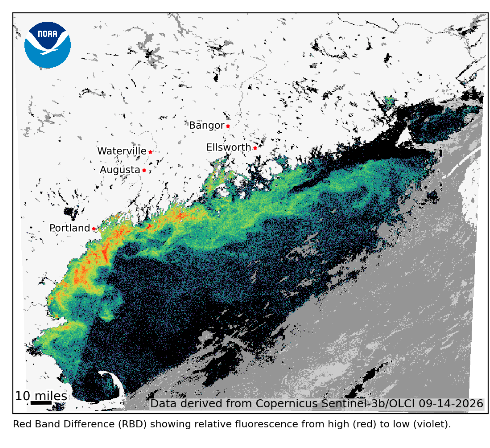
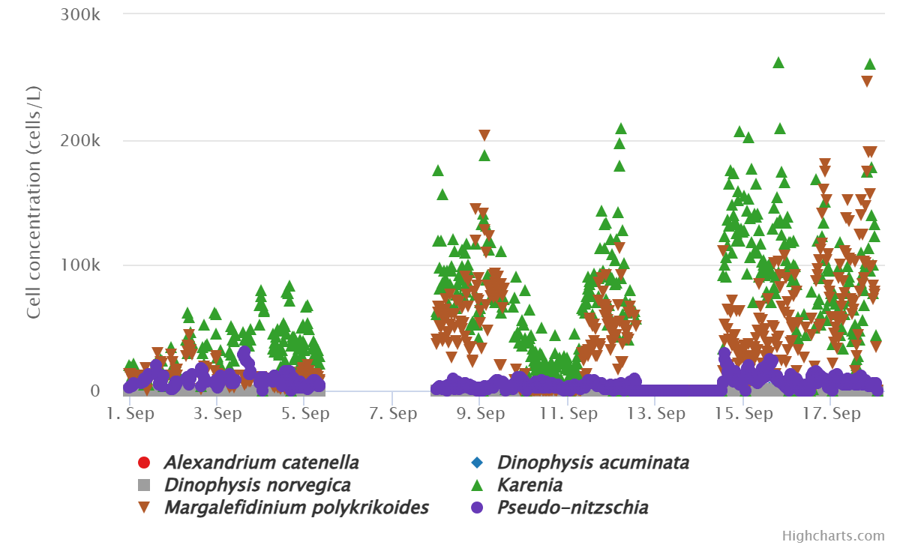
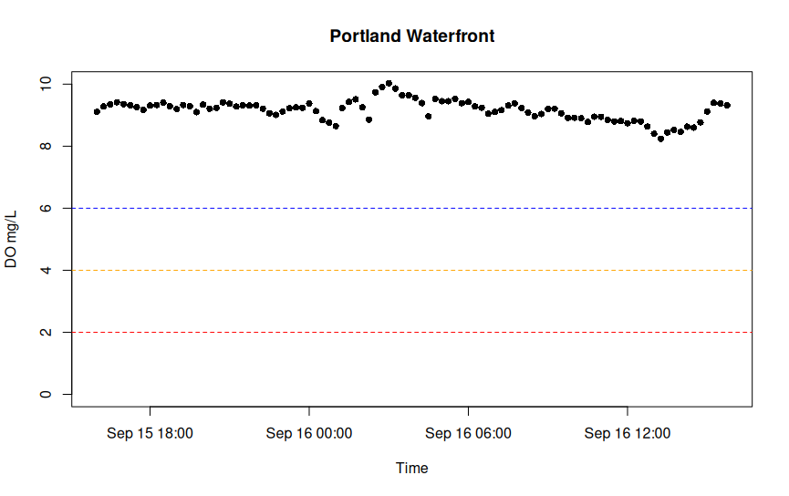
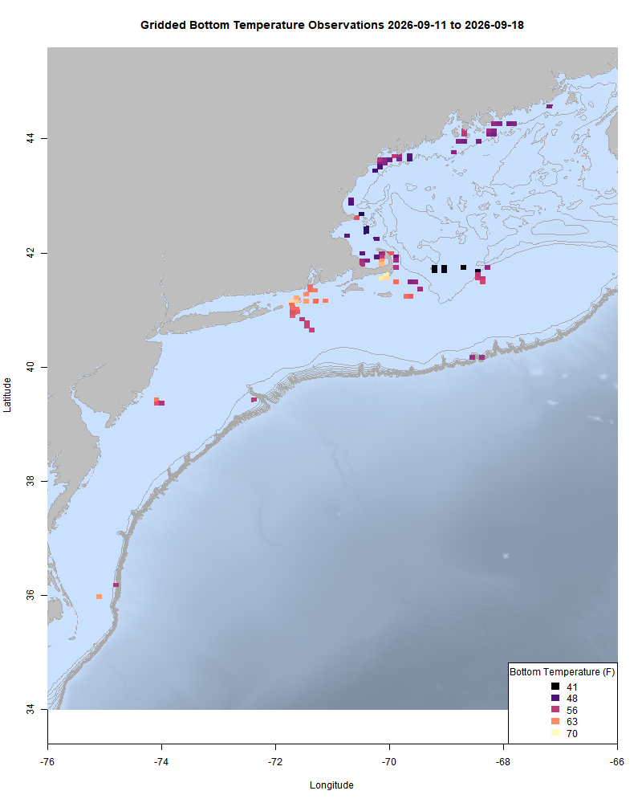
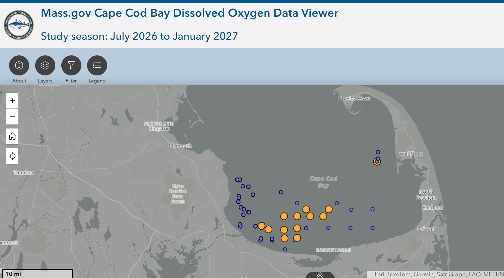
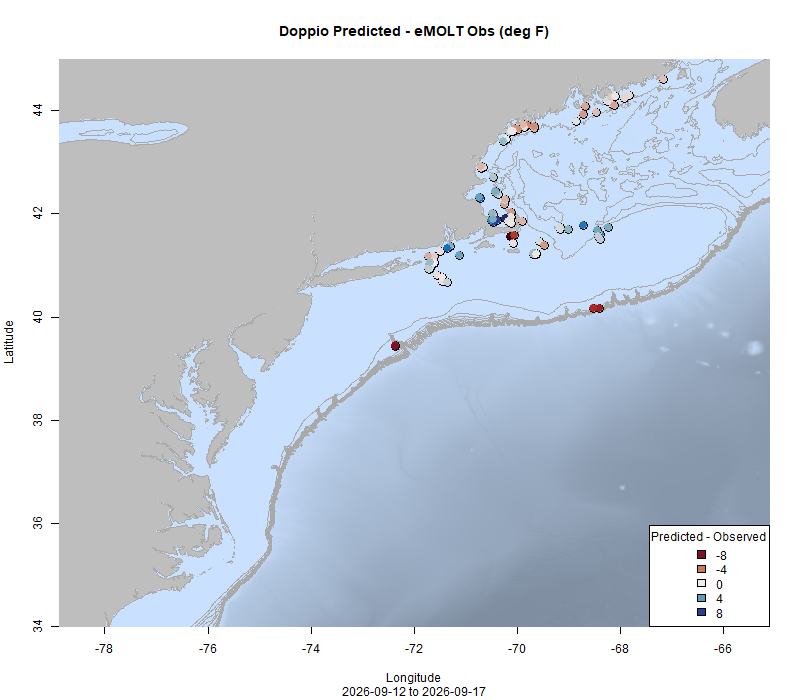
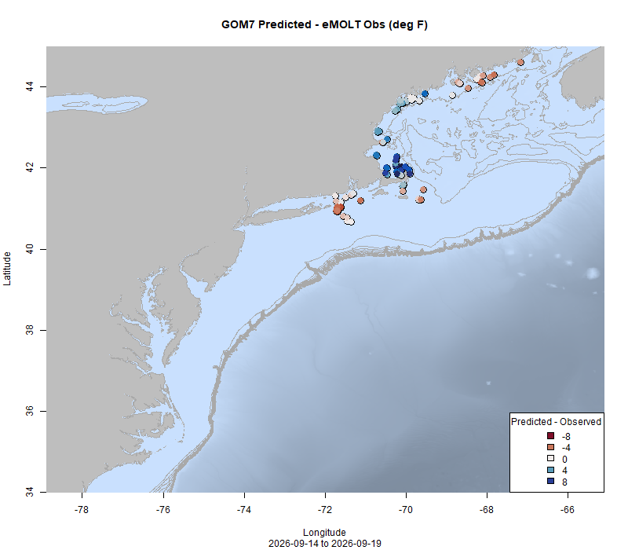

  
```{r setup, include=FALSE}
knitr::opts_chunk$set(echo = TRUE)
options(scipen = 999)
library(marmap)
library(rstudioapi)
if(Sys.info()["sysname"]=="Windows"){
  source("C:/Users/george.maynard/Documents/GitHubRepos/emolt_project_management/WeeklyUpdates/forecast_check/R/emolt_download.R")
} else {
  source("/home/george/Documents/emolt_project_management/WeeklyUpdates/forecast_check/R/emolt_download.R")
}
# if(file.exists(paste0("C:/Users/george.maynard/Documents/emolt_project_management/WeeklyUpdates/",lubridate::year(Sys.time()),"/",lubridate::year(Sys.time()),"-",lubridate::month(Sys.time()),"-",lubridate::day(Sys.time()),"/Doppio_comparison_",format(Sys.time(), "%Y%m%d"),".csv")
# )==FALSE){
#   source("C:/Users/george.maynard/Documents/emolt_project_management/WeeklyUpdates/forecast_check/R/doppio_all_R_compare_and_plot.R")
# }
# if(file.exists(paste0("C:/Users/george.maynard/Documents/emolt_project_management/WeeklyUpdates/",lubridate::year(Sys.time()),"/",lubridate::year(Sys.time()),"-",lubridate::month(Sys.time()),"-",lubridate::day(Sys.time()),"/GOM7_comparison_",format(Sys.time(), "%Y%m%d"),".csv")
# )==FALSE){
#   reticulate::source_python("C:/Users/george.maynard/Documents/emolt_project_management/WeeklyUpdates/Plotting/Windows/GOM7.py")
#   source("C:/Users/george.maynard/Documents/emolt_project_management/WeeklyUpdates/forecast_check/R/plot_comparisons.R")
# }
data=emolt_download(days=7)
start_date=Sys.Date()-lubridate::days(7)
## Use the dates from above to create a URL for grabbing the data
full_data=read.csv(
  paste0(
    "https://erddap.emolt.net/erddap/tabledap/eMOLT_RT.csvp?tow_id%2Csegment_type%2Ctime%2Clatitude%2Clongitude%2Cdepth%2Ctemperature%2Csensor_type&segment_type=3&time%3E=",
    lubridate::year(start_date),
    "-",
    lubridate::month(start_date),
    "-",
    lubridate::day(start_date),
    "T00%3A00%3A00Z&time%3C=",
    lubridate::year(Sys.Date()),
    "-",
    lubridate::month(Sys.Date()),
    "-",
    lubridate::day(Sys.Date()),
    "T23%3A59%3A59Z"
  )
)
sensor_time=0
for(tow in unique(full_data$tow_id)){
  x=subset(full_data,full_data$tow_id==tow)
  sensor_time=sensor_time+difftime(max(x$time..UTC.),units='hours',min(x$time..UTC.))
}
```

<center> 

<font size="5"> *eMOLT Update `r Sys.Date()` * </font>
  
</center>

Yesterday, Huanxin and I were aboard the F/V Direction over in Fairhaven to set up a new eMOLT system there. Big thanks to Captain John and his crew for accommodating us and lending a hand with running some wires. Thanks also to Jack from ODN who has been busy up north helping get more oxygen sensors out to our industry partners up there to help monitor the ongoing plankton bloom, which now stretches from Penobscot Bay down to Plymouth, MA -- see the image below from NOAA's Center for Coastal Ocean Science. 


According to NCCOS, this bloom exhibits characteristics of a dinoflagellate bloom. The [Northeast HabHub network](https://northeasthab.whoi.edu/) is showing elevated levels of two potentially harmful dinoflagellates, [*Karenia sp.*](https://northeasthab.whoi.edu/habs/karenia-mikimotoi/) which shown as green triangles in the graph below and [*Margalefidinium polykrikoides*](https://northeasthab.whoi.edu/habs/by-species/margalefidinium-polykrikoides/) which is shown as upside down brown triangles in the graph below.



While our systems are not capable of collecting data on plankton bloom composition, the eMOLT Program can assist with tracking dissolved oxygen levels, which can crash following die offs of plankton blooms. Big thanks this week to Captain Curt on the F/V Lil' More Tail for deploying a sensor off the wharf where he ties up on the Portland Waterfront, where the water is thick with plankton. As of Wednesday, oxygen levels (black dots) are still normal there. The dashed lines in the graph below represent the cut-off levels used by Massachusetts DMF in their oxygen monitoring program for Cape Cod Bay (> 6 mg/L = normal, betweeen 4-6 mg/L = Low, between 2-4 mg/L = Very Low, and < 2 mg/L = Critical). 


This week, the eMOLT fleet recorded `r length(unique(full_data$tow_id))` tows of sensorized fishing gear totaling `r as.numeric(sensor_time)` sensor hours underwater. Bottom temps are in line with last year's averages most place except the Western Gulf of Maine, where temps are averaging ~3 degrees Fahrenheit warmer than they were at this time last year. 

```{r FISHBOT_Plot, echo=FALSE, fig.width=8, fig.height=10,warning=FALSE,message=FALSE,error=FALSE}
source("C:/Users/george.maynard/Documents/emolt_project_management/WeeklyUpdates/Plotting/FISHBOT_Weekly.R")
```



> *FISHBOT bottom temperature records from the past week. The data are available on the [Commercial Fisheries Research Foundation ERDDAP](https://erddap.ondeckdata.com/erddap/tabledap/fishbot_realtime.html) and an interactive visualization is available at the [Cape Cod Ocean Watch](https://ccocean.whoi.edu/index.html) dashboard hosted by Woods Hole Oceanographic Institution. FISHBOT aggregates data provided by participants in eMOLT, the CFRF Lobster and Jonah Crab Research Fleet, the CFRF Shelf Research Fleet, the Cape Cod Commercial Fishermen's Alliance Cape Cod Oceanographic Research Fleet, the Maine Coast Fishermen's Association Fisheries Ocean Data Program, MassDMF Cape Cod Bay Study Fleet, the Northeast Fisheries Science Center Study Fleet, and the Northeast Fisheries Science Center Ecosystem Monitoring Surveys*

### Dissolved Oxygen

Oxygen levels remain high off Stonington, ME and east of Nantucket Sound. Levels are lower, but still in the acceptable range in Casco Bay. 

Dissolved oxygen levels in western Cape Cod Bay are good for the most part. The team at  was busy this week, deploying a Warden autonomous vehicle to monitor DO in a grid north of Barnstable. In this week's screenshot from [Massachusetts DMF's Cape Cod Bay dashboard](https://experience.arcgis.com/experience/0af88a18b7364b228004bb6d7dc71b5a), you can see low oxygen values north and west of Barnstable Harbor. There was also one early morning low reading off Wellfleet a few days ago, however, a return trip to that site found values on the low end of normal.



### Bottom Temperature Forecast Performance

Doppio performed reasonably well this week, with observations slightly warmer than forecasted temps along the Maine Coast and the Outer Cape, and cooler than forecasted in the Great South Channel and Cape Cod Bay. Values SE of Long Island were pretty much spot on, and as always there were outliers along the shelf break. Temps were warmer than the NECOFS forecast east of Penobscot Bay and south of Cape Cod. Observations along Southern Maine, NH, and Massachusetts Bay were all colder than the NECOFS forecast expected.  

{width=45%} {width=45%}
> *Comparisons between bottom temperatures predicted by two ocean forecasting models and observations from the eMOLT fleet. Blue dots show where the observations were cooler than the forecast and red dots show where the observations were warmer than the forecast. White dots show areas where the observations and forecasts agreed. On the left is the comparison with the Doppio model and on the right is the comparison with the NECOFS model (GOM7).*

### 2026 Fall Bottom Trawl Survey Stations


The 2026 Fall Bottom Trawl Survey is getting underway. To avoid conflicts with fixed gear fishermen, the Trawl Survey team is making this station map available. To download a TimeZero compatible .gpx file of the points from www.emolt.org, please click [this link](https://www.emolt.org/BTS_2026_fall.gpx). You can follow the NOAAS Henry Bigelow's location [here](https://www.marinetraffic.com/en/ais/home/centerx:-73.5/centery:39.1/zoom:8).

For questions about survey operations, please contact [Bridget St. Amand](https://www.fisheries.noaa.gov/contact/bridget-st-amand).

>Want an eMOLT system for your boat or know somebody else who does? Check out our [online eMOLT System Request form](https://emolt.org/signup.html) to get on the wait list. Being able to break this list down by gear type and geographic area is helpful when we apply for funding to expand the program. 

### Disclaimer
  
The eMOLT Update is NOT an official NOAA document. Mention of products or manufacturers does not constitute an endorsement by NOAA or Department of Commerce. The content of this update reflects only the personal views of the authors and does not necessarily represent the views of NOAA Fisheries, the Department of Commerce, or the United States.


All the best,

-George
