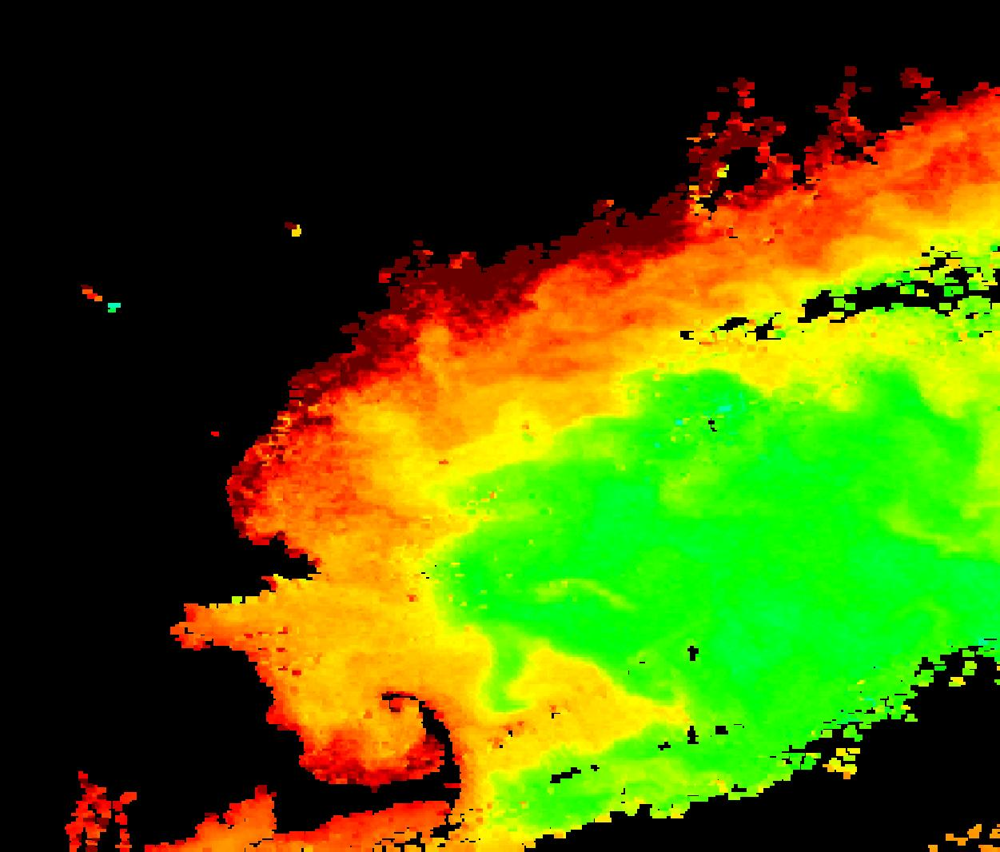
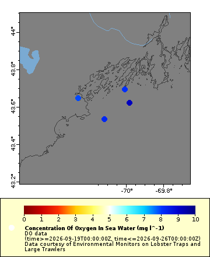
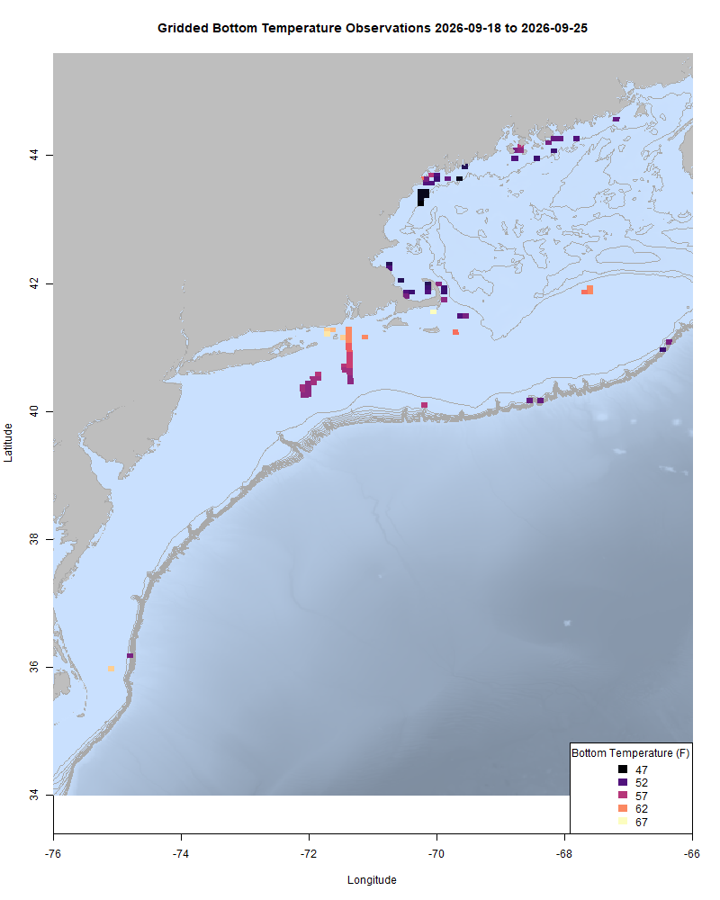
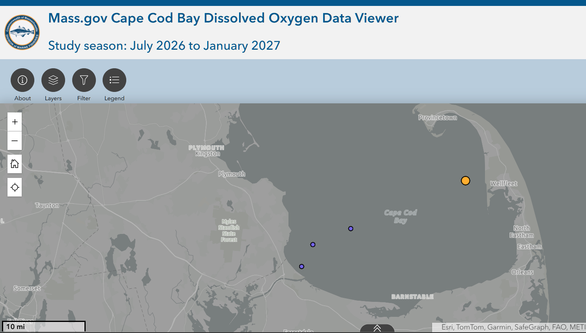
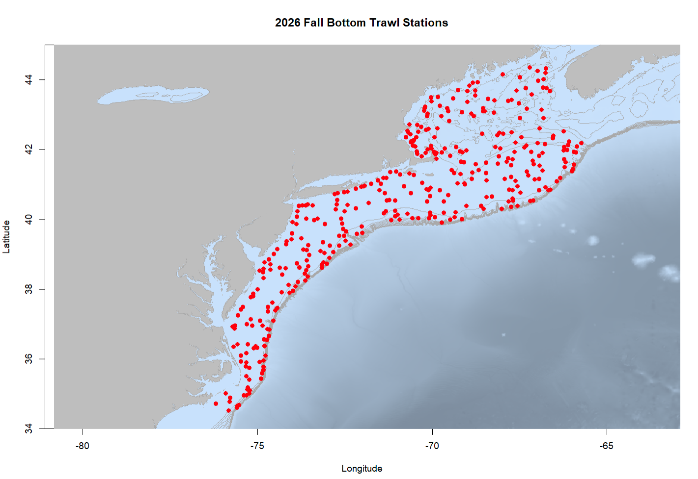

  
```{r setup, include=FALSE}
knitr::opts_chunk$set(echo = TRUE)
options(scipen = 999)
library(marmap)
library(rstudioapi)
if(Sys.info()["sysname"]=="Windows"){
  source("C:/Users/george.maynard/Documents/GitHubRepos/emolt_project_management/WeeklyUpdates/forecast_check/R/emolt_download.R")
} else {
  source("/home/george/Documents/emolt_project_management/WeeklyUpdates/forecast_check/R/emolt_download.R")
}
# if(file.exists(paste0("C:/Users/george.maynard/Documents/emolt_project_management/WeeklyUpdates/",lubridate::year(Sys.time()),"/",lubridate::year(Sys.time()),"-",lubridate::month(Sys.time()),"-",lubridate::day(Sys.time()),"/Doppio_comparison_",format(Sys.time(), "%Y%m%d"),".csv")
# )==FALSE){
#   source("C:/Users/george.maynard/Documents/emolt_project_management/WeeklyUpdates/forecast_check/R/doppio_all_R_compare_and_plot.R")
# }
# if(file.exists(paste0("C:/Users/george.maynard/Documents/emolt_project_management/WeeklyUpdates/",lubridate::year(Sys.time()),"/",lubridate::year(Sys.time()),"-",lubridate::month(Sys.time()),"-",lubridate::day(Sys.time()),"/GOM7_comparison_",format(Sys.time(), "%Y%m%d"),".csv")
# )==FALSE){
#   reticulate::source_python("C:/Users/george.maynard/Documents/emolt_project_management/WeeklyUpdates/Plotting/Windows/GOM7.py")
#   source("C:/Users/george.maynard/Documents/emolt_project_management/WeeklyUpdates/forecast_check/R/plot_comparisons.R")
# }
data=emolt_download(days=7)
start_date=Sys.Date()-lubridate::days(7)
## Use the dates from above to create a URL for grabbing the data
full_data=read.csv(
  paste0(
    "https://erddap.emolt.net/erddap/tabledap/eMOLT_RT.csvp?tow_id%2Csegment_type%2Ctime%2Clatitude%2Clongitude%2Cdepth%2Ctemperature%2Csensor_type&segment_type=3&time%3E=",
    lubridate::year(start_date),
    "-",
    lubridate::month(start_date),
    "-",
    lubridate::day(start_date),
    "T00%3A00%3A00Z&time%3C=",
    lubridate::year(Sys.Date()),
    "-",
    lubridate::month(Sys.Date()),
    "-",
    lubridate::day(Sys.Date()),
    "T23%3A59%3A59Z"
  )
)
sensor_time=0
for(tow in unique(full_data$tow_id)){
  x=subset(full_data,full_data$tow_id==tow)
  sensor_time=sensor_time+difftime(max(x$time..UTC.),units='hours',min(x$time..UTC.))
}
```

<center> 

<font size="5"> *eMOLT Update `r Sys.Date()` * </font>
  
</center>


*Chlorophyll a concentrations documented by the PACE satellite from 9/23/2026. The red areas represent concentrations of over 20 mg per cubic meter*

The noreaster coming this weekend will likely cause quite a bit of mixing along the coastline from Massachusetts up to Maine. Currently, there's still a lot of algae in the water, but oxygen levels remain high at the stations eMOLT participants are monitoring around Casco Bay. 



Thanks to Capt. John on the F/V Direction for flagging a dead link in last week's email. The TimeZero compatible file of Bottom Trawl Stations should be [back up on emolt.org](https://www.emolt.org/files/BTS_2026_fall.gpx) now that we've dealt with an errant backslash. 

This week, the eMOLT fleet recorded `r length(unique(full_data$tow_id))` tows of sensorized fishing gear totaling `r as.numeric(sensor_time)` sensor hours underwater. Bottom temps are in line with last year's averages most place except for Georges Bank, where temps are averaging ~4 degrees Fahrenheit warmer than they were at this time last year. This corresponds well to observations from a captain I spoke with in New Bedford earlier this week who said he's seen well mixed temps in the mid 60s up on the bank.

```{r FISHBOT_Plot, echo=FALSE, fig.width=8, fig.height=10,warning=FALSE,message=FALSE,error=FALSE}
source("C:/Users/george.maynard/Documents/emolt_project_management/WeeklyUpdates/Plotting/FISHBOT_Weekly.R")
```



> *FISHBOT bottom temperature records from the past week. The data are available on the [Commercial Fisheries Research Foundation ERDDAP](https://erddap.ondeckdata.com/erddap/tabledap/fishbot_realtime.html) and an interactive visualization is available at the [Cape Cod Ocean Watch](https://ccocean.whoi.edu/index.html) dashboard hosted by Woods Hole Oceanographic Institution. FISHBOT aggregates data provided by participants in eMOLT, the CFRF Lobster and Jonah Crab Research Fleet, the CFRF Shelf Research Fleet, the Cape Cod Commercial Fishermen's Alliance Cape Cod Oceanographic Research Fleet, the Maine Coast Fishermen's Association Fisheries Ocean Data Program, MassDMF Cape Cod Bay Study Fleet, the Northeast Fisheries Science Center Study Fleet, and the Northeast Fisheries Science Center Ecosystem Monitoring Surveys*

### Dissolved Oxygen

Oxygen levels remain high off Stonington, ME and east of Nantucket Sound. Levels are lower, but still in the acceptable range in Casco Bay. 

Without the Warden out and about and with fewer fishermen out this week, there's not a lot of data to look at in this week's screenshot from [Massachusetts DMF's Cape Cod Bay dashboard](https://experience.arcgis.com/experience/0af88a18b7364b228004bb6d7dc71b5a). You can see one low oxygen value off of Wellfleet. The other values north of the canal are good. 



### 2026 Fall Bottom Trawl Survey Stations


The 2026 Fall Bottom Trawl Survey is getting underway. To avoid conflicts with fixed gear fishermen, the Trawl Survey team is making this station map available. To download a TimeZero compatible .gpx file of the points from www.emolt.org, please click [this link](https://www.emolt.org/BTS_2026_fall.gpx). You can follow the NOAAS Henry Bigelow's location [here](https://www.marinetraffic.com/en/ais/home/centerx:-73.5/centery:39.1/zoom:8).

For questions about survey operations, please contact [Bridget St. Amand](https://www.fisheries.noaa.gov/contact/bridget-st-amand).

>Want an eMOLT system for your boat or know somebody else who does? Check out our [online eMOLT System Request form](https://emolt.org/signup.html) to get on the wait list. Being able to break this list down by gear type and geographic area is helpful when we apply for funding to expand the program. 

### Disclaimer
  
The eMOLT Update is NOT an official NOAA document. Mention of products or manufacturers does not constitute an endorsement by NOAA or Department of Commerce. The content of this update reflects only the personal views of the authors and does not necessarily represent the views of NOAA Fisheries, the Department of Commerce, or the United States.


All the best,

-George
