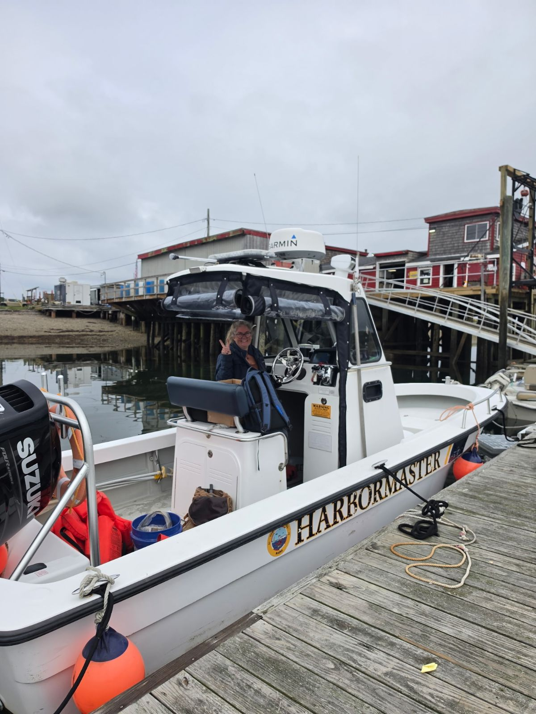
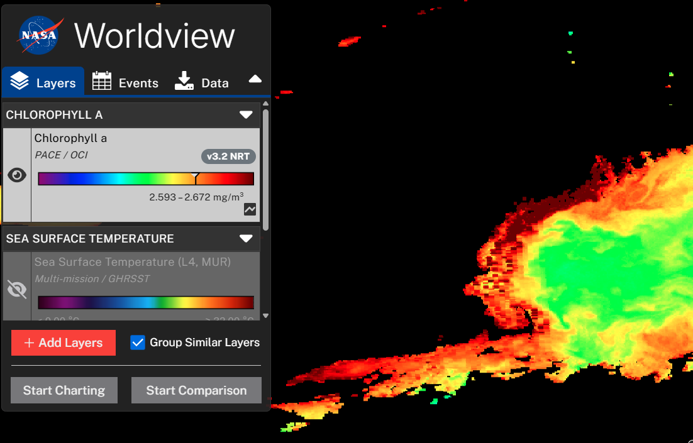
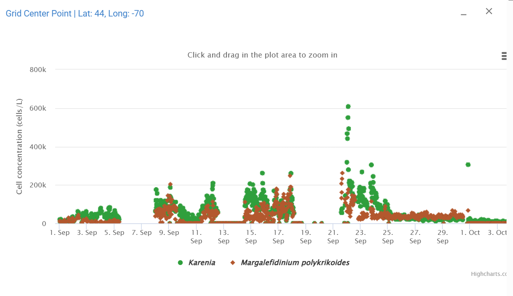
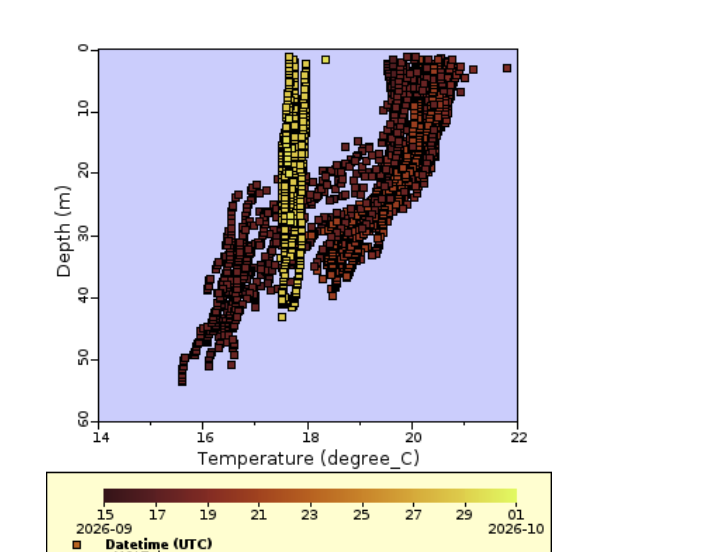
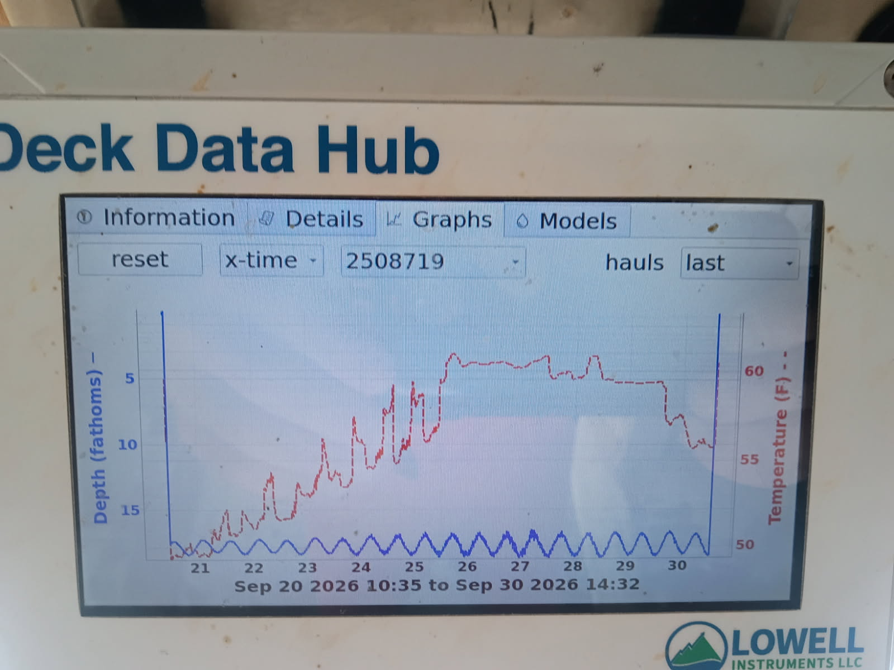
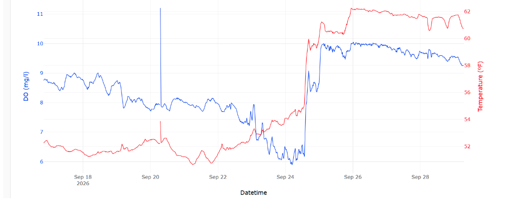
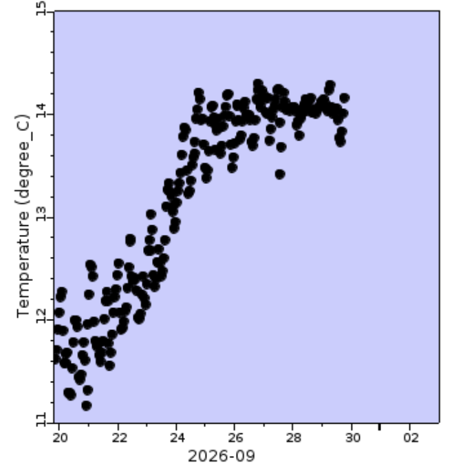
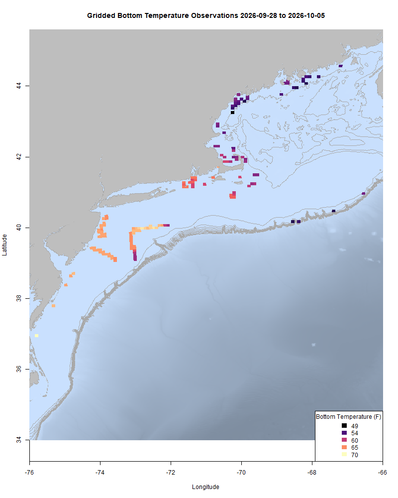
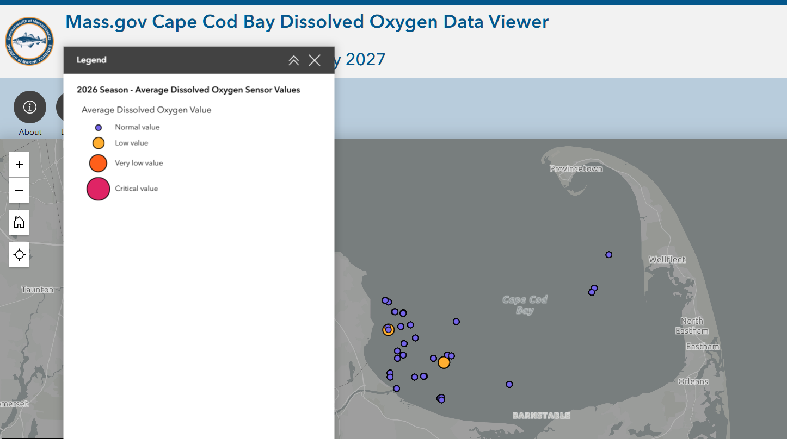

  
```{r setup, include=FALSE}
knitr::opts_chunk$set(echo = TRUE)
options(scipen = 999)
library(marmap)
library(rstudioapi)
if(Sys.info()["sysname"]=="Windows"){
  source("C:/Users/george.maynard/Documents/GitHubRepos/emolt_project_management/WeeklyUpdates/forecast_check/R/emolt_download.R")
} else {
  source("/home/george/Documents/emolt_project_management/WeeklyUpdates/forecast_check/R/emolt_download.R")
}
# if(file.exists(paste0("C:/Users/george.maynard/Documents/emolt_project_management/WeeklyUpdates/",lubridate::year(Sys.time()),"/",lubridate::year(Sys.time()),"-",lubridate::month(Sys.time()),"-",lubridate::day(Sys.time()),"/Doppio_comparison_",format(Sys.time(), "%Y%m%d"),".csv")
# )==FALSE){
#   source("C:/Users/george.maynard/Documents/emolt_project_management/WeeklyUpdates/forecast_check/R/doppio_all_R_compare_and_plot.R")
# }
# if(file.exists(paste0("C:/Users/george.maynard/Documents/emolt_project_management/WeeklyUpdates/",lubridate::year(Sys.time()),"/",lubridate::year(Sys.time()),"-",lubridate::month(Sys.time()),"-",lubridate::day(Sys.time()),"/GOM7_comparison_",format(Sys.time(), "%Y%m%d"),".csv")
# )==FALSE){
#   reticulate::source_python("C:/Users/george.maynard/Documents/emolt_project_management/WeeklyUpdates/Plotting/Windows/GOM7.py")
#   source("C:/Users/george.maynard/Documents/emolt_project_management/WeeklyUpdates/forecast_check/R/plot_comparisons.R")
# }
data=emolt_download(days=7)
start_date=Sys.Date()-lubridate::days(7)
## Use the dates from above to create a URL for grabbing the data
full_data=read.csv(
  paste0(
    "https://erddap.emolt.net/erddap/tabledap/eMOLT_RT.csvp?tow_id%2Csegment_type%2Ctime%2Clatitude%2Clongitude%2Cdepth%2Ctemperature%2Csensor_type&segment_type=3&time%3E=",
    lubridate::year(start_date),
    "-",
    lubridate::month(start_date),
    "-",
    lubridate::day(start_date),
    "T00%3A00%3A00Z&time%3C=",
    lubridate::year(Sys.Date()),
    "-",
    lubridate::month(Sys.Date()),
    "-",
    lubridate::day(Sys.Date()),
    "T23%3A59%3A59Z"
  )
)
sensor_time=0
for(tow in unique(full_data$tow_id)){
  x=subset(full_data,full_data$tow_id==tow)
  sensor_time=sensor_time+difftime(max(x$time..UTC.),units='hours',min(x$time..UTC.))
}
```

<center> 

<font size="5"> *eMOLT Update `r Sys.Date()` * </font>
  
</center>

Sorry for the delay getting this out; there's just been a lot to write about recently, and it doesn't seem to be slowing down!

Last week, Huanxin took a trip up to Harpswell to help Harbormaster Darcie Couture set up a loaner eMOLT system aboard her skiff. Although this isn't a commercial fishing vessel per se, we thought we'd make an exception since Darcie plans to use the data to help in tracking the plankton bloom's impacts on dissolved oxygen around the commercially important flats where fishermen dig clams and worms. We're looking forward to seeing data start flowing from this platform sometime soon. It should be a nice complement to the BlueSonde buoys deployed to monitor chlorophyll and surface oxygen in the area.



As a brief aside on complementary ocean measurements, it was welcome news this week to hear that the National Science Foundation is replacing many of the ocean observing assets from the Ocean Observatories Initiative that it had previously decommissioned. As mentioned in an article in the Vinyard Times earlier this summer, systems like the eMOLT Program are meant to provide additional spatial coverage beyond what platforms like buoys, gliders, and research vessels can do. All of these systems play different roles in collecting data to help us better understand the ocean. For more, see coverage from [WBUR](https://www.wbur.org/news/2026/09/28/national-science-foundation-ocean-observatories-initiative-trump-funding) and the [New York Times](https://www.linkedin.com/safety/go/?url=https%3A%2F%2Fwww.nytimes.com%2F2026%2F10%2F03%2Fclimate%2Fafter-outcry-monitors-the-trump-administration-tried-to-scrap-return-to-sea.html%3Funlocked_article_code%3D1&urlhash=ti3-&mt=MNa26g86rahv_aAwVYg9yFzQKrI4Bb04l61DIXsVDDnIIzNV1xcuGKqsXnxgSS020rhwxLKZKCLr_6ELuwcxfFE7mySwncaSuWnzzXr3JMXQklDbOIp46i1CbA&isSdui=true&lipi=urn%3Ali%3Apage%3Ad_flagship3_profile_view_base%3B1hI0cIOsQ6CNEFCrxR7QLQ%3D%3D).

Coming back to Harpswell, the plankton bloom appears to still be in full swing after the big storm, see the PACE satellite shot below from October 3.


*Chlorophyll a concentrations documented by the PACE satellite from 10/3/2026. The red areas represent concentrations of over 20 mg per cubic meter*

It seems as though there may have been a bit of a shift in the composition of the bloom since concentrations of both toxin producing plankton *Karenia* and *Margalefidinium polykrikoides* are down from highs a few weeks ago according to [WHOI's HABhub](https://habhub.whoi.edu/).



There have been a number of other changes around the region after the big storm though, most noticeably a breakdown of the thermocline almost everywhere. One of the most dramatic examples of this comes from the area around Block Island. Each line of points represents a sensor falling through the water or being hauled back. Brown points took place before the storm, and a thermocline is clearly visible, with surface waters being 4 to 6 degrees C warmer than bottom waters. Yellow points were measured after the storm, when the water column was thoroughly mixed from top to bottom. 



Changes weren't just up in the water column though. Temps came up several degrees off Cohasset according to this plot from Captain Joe on the F/V Ryan Joseph.



In Cape Cod Bay, oxygen loggers showed  an increase in both oxygen (blue line) and temperature (red line) following mixing from the storm.



Even in deeper water along the shelf break on the southern edge of Georges Bank, there was a bit of a bump in bottom temps after the storm.



This week, the eMOLT fleet recorded `r length(unique(full_data$tow_id))` tows of sensorized fishing gear totaling `r as.numeric(sensor_time)` sensor hours underwater. After the storm, bottom temps are mostly warmer than they were this time last year, except in the eastern Gulf of Maine.

```{r FISHBOT_Plot, echo=FALSE, fig.width=8, fig.height=10,warning=FALSE,message=FALSE,error=FALSE}
source("C:/Users/george.maynard/Documents/emolt_project_management/WeeklyUpdates/Plotting/FISHBOT_Weekly.R")
```



> *FISHBOT bottom temperature records from the past week. The data are available on the [Commercial Fisheries Research Foundation ERDDAP](https://erddap.ondeckdata.com/erddap/tabledap/fishbot_realtime.html) and an interactive visualization is available at the [Cape Cod Ocean Watch](https://ccocean.whoi.edu/index.html) dashboard hosted by Woods Hole Oceanographic Institution. FISHBOT aggregates data provided by participants in eMOLT, the CFRF Lobster and Jonah Crab Research Fleet, the CFRF Shelf Research Fleet, the Cape Cod Commercial Fishermen's Alliance Cape Cod Oceanographic Research Fleet, the Maine Coast Fishermen's Association Fisheries Ocean Data Program, MassDMF Cape Cod Bay Study Fleet, the Northeast Fisheries Science Center Study Fleet, and the Northeast Fisheries Science Center Ecosystem Monitoring Surveys*

### Dissolved Oxygen

Oxygen levels remain high off Stonington, ME and east of Nantucket Sound. Levels are holding steady in the acceptable range around Casco Bay.

The Sedna Robotics team is taking a little break from assisting with monitoring in Cape Cod Bay to bring the Warden on an international journey, but  there's plenty of fisherman collected data to look at in this week's screenshot from [Massachusetts DMF's Cape Cod Bay dashboard](https://experience.arcgis.com/experience/0af88a18b7364b228004bb6d7dc71b5a). You can see a few marginal DO measurements off Ellisville and Sagamore, but most measurements look good.  



### 2027 Cooperative Research Summit Registration Open

The [2027 Cooperative Research Summit](https://www.fisheries.noaa.gov/event/2027-northeast-cooperative-research-summit) will be held in Salem, Massachusetts on March 16,2027. [Registration](https://docs.google.com/forms/d/e/1FAIpQLScssRP9qgjR8ZUrpHYHSRLj23QffAcRzEDlILVBeCIm4vq9Ow/viewform) is open here until December 4, 2026. The Summit provides a unique opportunity to interact with members of the fishing community, share and learn about ongoing cooperative research, and develop partnerships to address the many research needs and challenges in our region. Agenda items include presentations from researchers and members of the fishing community, breakout sessions, a research prioritization exercise, and networking. 

To maximize information sharing at the Summit, we are soliciting presentations about ongoing or recently completed cooperative research projects. Abstract submission forms will be sent out after registration, and will be due by December 4, 2026. Graduate students and other early career scientists who are engaged in cooperative research are encouraged to contribute presentations. If you have never been involved in cooperative research, but are interested in learning more and becoming more involved, please consider attending.

Please help us spread the word about the Summit by sharing this invitation with your colleagues and networks. This Summit will be most productive with the participation of all parties that engage in cooperative research.

### 2026 Fall Bottom Trawl Survey Stations


The 2026 Fall Bottom Trawl Survey is getting underway. To avoid conflicts with fixed gear fishermen, the Trawl Survey team is making this station map available. To download a TimeZero compatible .gpx file of the points from www.emolt.org, please click [this link](https://www.emolt.org/BTS_2026_fall.gpx). You can follow the NOAAS Henry Bigelow's location [here](https://www.marinetraffic.com/en/ais/home/centerx:-73.5/centery:39.1/zoom:8).

For questions about survey operations, please contact [Bridget St. Amand](https://www.fisheries.noaa.gov/contact/bridget-st-amand).

>Want an eMOLT system for your boat or know somebody else who does? Check out our [online eMOLT System Request form](https://emolt.org/signup.html) to get on the wait list. Being able to break this list down by gear type and geographic area is helpful when we apply for funding to expand the program. 

### Disclaimer
  
The eMOLT Update is NOT an official NOAA document. Mention of products or manufacturers does not constitute an endorsement by NOAA or Department of Commerce. The content of this update reflects only the personal views of the authors and does not necessarily represent the views of NOAA Fisheries, the Department of Commerce, or the United States.


All the best,

-George
