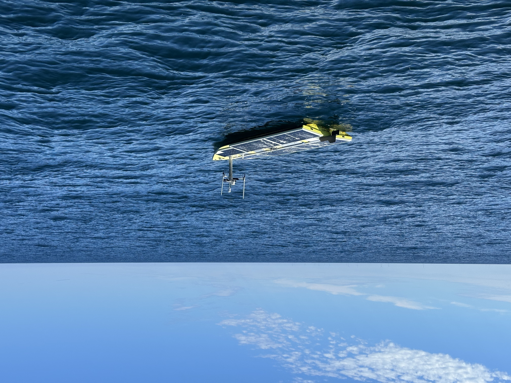
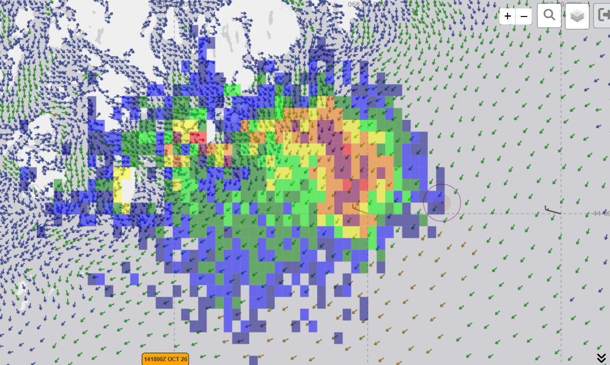
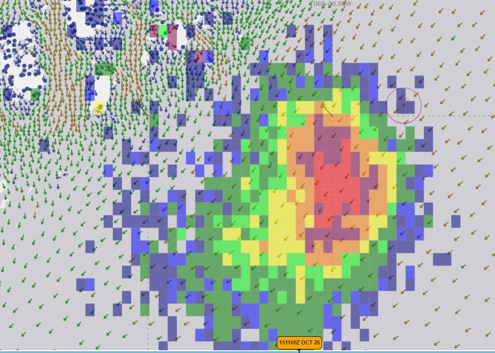
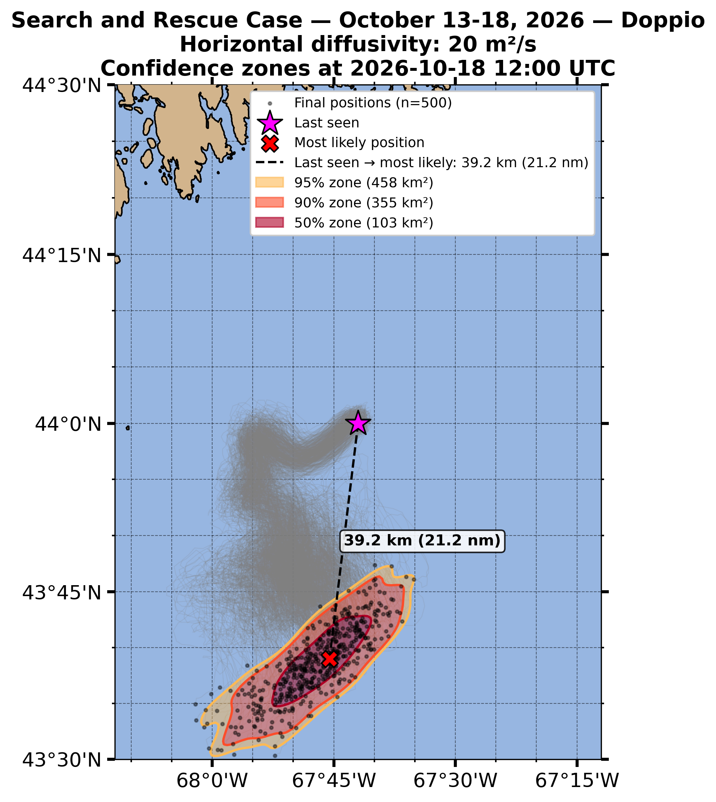
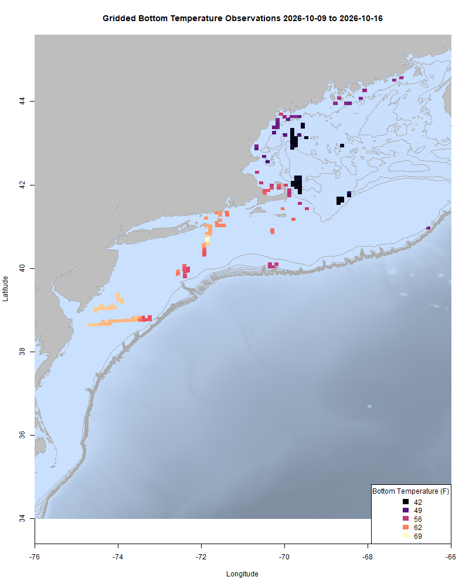
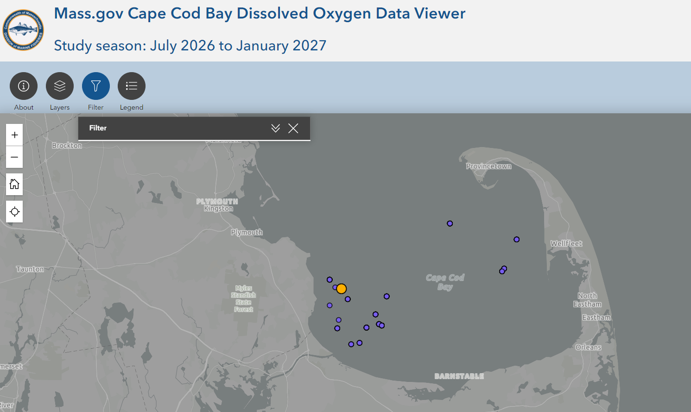
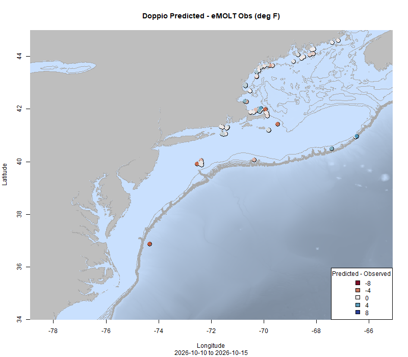
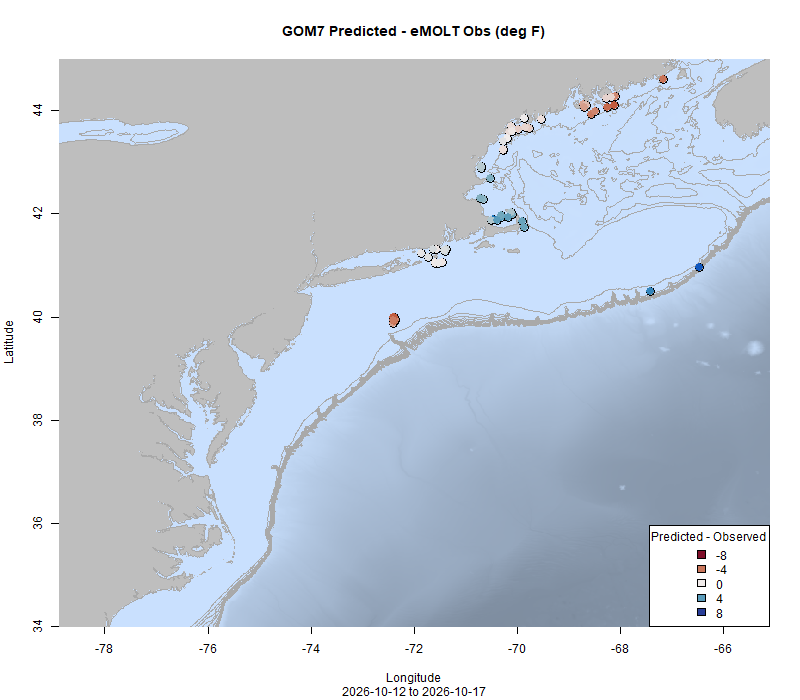
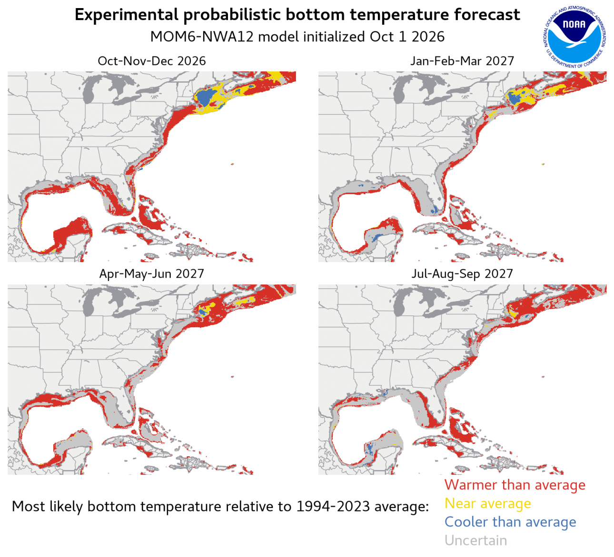

  
```{r setup, include=FALSE}
knitr::opts_chunk$set(echo = TRUE)
options(scipen = 999)
library(marmap)
library(rstudioapi)
if(Sys.info()["sysname"]=="Windows"){
  source("C:/Users/george.maynard/Documents/GitHubRepos/emolt_project_management/WeeklyUpdates/forecast_check/R/emolt_download.R")
} else {
  source("/home/george/Documents/emolt_project_management/WeeklyUpdates/forecast_check/R/emolt_download.R")
}
if(file.exists(paste0("C:/Users/george.maynard/Documents/emolt_project_management/WeeklyUpdates/",lubridate::year(Sys.time()),"/",lubridate::year(Sys.time()),"-",lubridate::month(Sys.time()),"-",lubridate::day(Sys.time()),"/Doppio_comparison_",format(Sys.time(), "%Y%m%d"),".csv")
)==FALSE){
  source("C:/Users/george.maynard/Documents/emolt_project_management/WeeklyUpdates/forecast_check/R/doppio_all_R_compare_and_plot.R")
}
if(file.exists(paste0("C:/Users/george.maynard/Documents/emolt_project_management/WeeklyUpdates/",lubridate::year(Sys.time()),"/",lubridate::year(Sys.time()),"-",lubridate::month(Sys.time()),"-",lubridate::day(Sys.time()),"/GOM7_comparison_",format(Sys.time(), "%Y%m%d"),".csv")
)==FALSE){
  reticulate::source_python("C:/Users/george.maynard/Documents/emolt_project_management/WeeklyUpdates/Plotting/Windows/GOM7.py")
  source("C:/Users/george.maynard/Documents/emolt_project_management/WeeklyUpdates/forecast_check/R/plot_comparisons.R")
}
data=emolt_download(days=7)
start_date=Sys.Date()-lubridate::days(7)
## Use the dates from above to create a URL for grabbing the data
full_data=read.csv(
  paste0(
    "https://erddap.emolt.net/erddap/tabledap/eMOLT_RT.csvp?tow_id%2Csegment_type%2Ctime%2Clatitude%2Clongitude%2Cdepth%2Ctemperature%2Csensor_type&segment_type=3&time%3E=",
    lubridate::year(start_date),
    "-",
    lubridate::month(start_date),
    "-",
    lubridate::day(start_date),
    "T00%3A00%3A00Z&time%3C=",
    lubridate::year(Sys.Date()),
    "-",
    lubridate::month(Sys.Date()),
    "-",
    lubridate::day(Sys.Date()),
    "T23%3A59%3A59Z"
  )
)
sensor_time=0
for(tow in unique(full_data$tow_id)){
  x=subset(full_data,full_data$tow_id==tow)
  sensor_time=sensor_time+difftime(max(x$time..UTC.),units='hours',min(x$time..UTC.))
}
```

<center> 

<font size="5"> *eMOLT Update `r Sys.Date()` * </font>
  
</center>

This week, Erin and Emma from the Gulf of Maine Lobster Foundation are over in Spain participating in the 13th International Conference and Workshop on Lobster Biology and Management. Thanks to Dr. Damian Brady from UMaine for highlighting the eMOLT Program on the international stage! Closer to home, I met up with Chris Cash from The Lobster Institute and we headed up to Winter Harbor, Maine to install a new eMOLT system aboard the F/V Allie Alayna. Thanks to Captain Jacob for his flexibility and patience with all the logistics. Yesterday, I joined Cassie Canastra Larsen (Canastra Fishing Company, BASE), Chris McGuire (The Nature Conservancy), Samir Patel (Coonamessett Farm Foundation), and Melissa Sanderson (Cape Cod Commercial Fishermen's Alliance) in a panel discussion about the use of tech on fishing vessels hosted by the New Bedford Ocean Cluster. Mel offered a wishlist from fishermen on Cape Cod for their "dream boat" which included more environmental sensors (particularly salinity both on the bottom and throughout the water column), and Cassie highlighted the need to make data collection a two way street, so that the fishermen participating in these efforts on the water can derive value from them and participate meaningfully in the discussions and decisions informed by their data. From the audience, Captain Joe of the F/V Lady Rebecca emphasized that technology at sea only works if fishermen are part of that tech's development. 

To all of those points, we are working on implementing some of your suggestions to improve the interface on the Deck Data Hubs. Thanks to Captain Mark on the F/V Prevail and Captain Mike on the F/V Resilient for agreeing to test drive that new software. If any of you have other suggestions for how we can make the eMOLT Program more useful to your fishing operations, please don't hesitate to reach out. I can't promise fast action, but know that we want to hear your suggestions and will take them into consideration as the program continues to evolve.

As many of you know, one use of data from the eMOLT Program is improving ocean forecast models. In the last few days, a team at Woods Hole Oceanographic Institution lost contact with an autonomous vehicle they deployed off the coast of Maine to help monitor the plankton bloom up that way. The SeaTrac SP-48 is around 16 feet long, 5 feet wide, and weighs ~650 lbs. It may be broadcasting on AIS as ‘UNMANNED SP-48 WHOI USV SN3’ with MMSI 338557554.




Below are some model outputs built from the ocean forecasts you all contribute to showing an estimated location of the autonomous vehicle SSE of Mount Desert Island. The first two plots were developed using the USCG SAROPS software which ingests outputs of multiple models. The top plot shows estimated position yesterday (red and purple are the highest likelihood zones) and the middle plot shows estimated position today. The bottom plot was developed by JiM and a modeling team from Rutgers using the Doppio model and shows a predicted drift track from the time the vehicle was lost until Sunday 10/18. 




Dr. Mike Brosnahan from WHOI and his team are actively searching for the vehicle using chartered planes and boats as weather allows. If you come across the vehicle in your fishing, please reach out ASAP. WHOI is also working on providing a financial reward for whoever tows the vehicle in.

This week, the eMOLT fleet recorded `r length(unique(full_data$tow_id))` tows of sensorized fishing gear totaling `r as.numeric(sensor_time)` sensor hours underwater. Bottom temps in the Gulf of Maine seem to have dropped off a bit from their post-storm high a few weeks ago and are cooler than this time last year. Warmer water persists on Georges Bank where temps are 3-4 degrees F warmer than they were last year, and bottom temps south of New England are generally in line with last year. 

```{r FISHBOT_Plot, echo=FALSE, fig.width=8, fig.height=10,warning=FALSE,message=FALSE,error=FALSE}
source("C:/Users/george.maynard/Documents/emolt_project_management/WeeklyUpdates/Plotting/FISHBOT_Weekly.R")
```



> *FISHBOT bottom temperature records from the past week. The data are available on the [Commercial Fisheries Research Foundation ERDDAP](https://erddap.ondeckdata.com/erddap/tabledap/fishbot_realtime.html) and an interactive visualization is available at the [Cape Cod Ocean Watch](https://ccocean.whoi.edu/index.html) dashboard hosted by Woods Hole Oceanographic Institution. FISHBOT aggregates data provided by participants in eMOLT, the CFRF Lobster and Jonah Crab Research Fleet, the CFRF Shelf Research Fleet, the Cape Cod Commercial Fishermen's Alliance Cape Cod Oceanographic Research Fleet, the Maine Coast Fishermen's Association Fisheries Ocean Data Program, MassDMF Cape Cod Bay Study Fleet, the Northeast Fisheries Science Center Study Fleet, and the Northeast Fisheries Science Center Ecosystem Monitoring Surveys*

### Dissolved Oxygen

Oxygen levels remain high off Stonington, ME and east of Nantucket Sound. Levels are holding steady in the acceptable range around Casco Bay and Cape Cod Bay. 



### Bottom Temperature Forecast Performance

Doppio performed well compared with observations this week (R2 = 0.883, RMSE = 0.821, Bias = -0.033). There were no real spatial patterns in model performance except for cooler than predicted temps observed way out on Eastern Georges Bank and warmer than forecast temps observed around Hudson Canyon. NECOFS had a decent week (R2 = 0.666, RMSE = 2.386, Bias = 0.001), but performance was spottier in space. Between Penobscot Bay and Cape Ann as well as south of Rhode Island the forecasts and observations were in close agreement. In Massachusetts Bay, observations were cooler than forecast, and East of Penobscot Bay, observations were warmer than forecast.

{width=45%} {width=45%}

> *Comparisons between bottom temperatures predicted by two ocean forecasting models and observations from the eMOLT fleet. Blue dots show where the observations were cooler than the forecast and red dots show where the observations were warmer than the forecast. White dots show areas where the observations and forecasts agreed. On the left is the comparison with the Doppio model and on the right is the comparison with the NECOFS model (GOM7).*


### [NOAA Releases Latest Experimental Quarterly Forecast for NW Atlantic](https://www.gfdl.noaa.gov/prediction/october-2026-northwest-atlantic-predictions/)

The latest MOM6 model run is available for the period from Q4 2026 (Oct-Dec) to Q3 2027 (Jul-Sep) at the link above. The plot below shows that by summertime next year, bottom temps across much of the region are likely to be warmer than average.  




### [eMOLT Highlighted as NOAA Monitors El Niño](https://www.fisheries.noaa.gov/feature-story/how-will-el-nino-affect-your-local-fisheries)

> Click the title above for the full story

*“It’s too early right now to tell what the impacts of this El Niño will be on the Northeast,” says Vince Saba, a fisheries biologist with the Northeast Fisheries Science Center. “This region is already in an anomalous state relative to the last 15 years because of this current cooling event. It’s hard to say whether we’ll see the warmer temperatures and milder winters that we usually expect with El Niño. The MOM6 seasonal to annual forecast for the Northwest Atlantic predicts an enhanced warming of the western tropical Atlantic in early to mid-2027 due to the strong El Niño. This enhanced warming of tropical Atlantic waters will surely have impacts further north in U.S. waters, but it is unclear as to what those impacts will be.”*  

*Cooperative research, conducted in partnership with local commercial and recreational fisherman, is another crucial component of tracking these changes in fisheries. “Cooperative research is critical to filling the gaps that the Northeast bottom trawl survey does not pick up spatially or temporally,” Saba says.*

### Rutgers to host Harold Haskin Fisherman's Forum on November 12th

You are invited to an upcoming presentation as part of Rutgers Haskin Shellfish Research Laboratory’s Harold Haskin Fisherman’s Forum on Thursday, November 12 at 4:30 PM. The meeting will be held in person at 1636 Delaware Avenue, Cape May, NJ.

[Register here](https://go.rutgers.edu/l5rviqan) to attend. Seating is limited and priority will be given to members of the fishing industry. A virtual option is also available. [Register here](https://go.rutgers.edu/2vx4x5mv) to receive the Zoom link.

Our speaker, Dr. Glen Gawarkiewicz, will discuss recent ocean observations and how changing marine conditions may be affecting marine ecosystems in the Mid-Atlantic region.

This will be an interactive discussion, with an emphasis on hearing directly from the fishing industry. Dr. Gawarkiewicz is interested in learning from fishermen about their on-the-water observations, including changes in marine conditions and fisheries in recent years. Your experiences and insights will help inform our understanding of these changes.

We encourage members of the fishing industry and other interested stakeholders to join the conversation, share their observations, and contribute to this important discussion.

### 2027 Cooperative Research Summit Waitlist Open

The [2027 Cooperative Research Summit](https://www.fisheries.noaa.gov/event/2027-northeast-cooperative-research-summit) will be held in Salem, Massachusetts on March 16,2027. We've reached capacity, but [the waitlist](https://docs.google.com/forms/d/e/1FAIpQLScssRP9qgjR8ZUrpHYHSRLj23QffAcRzEDlILVBeCIm4vq9Ow/viewform) is open here until December 4, 2026. The Summit provides a unique opportunity to interact with members of the fishing community, share and learn about ongoing cooperative research, and develop partnerships to address the many research needs and challenges in our region. Agenda items include presentations from researchers and members of the fishing community, breakout sessions, a research prioritization exercise, and networking. 

### 2026 Fall Bottom Trawl Survey Stations


The 2026 Fall Bottom Trawl Survey is underway. To avoid conflicts with fixed gear fishermen, the Trawl Survey team is making this station map available. To download a TimeZero compatible .gpx file of the points from www.emolt.org, please click [this link](https://www.emolt.org/BTS_2026_fall.gpx). You can follow the NOAAS Henry Bigelow's location [here](https://www.marinetraffic.com/en/ais/home/centerx:-73.5/centery:39.1/zoom:8).

For questions about survey operations, please contact [Bridget St. Amand](https://www.fisheries.noaa.gov/contact/bridget-st-amand).

>Want an eMOLT system for your boat or know somebody else who does? Check out our [online eMOLT System Request form](https://emolt.org/signup.html) to get on the wait list. Being able to break this list down by gear type and geographic area is helpful when we apply for funding to expand the program. 

### Disclaimer
  
The eMOLT Update is NOT an official NOAA document. Mention of products or manufacturers does not constitute an endorsement by NOAA or Department of Commerce. The content of this update reflects only the personal views of the authors and does not necessarily represent the views of NOAA Fisheries, the Department of Commerce, or the United States.


All the best,

-George
