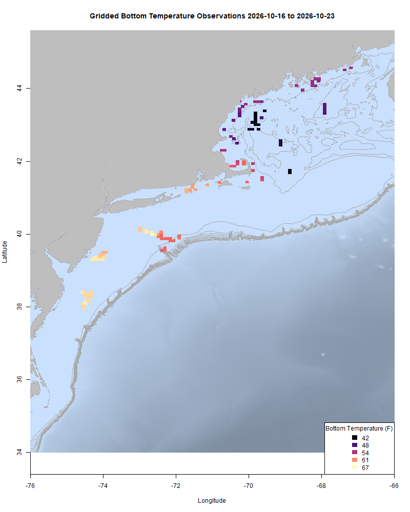
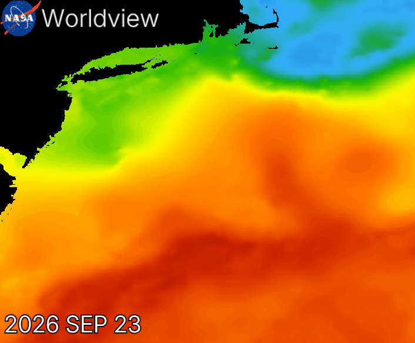
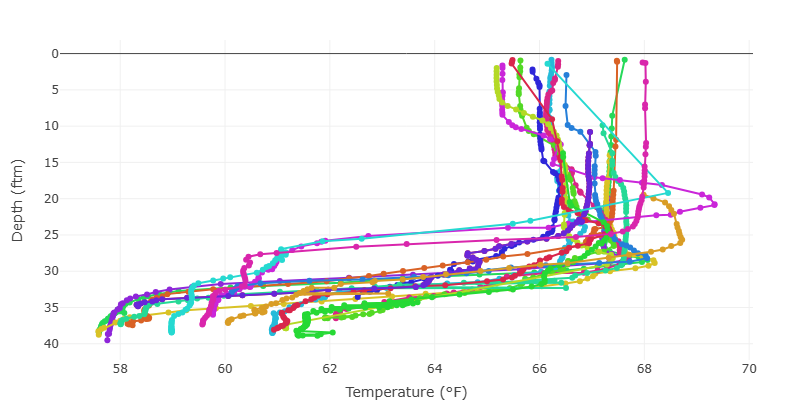
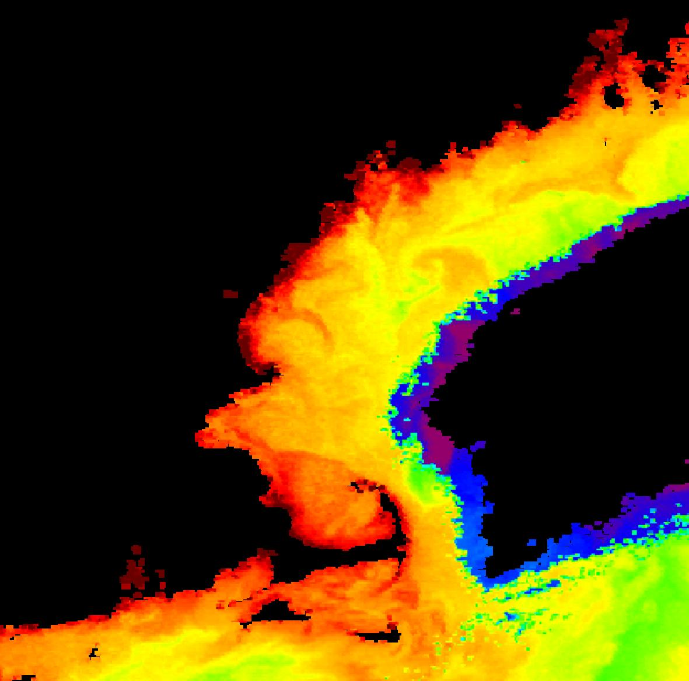
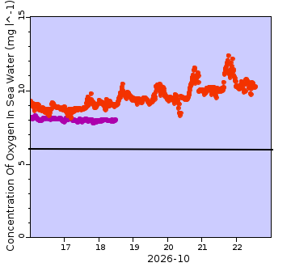
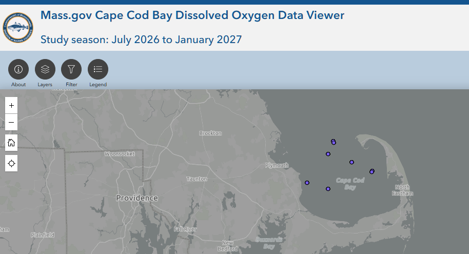
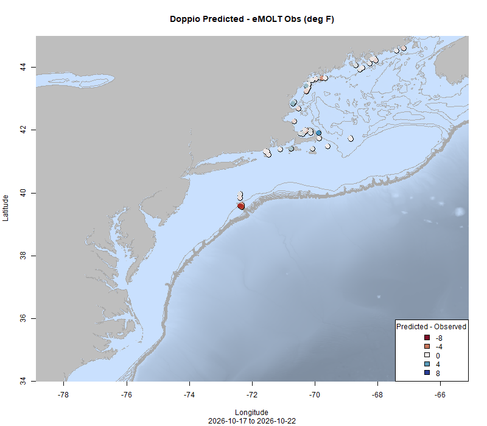
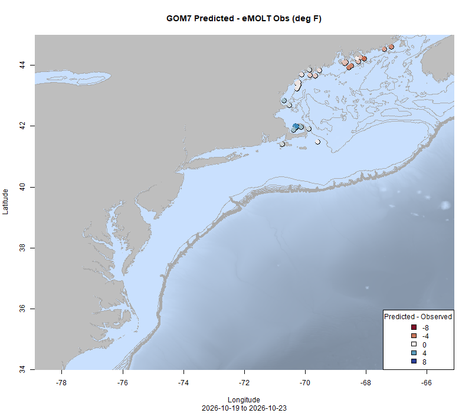

  
```{r setup, include=FALSE}
knitr::opts_chunk$set(echo = TRUE)
options(scipen = 999)
library(marmap)
library(rstudioapi)
if(Sys.info()["sysname"]=="Windows"){
  source("C:/Users/george.maynard/Documents/GitHubRepos/emolt_project_management/WeeklyUpdates/forecast_check/R/emolt_download.R")
} else {
  source("/home/george/Documents/emolt_project_management/WeeklyUpdates/forecast_check/R/emolt_download.R")
}
if(file.exists(paste0("C:/Users/george.maynard/Documents/emolt_project_management/WeeklyUpdates/",lubridate::year(Sys.time()),"/",lubridate::year(Sys.time()),"-",lubridate::month(Sys.time()),"-",lubridate::day(Sys.time()),"/Doppio_comparison_",format(Sys.time(), "%Y%m%d"),".csv")
)==FALSE){
  source("C:/Users/george.maynard/Documents/emolt_project_management/WeeklyUpdates/forecast_check/R/doppio_all_R_compare_and_plot.R")
}
if(file.exists(paste0("C:/Users/george.maynard/Documents/emolt_project_management/WeeklyUpdates/",lubridate::year(Sys.time()),"/",lubridate::year(Sys.time()),"-",lubridate::month(Sys.time()),"-",lubridate::day(Sys.time()),"/GOM7_comparison_",format(Sys.time(), "%Y%m%d"),".csv")
)==FALSE){
  reticulate::source_python("C:/Users/george.maynard/Documents/emolt_project_management/WeeklyUpdates/Plotting/Windows/GOM7.py")
  source("C:/Users/george.maynard/Documents/emolt_project_management/WeeklyUpdates/forecast_check/R/plot_comparisons.R")
}
data=emolt_download(days=7)
start_date=Sys.Date()-lubridate::days(7)
## Use the dates from above to create a URL for grabbing the data
full_data=read.csv(
  paste0(
    "https://erddap.emolt.net/erddap/tabledap/eMOLT_RT.csvp?tow_id%2Csegment_type%2Ctime%2Clatitude%2Clongitude%2Cdepth%2Ctemperature%2Csensor_type&segment_type=3&time%3E=",
    lubridate::year(start_date),
    "-",
    lubridate::month(start_date),
    "-",
    lubridate::day(start_date),
    "T00%3A00%3A00Z&time%3C=",
    lubridate::year(Sys.Date()),
    "-",
    lubridate::month(Sys.Date()),
    "-",
    lubridate::day(Sys.Date()),
    "T23%3A59%3A59Z"
  )
)
sensor_time=0
for(tow in unique(full_data$tow_id)){
  x=subset(full_data,full_data$tow_id==tow)
  sensor_time=sensor_time+difftime(max(x$time..UTC.),units='hours',min(x$time..UTC.))
}
```

<center> 

<font size="5"> *eMOLT Update `r Sys.Date()` * </font>
  
</center>

A big thanks goes out this week to Jeff Pessutti, one of my colleagues at the Northeast Fisheries Science Center for his efforts to get three eMOLT systems up and running in Gloucester. Taking advantage of the strong winds keeping vessels tied up, Jeff was able to install new sensors aboard the F/V Enterprise and F/V Dyrsten and replace a broken deckbox aboard the F/V Retriever. All three of these vessels are participating in the ongoing [Atlantic Mackerel Cooperative Research Initiative](https://www.fisheries.noaa.gov/new-england-mid-atlantic/science-data/atlantic-mackerel-cooperative-research-initiative). Speaking of mackerel, the Atlantic States Marine Fisheries Commission is currently running an RFP for 12 sea days aboard a vessel to conduct paired acoustic and biological sampling of mackerel. You can learn more about the project and apply [here](https://asmfc.org/resources/atl-mackerel-paired-acoustics-biological-sampling-rfp/). Proposals are due next Friday. 

This week, the eMOLT fleet recorded `r length(unique(full_data$tow_id))` tows of sensorized fishing gear totaling `r as.numeric(sensor_time)` sensor hours underwater. Bottom temps in the Gulf of Maine are in line with last year at this time, while temperatures on Georges Bank and along Southern New England are several degrees warmer than this time last year. 

```{r FISHBOT_Plot, echo=FALSE, fig.width=8, fig.height=10,warning=FALSE,message=FALSE,error=FALSE}
source("C:/Users/george.maynard/Documents/emolt_project_management/WeeklyUpdates/Plotting/FISHBOT_Weekly.R")
```



> *FISHBOT bottom temperature records from the past week. The data are available on the [Commercial Fisheries Research Foundation ERDDAP](https://erddap.ondeckdata.com/erddap/tabledap/fishbot_realtime.html) and an interactive visualization is available at the [Cape Cod Ocean Watch](https://ccocean.whoi.edu/index.html) dashboard hosted by Woods Hole Oceanographic Institution. FISHBOT aggregates data provided by participants in eMOLT, the CFRF Lobster and Jonah Crab Research Fleet, the CFRF Shelf Research Fleet, the Cape Cod Commercial Fishermen's Alliance Cape Cod Oceanographic Research Fleet, the Maine Coast Fishermen's Association Fisheries Ocean Data Program, MassDMF Cape Cod Bay Study Fleet, the Northeast Fisheries Science Center Study Fleet, and the Northeast Fisheries Science Center Ecosystem Monitoring Surveys*

These warmer temps south of Cape Cod are at least in part driven by the two large warm core rings that are present in the area. As noted by Dr. Glen Gawarkiewicz on this morning's Squid Squad call, the western ring actually spans almost the entire distance from the shelf break to the Gulf Stream and received an influx of Gulf Stream water late last week (visible in the gif below). 


The influence of the ring is also clearly visible in these profiles collected by an eMOLT participant operating near Hudson Canyon.


In the plot, you can see a thick layer of water (30 fathoms or so) in the high 60s and low 70s with things cooling off substantially down below. Keep in mind that these profiles were collected inside of the 50 fathom contour, inshore of the main ring. 


Further north, the plankton bloom continues along the Maine Coast although the density appears to be waning (screenshot above) with phytoplankton concentrations near Chebeague Island now about half of what they were two weeks ago. Oxygen readings from eMOLT participants in and around Casco Bay remain high. The plot below shows readings from two loggers. The orange site is on the waterfront in Portland and the purple site is SE of Cape Elizabeth. The black line at 6 mg/L represents the threshold for "normal" levels of dissolved oxygen.



Two of the concerning Harmful Algal Bloom species that peaked back in September are still present, but at much lower concentrations than their late September peak. 


### Dissolved Oxygen

Oxygen levels remain high off Stonington, ME and east of Nantucket Sound. Levels are holding steady in the acceptable range in Cape Cod Bay. 



### Bottom Temperature Forecast Performance

Doppio performed well compared with observations this week (R2 = 0.857, RMSE = 0.974, Bias = -0.181) although performance dipped a little from last week. There were no real spatial patterns in model performance except for much warmer than forecast temps observed around Hudson Canyon. NECOFS performance improved slightly from last week (R2 = 0.737, RMSE = 1.561, Bias = -0.194), although spatial patterns in performance are still evident with observations warmer than the forecast east of Penobscot Bay and colder than the forecast in Cape Cod Bay. 

{width=45%} {width=45%}

> *Comparisons between bottom temperatures predicted by two ocean forecasting models and observations from the eMOLT fleet. Blue dots show where the observations were cooler than the forecast and red dots show where the observations were warmer than the forecast. White dots show areas where the observations and forecasts agreed. On the left is the comparison with the Doppio model and on the right is the comparison with the NECOFS model (GOM7).*

### Research of Interest

Congratulations to the team behind a [recent peer-reviewed publication](https://doi.org/10.1029/2026JC024883) exploring the cold, fresh pulse of water that impacted our region in 2023 and 2024. You'll note several familiar names among the authors list including Dr. Glen Gawarkiewicz (WHOI), Linus Stoltz and Noelle Olsen (Commercial Fisheries Research Foundation), and Dr. Kim Hyde and Dr. Sarah Salois (NOAA Northeast Fisheries Science Center). Cooperative research, in particular CFRF's Shelf Research Fleet Program and The Squid Squad provided data and insights that were critical to the study's conclusions. Per an [interview with study authors published by WHOI](https://www.whoi.edu/press-room/news-release/coldpulse/), *"There is a lot of positivity in terms of the fishermen being really receptive to hearing about the science now, and for scientists to be more open-minded about all the knowledge that the fishermen have,” Gawarkiewicz explained. “There’s a real opportunity to bring those two perspectives together, because fishermen are out there experiencing these changes firsthand, and scientists can help put those observations into a broader scientific context."*

In other cooperative research news, scientists from Maine DMR and the University of Maine recently collaborated with lobstermen on [a study of lobster recruitment](https://www.int-res.com/journals/meps/articles/meps15190) along the Maine Coast, showing a decline in shallow water recruitment and adolescent abundance along the midcoast, less of a decline Downeast, and no measurable trend along Southern Maine. Study authors attributed at least part of the changes in abundance to changes in thermal habitat availability. According to a [summary of the work](https://www.mdislander.com/news/maritime/baby-lobster-decline-foreshadows-major-midcoast-population-losses-study-shows/article_107ce0f9-08e6-4c7e-8049-b6eaf2352167.html) published in the Mount Desert Islander *"Maine DMR is invested in a comprehensive, coastwide lobster monitoring approach and leads multiple surveys to study lobsters across their full life cycle,” said study co-author Kathleen Reardon, senior lobster fishery scientist with the department. “Collaborations with the fishing industry make these surveys possible, and collaborations with UMaine researchers supplement the findings of the stock assessment analyses and aid us in synthesizing these large datasets into tangible insights about the future of the Gulf of Maine lobster resource."*

### Ocean Sensor Tech Demos

The NSF Seafood Engine in New England is sponsoring tech demos of underwater robots that collect environmental data for fishermen who may be able to use those data. Stop by for 20 minutes to watch a deployment of the robots from a beach, learn about cooperative research opportunities, and chat about ocean conditions. Times, locations, and points of contact below:

- Tuesday October 27 from 1430-1730 at the [Chatham Fish Pier South Float Dock](https://maps.app.goo.gl/99Lr3SUWQgWLSXEi7) (POC: Melissa Sanderson, Cape Cod Commercial Fishermen's Alliance melissa@capecodfishermen.org)
- Friday October 30 from 1200-1400 at [Salty Brine State Beach](https://maps.app.goo.gl/sWUjpkvk3FcRFSsu8) (POC: Noelle Olsen, Commercial Fisheries Research Foundation nolsen@cfrfoundation.org)

### Rutgers to host Harold Haskin Fisherman's Forum on November 12th

You are invited to an upcoming presentation as part of Rutgers Haskin Shellfish Research Laboratory’s Harold Haskin Fisherman’s Forum on Thursday, November 12 at 4:30 PM. The meeting will be held in person at 1636 Delaware Avenue, Cape May, NJ.

[Register here](https://go.rutgers.edu/l5rviqan) to attend. Seating is limited and priority will be given to members of the fishing industry. A virtual option is also available. [Register here](https://go.rutgers.edu/2vx4x5mv) to receive the Zoom link.

Our speaker, Dr. Glen Gawarkiewicz, will discuss recent ocean observations and how changing marine conditions may be affecting marine ecosystems in the Mid-Atlantic region.

This will be an interactive discussion, with an emphasis on hearing directly from the fishing industry. Dr. Gawarkiewicz is interested in learning from fishermen about their on-the-water observations, including changes in marine conditions and fisheries in recent years. Your experiences and insights will help inform our understanding of these changes.

We encourage members of the fishing industry and other interested stakeholders to join the conversation, share their observations, and contribute to this important discussion.

### 2027 Cooperative Research Summit Waitlist Open

The [2027 Cooperative Research Summit](https://www.fisheries.noaa.gov/event/2027-northeast-cooperative-research-summit) will be held in Salem, Massachusetts on March 16,2027. We've reached capacity, but [the waitlist](https://docs.google.com/forms/d/e/1FAIpQLScssRP9qgjR8ZUrpHYHSRLj23QffAcRzEDlILVBeCIm4vq9Ow/viewform) is open here until December 4, 2026. The Summit provides a unique opportunity to interact with members of the fishing community, share and learn about ongoing cooperative research, and develop partnerships to address the many research needs and challenges in our region. Agenda items include presentations from researchers and members of the fishing community, breakout sessions, a research prioritization exercise, and networking. 

### 2026 Fall Bottom Trawl Survey Stations


The 2026 Fall Bottom Trawl Survey is underway. To avoid conflicts with fixed gear fishermen, the Trawl Survey team is making this station map available. To download a TimeZero compatible .gpx file of the points from www.emolt.org, please click [this link](https://www.emolt.org/BTS_2026_fall.gpx). You can follow the NOAAS Henry Bigelow's location [here](https://www.marinetraffic.com/en/ais/home/centerx:-73.5/centery:39.1/zoom:8).

For questions about survey operations, please contact [Bridget St. Amand](https://www.fisheries.noaa.gov/contact/bridget-st-amand).

>Want an eMOLT system for your boat or know somebody else who does? Check out our [online eMOLT System Request form](https://emolt.org/signup.html) to get on the wait list. Being able to break this list down by gear type and geographic area is helpful when we apply for funding to expand the program. 

### Disclaimer
  
The eMOLT Update is NOT an official NOAA document. Mention of products or manufacturers does not constitute an endorsement by NOAA or Department of Commerce. The content of this update reflects only the personal views of the authors and does not necessarily represent the views of NOAA Fisheries, the Department of Commerce, or the United States.


All the best,

-George
