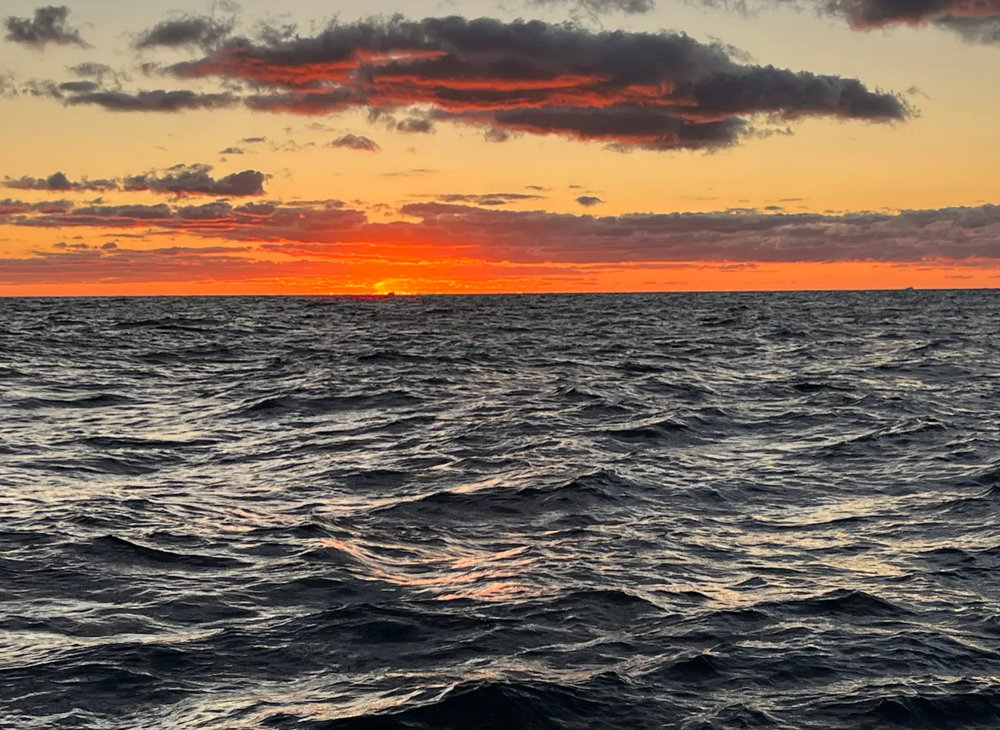
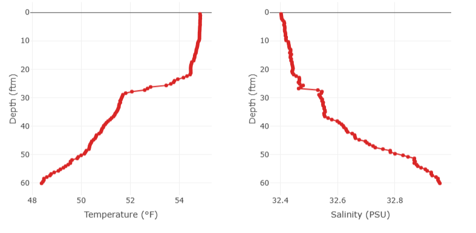
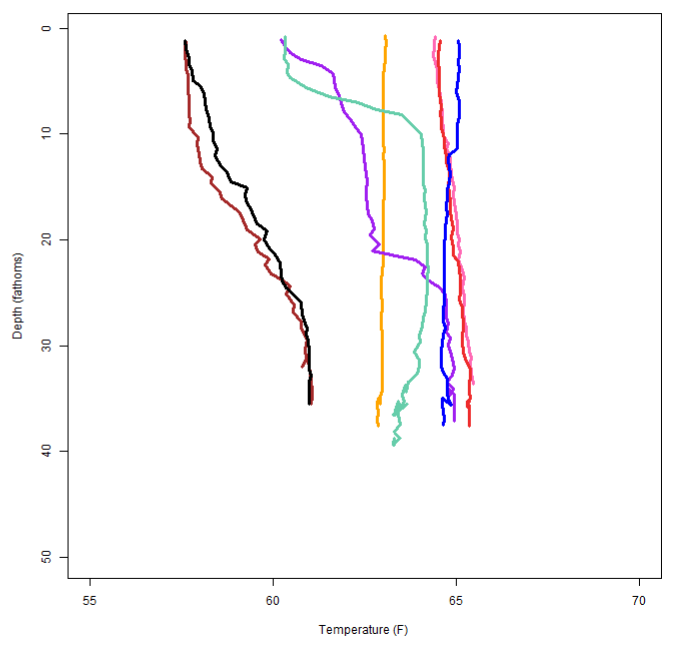
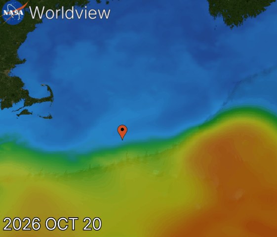
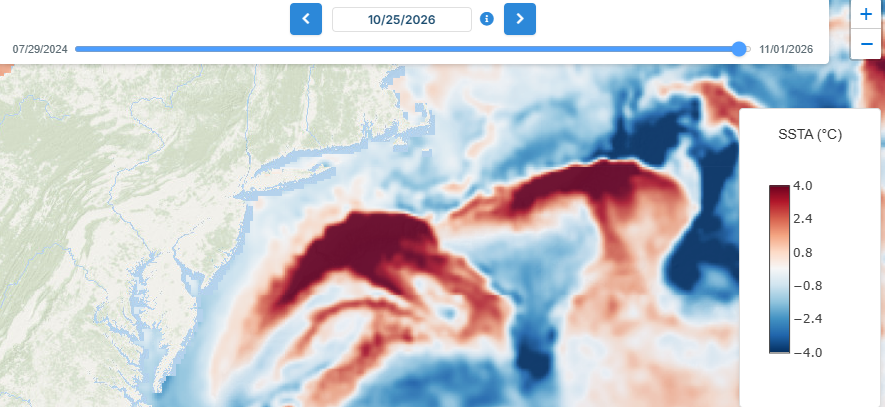
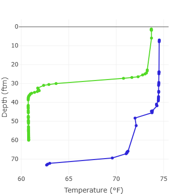
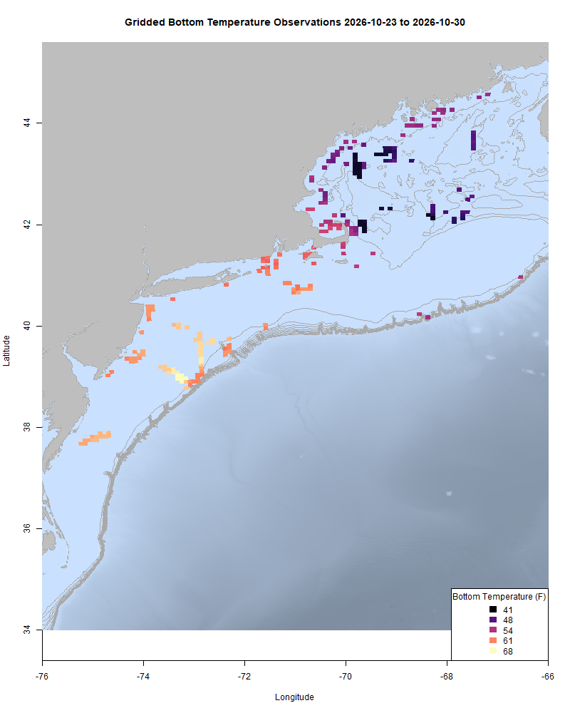
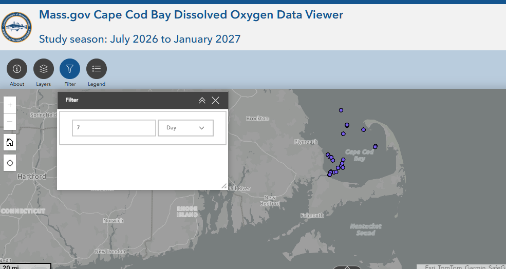
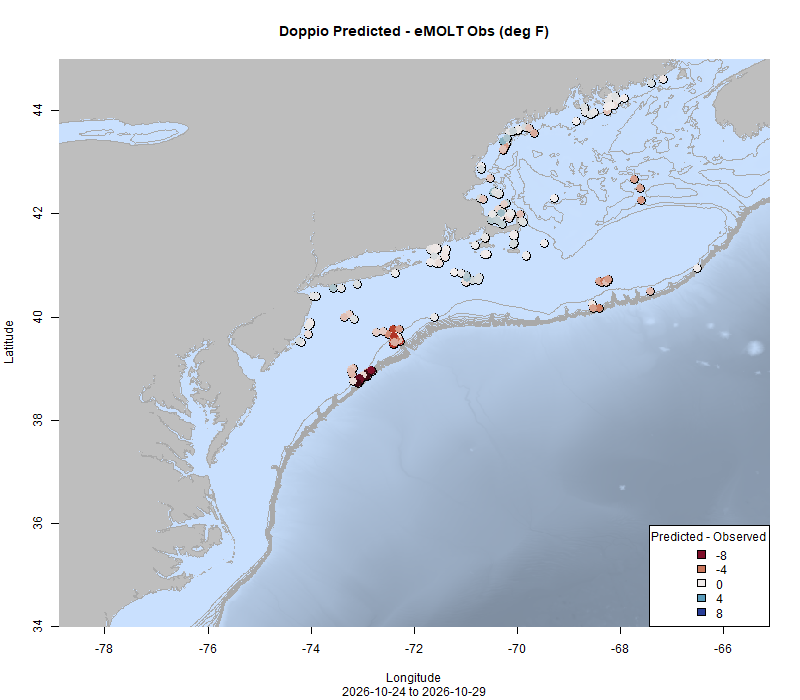
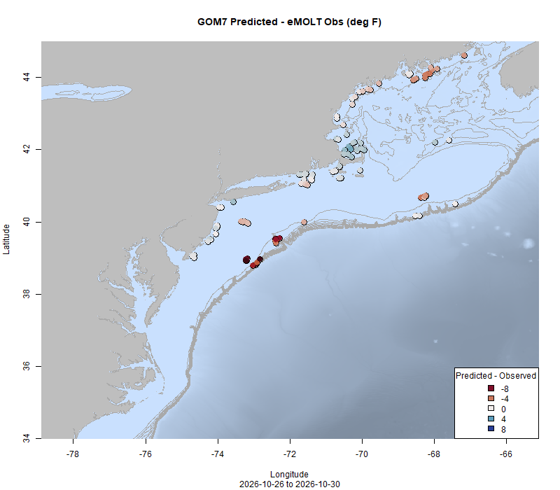

  
```{r setup, include=FALSE}
knitr::opts_chunk$set(echo = TRUE)
options(scipen = 999)
library(marmap)
library(rstudioapi)
if(Sys.info()["sysname"]=="Windows"){
  source("C:/Users/george.maynard/Documents/GitHubRepos/emolt_project_management/WeeklyUpdates/forecast_check/R/emolt_download.R")
} else {
  source("/home/george/Documents/emolt_project_management/WeeklyUpdates/forecast_check/R/emolt_download.R")
}
if(file.exists(paste0("C:/Users/george.maynard/Documents/emolt_project_management/WeeklyUpdates/",lubridate::year(Sys.time()),"/",lubridate::year(Sys.time()),"-",lubridate::month(Sys.time()),"-",lubridate::day(Sys.time()),"/Doppio_comparison_",format(Sys.time(), "%Y%m%d"),".csv")
)==FALSE){
  source("C:/Users/george.maynard/Documents/emolt_project_management/WeeklyUpdates/forecast_check/R/doppio_all_R_compare_and_plot.R")
}
if(file.exists(paste0("C:/Users/george.maynard/Documents/emolt_project_management/WeeklyUpdates/",lubridate::year(Sys.time()),"/",lubridate::year(Sys.time()),"-",lubridate::month(Sys.time()),"-",lubridate::day(Sys.time()),"/GOM7_comparison_",format(Sys.time(), "%Y%m%d"),".csv")
)==FALSE){
  reticulate::source_python("C:/Users/george.maynard/Documents/emolt_project_management/WeeklyUpdates/Plotting/Windows/GOM7.py")
  source("C:/Users/george.maynard/Documents/emolt_project_management/WeeklyUpdates/forecast_check/R/plot_comparisons.R")
}
data=emolt_download(days=7)
start_date=Sys.Date()-lubridate::days(7)
## Use the dates from above to create a URL for grabbing the data
full_data=read.csv(
  paste0(
    "https://erddap.emolt.net/erddap/tabledap/eMOLT_RT.csvp?tow_id%2Csegment_type%2Ctime%2Clatitude%2Clongitude%2Cdepth%2Ctemperature%2Csensor_type&segment_type=3&time%3E=",
    lubridate::year(start_date),
    "-",
    lubridate::month(start_date),
    "-",
    lubridate::day(start_date),
    "T00%3A00%3A00Z&time%3C=",
    lubridate::year(Sys.Date()),
    "-",
    lubridate::month(Sys.Date()),
    "-",
    lubridate::day(Sys.Date()),
    "T23%3A59%3A59Z"
  )
)
sensor_time=0
for(tow in unique(full_data$tow_id)){
  x=subset(full_data,full_data$tow_id==tow)
  sensor_time=sensor_time+difftime(max(x$time..UTC.),units='hours',min(x$time..UTC.))
}
```

<center> 

<font size="5"> *eMOLT Update `r Sys.Date()` * </font>
  
</center>



Earlier this week, I had the privilege of sailing on a leg of the Gulf of Maine Bottom Longline Survey aboard the F/V Tenacious II with longtime cooperative research partner, Captain Eric Hesse. Since the stations we sampled on this trip were on soft bottom, catches were light, but it's always good to get out from behind a desk. Captain Eric also participates in the Cape Cod Commercial Fishermen's Alliance, Commercial Fisheries Research Foundation, and Woods Hole Oceanographic collaborative oceanographic research program. After deploying and retrieving our camera system at each station, he deployed an RBR Concerto CTD to take a profile of the full water column. After days of steady NE winds, the top 20 fathoms or so of the water column were well mixed both in terms of temperature (left) and salinity (right). 



The two large warm core rings near Hudson Canyon and the eastern edge of Georges Bank are closer inshore than they were previously, bringing water that's ~7 degrees Fahrenheit warmer than normal up onto the shelf in places. The plot below shows several profiles taken on the same day within a few miles of each other up on top of Georges Bank just north of one of the rings. 



Most of the profiles show well mixed water from surface to bottom, but there's a difference of 6-7 degrees F in a relatively small area as the ring moves in and out (see gif below. All profiles shown were taken within a few miles of the red pin).





The profiles below were taken inside of the rings by eMOLT participants and show how far down into the water column they extend. The green profile was taken SW of Hudson Canyon and show the ring extending about 30 fathoms down. The blue profile was taken along the Southeast Part of Georges Bank and shows the ring extending nearly 70 fathoms down. 




This week, the eMOLT fleet recorded `r length(unique(full_data$tow_id))` tows of sensorized fishing gear totaling `r as.numeric(sensor_time)` sensor hours underwater. Bottom temps in the Gulf of Maine are slightly cooler than last year at this time, while temperatures on Georges Bank and along Southern New England are several degrees warmer than this time last year thanks to the influence of those rings. 

```{r FISHBOT_Plot, echo=FALSE, fig.width=8, fig.height=10,warning=FALSE,message=FALSE,error=FALSE}
source("C:/Users/george.maynard/Documents/emolt_project_management/WeeklyUpdates/Plotting/FISHBOT_Weekly.R")
```



> *FISHBOT bottom temperature records from the past week. The data are available on the [Commercial Fisheries Research Foundation ERDDAP](https://erddap.ondeckdata.com/erddap/tabledap/fishbot_realtime.html) and an interactive visualization is available at the [Cape Cod Ocean Watch](https://ccocean.whoi.edu/index.html) dashboard hosted by Woods Hole Oceanographic Institution. FISHBOT aggregates data provided by participants in eMOLT, the CFRF Lobster and Jonah Crab Research Fleet, the CFRF Shelf Research Fleet, the Cape Cod Commercial Fishermen's Alliance Cape Cod Oceanographic Research Fleet, the Maine Coast Fishermen's Association Fisheries Ocean Data Program, MassDMF Cape Cod Bay Study Fleet, the Northeast Fisheries Science Center Study Fleet, and the Northeast Fisheries Science Center Ecosystem Monitoring Surveys*

### Dissolved Oxygen

Oxygen levels seem to be stable or rising in and around Casco Bay relative to early October. Current readings are between 7 mg/L and 10 mg/L. Oxygen levels are slightly lower, but still in the normal range off Stonington, ME as chlorophyll concentrations there decline. Levels are holding steady in the acceptable range in Cape Cod Bay. 



### Bottom Temperature Forecast Performance

The performance of both models dipped this week, in large part due to much warmer than expected observations around the two warm-core rings. Doppio performed well along the coast throughout much of the region. Observations were much warmer than the NECOFS forecast Downeast and colder than the forecast in Cape Cod Bay.   

{width=45%} {width=45%}

> *Comparisons between bottom temperatures predicted by two ocean forecasting models and observations from the eMOLT fleet. Blue dots show where the observations were cooler than the forecast and red dots show where the observations were warmer than the forecast. White dots show areas where the observations and forecasts agreed. On the left is the comparison with the Doppio model and on the right is the comparison with the NECOFS model (GOM7).*

### Industry Response to Lobster Recruitment Study

eMOLT participant Curt Brown of Bold Coast Seafood offered a response to the study on juvenile lobster decline that I mentioned last week. In an [interview with the Ellsworth American](https://www.ellsworthamerican.com/news/waterfront/lobstermen-weigh-in-on-study-of-baby-lobster-decline/article_7693a30a-ec4e-4386-b10b-373e8eeb6a56.html), Curt discussed how the recent cold fresh pulse in the Gulf of Maine has impacted lobster habitat use. 

### Rutgers to host Harold Haskin Fisherman's Forum on November 12th

You are invited to an upcoming presentation as part of Rutgers Haskin Shellfish Research Laboratory’s Harold Haskin Fisherman’s Forum on Thursday, November 12 at 4:30 PM. The meeting will be held in person at 1636 Delaware Avenue, Cape May, NJ.

[Register here](https://go.rutgers.edu/l5rviqan) to attend. Seating is limited and priority will be given to members of the fishing industry. A virtual option is also available. [Register here](https://go.rutgers.edu/2vx4x5mv) to receive the Zoom link.

Our speaker, Dr. Glen Gawarkiewicz, will discuss recent ocean observations and how changing marine conditions may be affecting marine ecosystems in the Mid-Atlantic region.

This will be an interactive discussion, with an emphasis on hearing directly from the fishing industry. Dr. Gawarkiewicz is interested in learning from fishermen about their on-the-water observations, including changes in marine conditions and fisheries in recent years. Your experiences and insights will help inform our understanding of these changes.

We encourage members of the fishing industry and other interested stakeholders to join the conversation, share their observations, and contribute to this important discussion.

### 2027 Cooperative Research Summit Waitlist Open

The [2027 Cooperative Research Summit](https://www.fisheries.noaa.gov/event/2027-northeast-cooperative-research-summit) will be held in Salem, Massachusetts on March 16,2027. We've reached capacity, but [the waitlist](https://docs.google.com/forms/d/e/1FAIpQLScssRP9qgjR8ZUrpHYHSRLj23QffAcRzEDlILVBeCIm4vq9Ow/viewform) is open here until December 4, 2026. The Summit provides a unique opportunity to interact with members of the fishing community, share and learn about ongoing cooperative research, and develop partnerships to address the many research needs and challenges in our region. Agenda items include presentations from researchers and members of the fishing community, breakout sessions, a research prioritization exercise, and networking. 

### 2026 Fall Bottom Trawl Survey Stations


The 2026 Fall Bottom Trawl Survey is underway. To avoid conflicts with fixed gear fishermen, the Trawl Survey team is making this station map available. To download a TimeZero compatible .gpx file of the points from www.emolt.org, please click [this link](https://www.emolt.org/BTS_2026_fall.gpx). You can follow the NOAAS Henry Bigelow's location [here](https://www.marinetraffic.com/en/ais/home/centerx:-73.5/centery:39.1/zoom:8).

For questions about survey operations, please contact [Bridget St. Amand](https://www.fisheries.noaa.gov/contact/bridget-st-amand).

>Want an eMOLT system for your boat or know somebody else who does? Check out our [online eMOLT System Request form](https://emolt.org/signup.html) to get on the wait list. Being able to break this list down by gear type and geographic area is helpful when we apply for funding to expand the program. 

### Disclaimer
  
The eMOLT Update is NOT an official NOAA document. Mention of products or manufacturers does not constitute an endorsement by NOAA or Department of Commerce. The content of this update reflects only the personal views of the authors and does not necessarily represent the views of NOAA Fisheries, the Department of Commerce, or the United States.


All the best,

-George
